# Alternativas para el servicio de matching y recomendación de Smartruck

> Documento de análisis de alternativas (open source) para la toma de decisiones de arquitectura, diseño y stack tecnológico.
> Fecha: 2026-10-03

---

## 1. Contexto y restricciones

| Aspecto | Definición |
|---|---|
| **Modelo de negocio** | Marketplace de dos lados: dadores de carga publican cargas, transportistas las toman. |
| **Rol de la plataforma** | **Recomienda**; la decisión final es siempre del transportista (y del dador al elegir transportista). No se asigna automáticamente. |
| **Alcance funcional** | 1) Matcheo dador ↔ transportista (en ambos sentidos). 2) Recomendación de cargas a transportistas según múltiples parámetros. |
| **Plazo** | 3 semanas de implementación. |
| **Licenciamiento** | Todas las piezas deben ser open source. |
| **Requisito de diseño** | Las recomendaciones deben tener un **criterio explícito y una estructura** defendible. |

### Consecuencia directa del modelo de negocio

Como la plataforma **no asigna**, el problema no es de *asignación óptima* (algoritmo húngaro, OR-Tools), sino de **ranking explicable**: ordenar candidatos y justificar por qué.

Todas las alternativas comparten la estructura canónica de tres etapas utilizada por la industria ([Google ML – Recommendation systems overview](https://developers.google.com/machine-learning/recommendation/overview/types?authuser=5)):

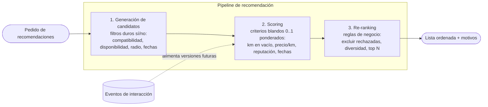

> Los diagramas de este documento están en [Mermaid](https://mermaid.js.org/) y se renderizan en GitHub, GitLab y VS Code. Para verlos dentro del mdBook hace falta el preprocesador `mdbook-mermaid`.

El matcheo dador → transportista es **el mismo motor visto desde el otro lado**: los candidatos son transportistas en lugar de cargas.

### Parámetros de recomendación considerados

| Parámetro | Tipo | Comentario |
|---|---|---|
| Compatibilidad de tráiler / tipo de carga / IMO | Duro | Si no es compatible, no es candidato. |
| Disponibilidad (estado del camión, fechas) | Duro | |
| Radio máximo de búsqueda | Duro | Índice geoespacial. |
| Kilómetros en vacío (posición → origen) | Blando | Principal costo del transportista. |
| Precio por km | Blando | Rentabilidad. |
| Ajuste de fecha de retiro / entrega | Blando | |
| Reputación de la contraparte | Blando | Mitiga riesgo. |
| Viaje de retorno (destino cercano a base) | Blando | Evita volver vacío. |
| Preferencias / historial | Blando (futuro) | Requiere datos de interacción. |

---

## 2. Criterios de evaluación

| Criterio | Pregunta que responde |
|---|---|
| **Costo** | ¿Cuánta infraestructura y operación nueva agrega? |
| **Beneficio** | ¿Qué calidad de recomendación y qué capacidades habilita? |
| **Complejidad** | ¿Cuánto conocimiento y piezas móviles requiere? |
| **Tiempo MVP** | ¿Entra en 3 semanas? |
| **Explicabilidad** | ¿Se puede decir *por qué* se recomendó algo? |
| **Cold start** | ¿Funciona sin historial de interacciones? |
| **Evolución** | ¿Tiene un camino claro hacia una versión más robusta? |

---

## 3. Piezas transversales (aplican a todas las opciones)

| Necesidad | Opción MVP | Opción robusta | Licencia | Fuente |
|---|---|---|---|---|
| Índice geoespacial | PostGIS (`ST_DWithin` + KNN `<->`) | H3 (índice hexagonal jerárquico) | GPL-2 / Apache-2.0 | [PostGIS KNN workshop](https://postgis.net/workshops/postgis-intro/knn.html), [ST_DWithin](https://postgis.net/docs/manual-3.4/ST_DWithin.html), [Uber H3](https://uber.com/blog/h3/) |
| Distancia real por ruta | Haversine / distancia ya calculada | OSRM (Table API) o Valhalla (costing `truck`) | BSD-2 / MIT | [OSRM Table API](https://blog.afi.io/blog/osrm-table-api-free-and-open-source-distance-matrix-api/), [Valhalla](https://github.com/Valhalla/valhalla) |
| Ponderación de criterios | Pesos en configuración | Métodos MCDM (TOPSIS / AHP) | MIT | [pymcdm](https://pypi.org/project/pymcdm/1.0.4), [mcdm](https://pypi.org/project/mcdm/1.3/) |
| Registro de eventos (recomendada / vista / aceptada / rechazada) | Tabla en Postgres | Kafka / Valkey Streams | PostgreSQL / Apache-2.0 / BSD | [Valkey](https://www.linuxfoundation.org/blog/a-year-of-valkey) |

> **Decisión transversal recomendada:** registrar eventos de interacción **desde el día 1**, sea cual sea la opción elegida. Es barato hoy e imposible de reconstruir después, y es el único insumo que habilita cualquier evolución hacia ML.

---

## 4. Alternativas

### Opción A — Monolito modular: PostgreSQL/PostGIS + scoring multicriterio en el backend

**Arquitectura (componentes)**

Todo ocurre dentro de un mismo proceso: un módulo hexagonal dentro del backend actual.

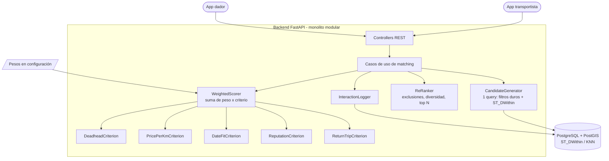

**Diagrama de robustez (ICONIX)**

Elegido porque el valor de esta opción está en **separar bien las responsabilidades**: qué es frontera, qué es control y qué es entidad. Cada criterio de scoring es una estrategia independiente que devuelve `0..1` y un motivo.

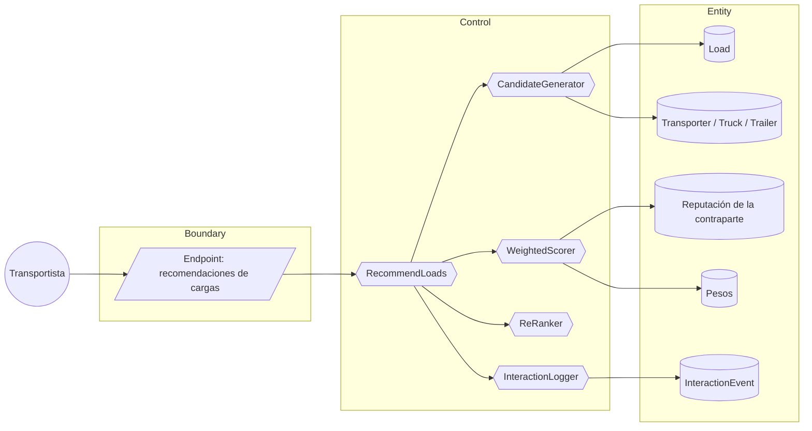

**Diagrama de secuencia**

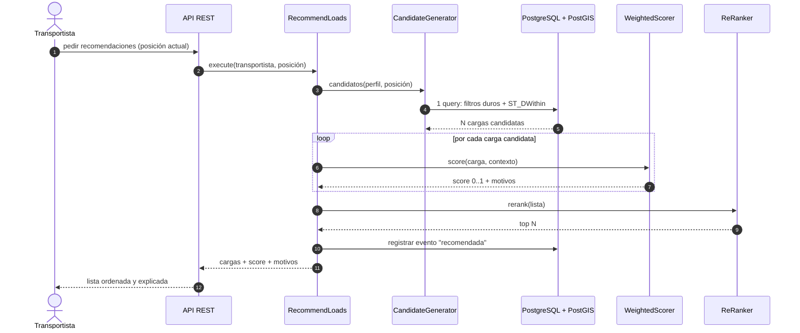

El matcheo dador → transportista recorre la misma secuencia con los roles invertidos: el candidato es un transportista y los criterios usan su reputación y su distancia al origen de la carga.

**Stack:** Python / FastAPI, PostgreSQL, PostGIS, pymcdm (opcional para calibrar pesos con AHP/TOPSIS). Funciones de decaimiento (gauss/exp) implementadas a mano para distancia y fechas, siguiendo el modelo conceptual de [Elastic – Decay functions](https://www.elastic.co/guide/en/elasticsearch/guide/current/decay-functions.html).

| Criterio | Evaluación |
|---|---|
| Costo | **Muy bajo**: cero infraestructura nueva. |
| Beneficio | Recomendaciones correctas y explicables; cubre ambos sentidos del matcheo. |
| Complejidad | **Baja**. |
| Tiempo MVP | ✅ 1,5 – 2 semanas. |
| Explicabilidad | ✅ Total: cada criterio aporta su motivo. |
| Cold start | ✅ No necesita historial. |
| Riesgo | Escalabilidad del cálculo on-demand con volúmenes altos (no es un problema en MVP). |

**Versión robusta a futuro (A+)**
- Distancias reales por ruta con **OSRM** o **Valhalla** (perfil camión) en lugar de distancia lineal.
- Personalización **content-based** con **pgvector**: vector del transportista a partir de las cargas que aceptó, similitud contra cargas candidatas, sin salir de Postgres.
- Modelo **híbrido** entrenado offline con **LightFM** (combina contenido + filtrado colaborativo y mitiga cold start), ejecutado como job batch.
- Pesos calibrados con **AHP** y validados con métricas offline (precisión@k sobre eventos registrados).

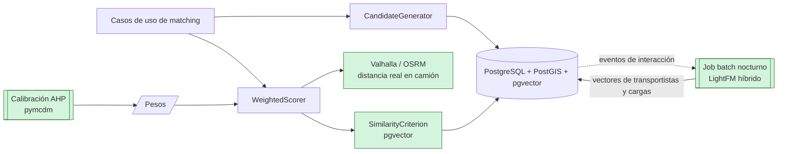

*En verde: componentes que se agregan respecto del MVP.*

**Fuentes**
- [Google ML – Recommendation systems (candidate generation, scoring, re-ranking)](https://developers.google.com/machine-learning/recommendation/overview/types?authuser=5)
- [Google ML – Scoring](https://developers.google.cn/machine-learning/recommendation/dnn/scoring)
- [PostGIS – Nearest-Neighbour Searching](https://postgis.net/workshops/postgis-intro/knn.html)
- [Tutorial "nearby drivers" con PostGIS](https://guides.micronaut.io/latest/micronaut-data-postgres-geospatial-nearby-drivers-gradle-java.html)
- [pymcdm (TOPSIS, VIKOR, PROMETHEE…)](https://pypi.org/project/pymcdm/1.0.4)
- [pgvector tutorial (DataCamp)](https://www.datacamp.com/tutorial/pgvector-tutorial) · [pgvector similarity search (Instaclustr)](https://www.instaclustr.com/education/vector-database/pgvector-similarity-search-basics-tutorial-and-best-practices/)
- [LightFM / implicit / Microsoft Recommenders (comparativa)](https://best-of-web.builder.io/library/lyst/lightfm)
- [Nexocode – Digital Freight Matching](https://nexocode.com/blog/posts/digital-freight-matching-personalized-load-to-carrier-recommendations)

---

### Opción B — Motor de búsqueda: OpenSearch con `function_score`

**Arquitectura**

Lo clave de esta opción es que **escritura y lectura van por caminos distintos** (CQRS liviano): Postgres es la fuente de verdad y OpenSearch es una proyección optimizada para rankear.

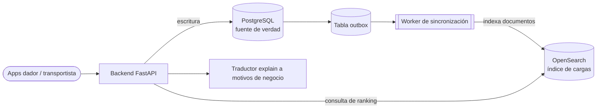

**Diagrama de secuencia**

Se muestran los dos flujos: publicación (escritura + sincronización) y recomendación (lectura).

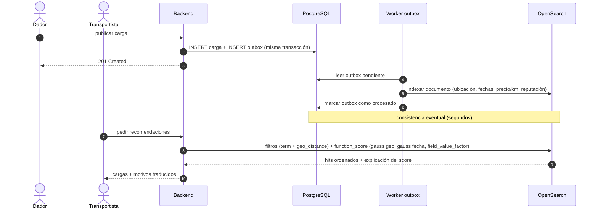

**Stack:** OpenSearch (Apache-2.0), cliente `opensearch-py`, patrón *transactional outbox* para sincronizar desde Postgres. Alternativa más liviana: **Meilisearch Community Edition** (MIT) con `_geoRadius` y orden `_geoPoint`, aunque con un scoring personalizado mucho más limitado.

| Criterio | Evaluación |
|---|---|
| Costo | **Medio**: un clúster más para operar (memoria/JVM), más sincronización. |
| Beneficio | Ranking multicriterio con decaimiento geo/fecha "de fábrica"; búsqueda de texto libre como extra. |
| Complejidad | **Media**: consistencia eventual entre DB e índice. |
| Tiempo MVP | ⚠️ 2,5 – 3 semanas (justo). |
| Explicabilidad | ⚠️ Parcial: `explain` existe pero es técnico; hay que traducirlo a motivos de negocio. |
| Cold start | ✅ No necesita historial. |
| Riesgo | La sincronización consume buena parte del plazo. |

**Versión robusta a futuro (B+)**
- Plugin **Learning to Rank** de OpenSearch: re-rankea con modelos XGBoost/RankLib entrenados con los eventos registrados.
- Sincronización por **CDC con Debezium + Kafka** en lugar del outbox manual.

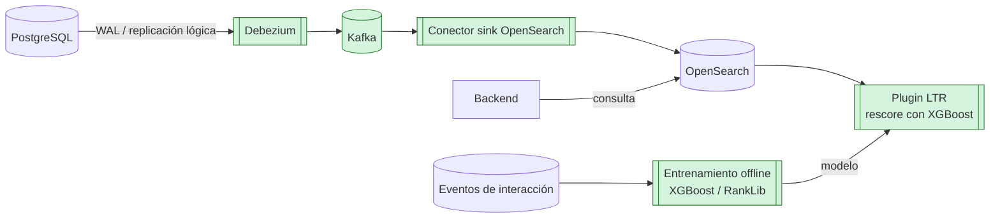

*En verde: componentes que reemplazan o se agregan al MVP.*

**Fuentes**
- [Elastic – Decay functions ("The closer, the better")](https://www.elastic.co/guide/en/elasticsearch/guide/current/decay-functions.html) (conceptualmente idéntico en OpenSearch)
- [A Gentle Intro to Function Scoring](https://www.elastic.co/blog/found-function-scoring)
- [OpenSearch – Learning to Rank](https://docs.opensearch.org/3.6/search-plugins/ltr/index/) · [Cómo encaja LTR en la búsqueda](https://docs.opensearch.org/3.3/search-plugins/ltr/fits-in)
- [Meilisearch – Geosearch](https://www.meilisearch.com/docs/learn/filtering_and_sorting/geosearch) · [Licencia CE (MIT) vs EE](https://www.meilisearch.com/blog/enterprise-license)
- [Debezium + PostgreSQL paso a paso](https://risingwave.com/blog/implementing-debezium-with-postgresql-a-step-by-step-guide/) · [Postgres → Kafka → OpenSearch (DEV)](https://thenote.app/post/en/connecting-rdbs-and-search-engines-chapter-5-kopi60ifq3)

---

### Opción C — Motor de recomendación dedicado: Gorse + prefiltro PostGIS

**Arquitectura**

Hay dos fuentes de score que se combinan: **lo que es válido** (PostGIS, reglas propias) y **lo que le gustaría** al transportista (Gorse, afinidad aprendida).

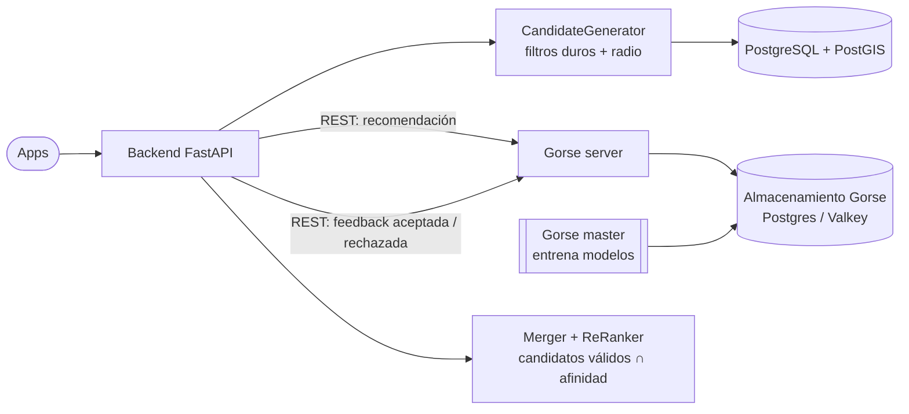

**Diagrama de secuencia**

Muestra el punto crítico de esta opción: qué pasa cuando el transportista **no tiene historial** (cold start).

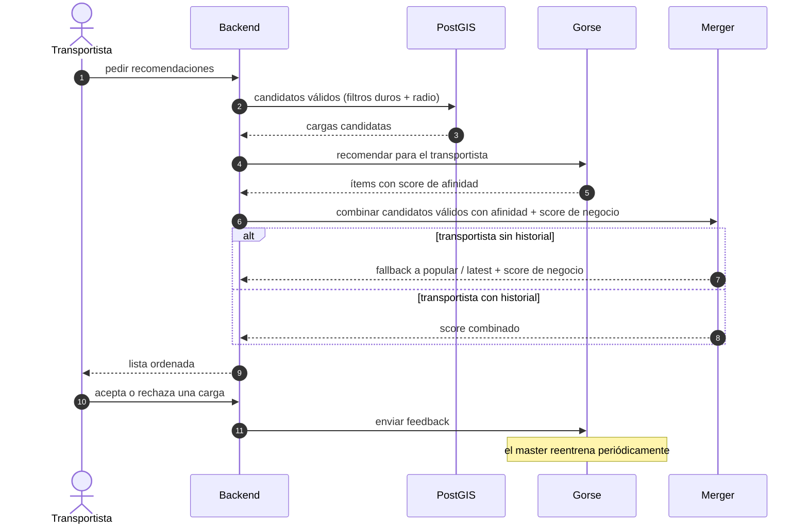

**Stack:** [Gorse](https://awesome.ecosyste.ms/projects/github.com%2Fzhenghaoz%2Fgorse) (Go, Apache-2.0) con backend Postgres o Valkey, consumido vía REST desde el backend.

| Criterio | Evaluación |
|---|---|
| Costo | **Medio**: un servicio más + su almacenamiento. |
| Beneficio | Personalización y AutoML listos para usar a medida que llegan datos. |
| Complejidad | **Media**: hay que mapear el dominio (usuarios, ítems, feedback) al modelo de Gorse. |
| Tiempo MVP | ⚠️ 2,5 – 3 semanas. |
| Explicabilidad | ❌ Baja: el score de CF no tiene motivos de negocio. |
| Cold start | ❌ Débil: sin interacciones degrada a "popular / latest". |
| Riesgo | Gorse no entiende geografía ni restricciones duras: **siempre** necesita el prefiltro propio. Las cargas son ítems efímeros (duran días), lo que penaliza al filtrado colaborativo clásico. |

**Versión robusta a futuro (C+)**
- Gorse en modo distribuido (master / workers) con escalado horizontal.
- Ítems enriquecidos con *labels* (ruta, tipo de carga, región H3) para que la recomendación se haga por **corredor/ruta** y no por carga individual. Así se mitiga el problema de ítems efímeros.

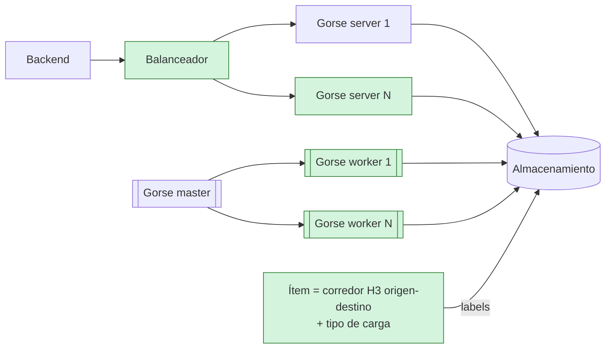

*En verde: escalado horizontal y el cambio de modelado del ítem (corredor en lugar de carga).*

**Fuentes**
- [Gorse (repositorio y features)](https://awesome.ecosyste.ms/projects/github.com%2Fzhenghaoz%2Fgorse) · [pkg.go.dev](https://pkg.go.dev/github.com/zhenghaoz/gorse@v0.4.16)
- [Curso Recommendation Systems on Google Cloud (CF, content-based, híbridos)](https://www.cloudskillsboost.google/course_templates/39?locale=fr)
- [PyCon DE 2026 – Solving Marketplace Cold Start with Ranking](https://pycon.de/archive/2026/talks/solving-marketplace-cold-start-at-scale-with-ranking/)

---

### Opción D — Microservicio de ranking event-driven (candidatos + re-ranker)

**Arquitectura**

El cambio de paradigma: las recomendaciones se **calculan cuando ocurre algo** (se publica una carga, se libera un camión) y no cuando el usuario las pide.

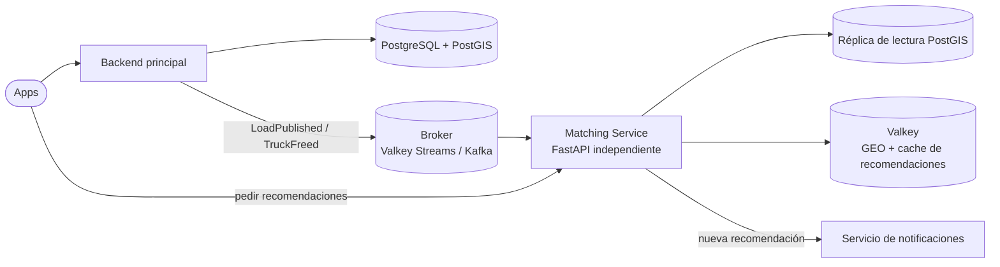

**Diagrama de secuencia**

Flujo asíncrono: el cálculo ocurre en la publicación y la lectura posterior es solo una consulta a cache.

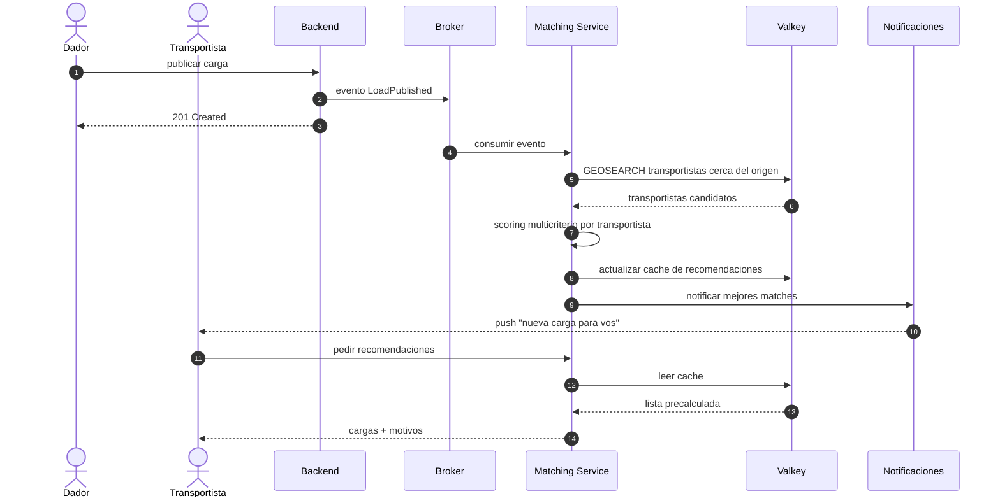

**Stack:** Python/FastAPI como servicio separado, Valkey (BSD) para geo + cache + streams, PostgreSQL/PostGIS como fuente de verdad.

| Criterio | Evaluación |
|---|---|
| Costo | **Medio-alto**: servicio, broker, cache y despliegue independientes. |
| Beneficio | Escala de forma independiente; permite precalcular y notificar ("nueva carga para vos"). |
| Complejidad | **Alta** para el plazo: contratos, consistencia eventual, observabilidad distribuida. |
| Tiempo MVP | ❌ Excede 3 semanas si se hace completo. |
| Explicabilidad | ✅ Igual que A (mismo scoring). |
| Cold start | ✅ |
| Riesgo | Sobreingeniería para el volumen actual. |

**Versión robusta a futuro (D+)**
- Re-ranking con **Metarank** (Apache-2.0): learning-to-rank sobre eventos de clicks/aceptaciones, latencia de 10-20 ms.
- **Feature store con Feast** (Apache-2.0) para servir features online/offline coherentes.
- **Contextual bandits con Vowpal Wabbit** (BSD) para balancear exploración/explotación y resolver cold start online.

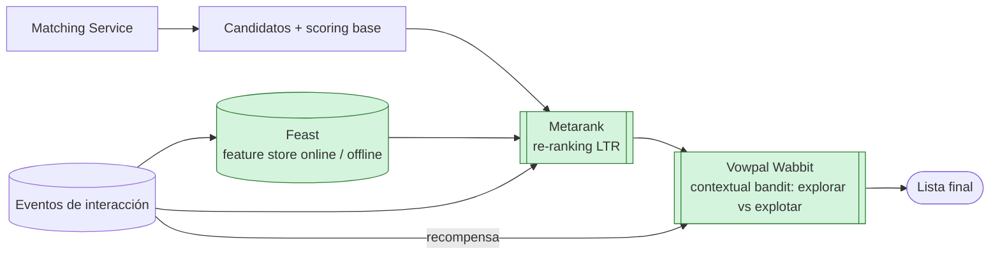

*En verde: capa de aprendizaje que se monta sobre el scoring base sin reemplazarlo.*

**Fuentes**
- [Valkey – un año del fork open source](https://www.linuxfoundation.org/blog/a-year-of-valkey) · [¿Qué es Valkey? (AWS)](https://aws.amazon.com/elasticache/what-is-valkey)
- [ByteByteGo – Proximity Service (geohash, quadtree)](https://blog.bytebytego.com/p/proximity-service)
- [Metarank – intro](https://github.com/metarank/metarank/blob/stabledoc/doc/intro.md) · [LTR con Metarank en producción (Fullscript)](https://builders.fullscript.com/posts/developing-a-modern-search-stack-learning-to-rank-with-metarank)
- [Feast](https://github.com/feast-dev)
- [Vowpal Wabbit – Contextual bandit personalization](https://vowpal-wabbit-next.readthedocs.io/en/latest/tutorials/contextual_bandit_content_personalization.html)

---

### Opción E — Vector-first: Qdrant con filtros geo + API de recomendación

**Arquitectura**

Cada carga se transforma en un vector. Recomendar pasa a ser "buscar cargas parecidas a las que aceptó y distintas de las que rechazó", con los filtros duros aplicados dentro de la misma búsqueda.

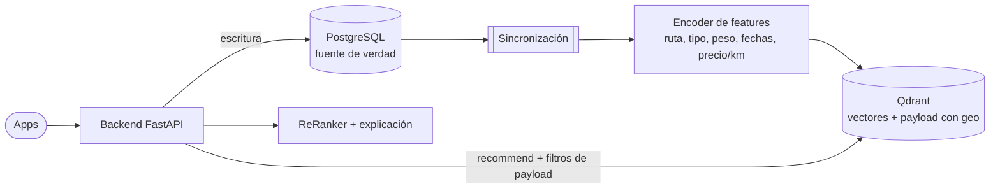

**Diagrama de secuencia**

Muestra las dos ramas según haya o no historial, que es donde esta opción se diferencia.

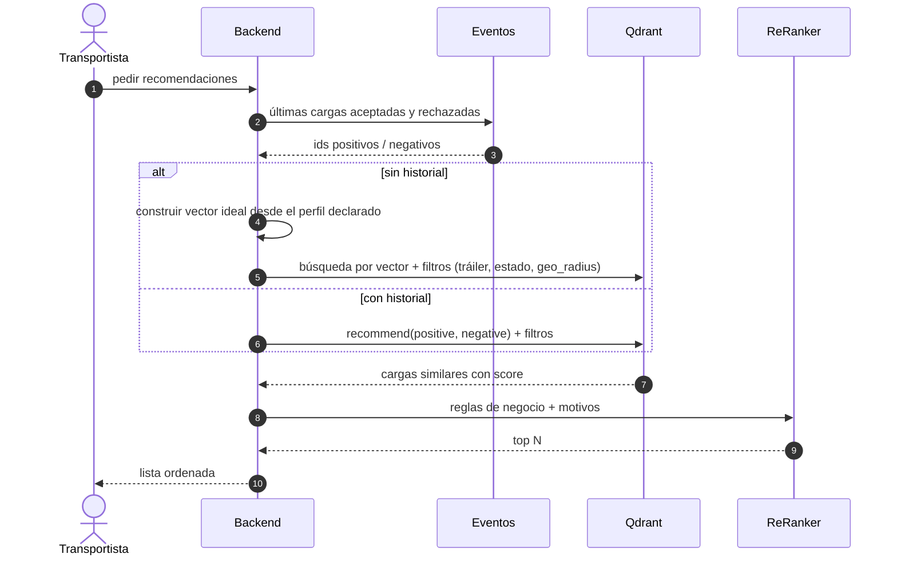

**Stack:** Qdrant (Rust, Apache-2.0), `qdrant-client` para Python, PostgreSQL como fuente de verdad.

| Criterio | Evaluación |
|---|---|
| Costo | **Medio**: un servicio más, con sincronización. |
| Beneficio | Personalización por ejemplos (aceptadas/rechazadas) sin entrenar un modelo; filtros duros y geo en la misma consulta. |
| Complejidad | **Media-alta**: diseñar el vector de features es la parte difícil y se lleva la explicabilidad. |
| Tiempo MVP | ⚠️ 3 semanas, con riesgo. |
| Explicabilidad | ❌ Baja: la similitud vectorial no se traduce directo a motivos. |
| Cold start | ⚠️ Sin historial cae a búsqueda por vector "ideal" del perfil declarado. |
| Riesgo | Mezclar features heterogéneas (km, $, fechas) en un vector exige normalización cuidadosa. |

**Versión robusta a futuro (E+)**
- Embeddings aprendidos (LightFM / two-tower) en lugar de features armadas a mano.
- Búsqueda híbrida (vector + reglas) con estrategias `best_score` / `sum_scores` para usar los rechazos como señal negativa.

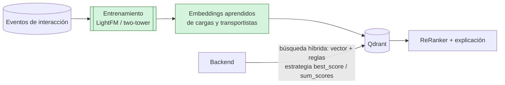

*En verde: el encoder manual se reemplaza por embeddings aprendidos de las interacciones.*

**Fuentes**
- [Qdrant – Explore / Recommendation API](https://qdrant.tech/documentation/search/explore/) · [Artículo: nueva API de recomendación](https://qdrant.tech/articles/new-recommendation-api/)
- [Qdrant – Indexing (geo index, geo_radius)](https://qdrant.tech/documentation/concepts/indexing) · [Payload filtering (curso)](https://qdrant.tech/course/beginners/module-2/payload-filtering/index.md)
- [LightFM](https://best-of-web.builder.io/library/lyst/lightfm)

---

## 5. Comparativa general

| Criterio | A · PostGIS + scoring | B · OpenSearch | C · Gorse | D · Microservicio event-driven | E · Qdrant vectorial |
|---|---|---|---|---|---|
| Costo infra | 🟢 Muy bajo | 🟡 Medio | 🟡 Medio | 🔴 Medio-alto | 🟡 Medio |
| Complejidad | 🟢 Baja | 🟡 Media | 🟡 Media | 🔴 Alta | 🟡 Media-alta |
| Tiempo MVP (≤ 3 sem.) | 🟢 Sí | 🟡 Justo | 🟡 Justo | 🔴 No | 🟡 Con riesgo |
| Explicabilidad | 🟢 Total | 🟡 Parcial | 🔴 Baja | 🟢 Total | 🔴 Baja |
| Cold start | 🟢 | 🟢 | 🔴 | 🟢 | 🟡 |
| Matcheo en ambos sentidos | 🟢 | 🟢 | 🟡 | 🟢 | 🟡 |
| Personalización | 🔴 (🟢 en A+) | 🔴 (🟢 en B+) | 🟢 | 🔴 (🟢 en D+) | 🟢 |
| Escalabilidad | 🟡 | 🟢 | 🟢 | 🟢 | 🟢 |
| Techo de evolución | 🟢 pgvector, LightFM | 🟢 LTR plugin | 🟡 | 🟢 Metarank, Feast, bandits | 🟢 embeddings aprendidos |

---

## 6. Recomendación

**Para el MVP de 3 semanas: Opción A**, por tres motivos:

1. Es la única que entra holgada en el plazo y cubre los dos requisitos (matcheo bidireccional y recomendación multiparámetro).
2. Cumple el requisito de **criterio y estructura explícitos**: cada recomendación tiene motivos de negocio trazables.
3. No hay datos de interacción todavía. Cualquier opción basada en ML (C, E, y las variantes "+") no tiene de qué aprender en esta etapa.

**Camino de evolución sugerido**

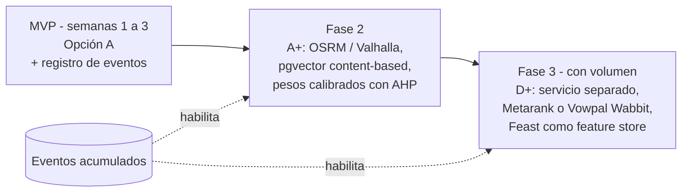

Este camino es el mismo que siguió la industria del freight matching: primero load boards con filtros, después recomendación por reglas y finalmente ML sobre el historial ([DAT](https://www.thetruckersreport.com/news/dat-launches-load-recommendations-improve-freight-matching-carriers/), [Truckstop](https://www.foodlogistics.com/transportation/trucking/news/22944066/truckstopcom-truckstop-introduces-new-load-board-features-to-enhance-load-matching-for-carriers), [KeepTruckin Smart Load Board](https://www.freightwaves.com/?p=296090)).

### Decisiones a registrar como ADR

1. Ranking explicable vs. asignación automática (decidido: ranking).
2. Cálculo on-demand vs. precalculado.
3. Distancia lineal vs. distancia por ruta.
4. Origen de los pesos: configuración manual vs. AHP vs. aprendidos.
5. Esquema de registro de eventos de interacción.
6. Módulo dentro del backend vs. microservicio.

---

## 7. Material de estudio complementario

### Lecturas
- [Patente: Freight Load Matching System](https://patents.justia.com/patent/20210201262) (factores usados en la industria)
- [Patente: Uber Freight vehicle matching](https://patents.google.com/patent/US11392881)
- [Paper: Optimizing Rankings for Recommendation in Matching Markets](https://ar5iv.labs.arxiv.org/html/2106.01941)
- [Vespa – GBDT Learning to Rank](https://learn.vespa.ai/reranking-ltr/gbdt-ltr)
- [PyTerrier – Learning to Rank](https://pyterrier.readthedocs.io/en/latest/ltr.html)

### Búsquedas sugeridas en YouTube
- `TOPSIS method explained` / `AHP analytic hierarchy process example`
- `PostGIS KNN nearest neighbor tutorial`
- `ByteByteGo proximity service` / `design Uber system design`
- `Elasticsearch function score decay`
- `content based vs collaborative filtering` / `Andrew Ng recommender systems`
- `learning to rank explained` / `contextual bandits explained`
- `Gorse recommender system` / `Qdrant recommendation API`
- `two-sided marketplace recommendation cold start`

> Nota: los términos de YouTube son sugerencias de búsqueda; no se verificaron videos puntuales.
