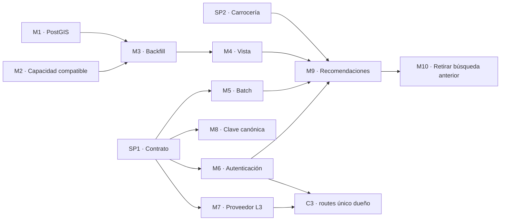

# Borrador de user stories: matching con PostGIS y centralización de `routes`

> Borrador para revisión **antes** de crear las historias en GitHub. Fuentes: [plan-busqueda.md](plan-busqueda.md), [filtrado-geografico-candidatos-postgis.md](filtrado-geografico-candidatos-postgis.md) y [plan-centralizacion-routes.md](plan-centralizacion-routes.md).
> Formato según la automatización vigente de `roadmap` (`scripts/auto_number_issues.py`, actualizado el 2026-09-26) y las historias recientes (por ejemplo, roadmap#128).
> Fecha: 2026-10-09 · v4: descripciones con Gherkins según el ciclo de vida documentado en la [plantilla de ticket](src/wiki/tickets/plantilla-ticket.md); M2 reformulada; C1, C2, C4 y C5 eliminadas o integradas en C3 tras verificar contra `origin/main`.

---

## 0. Formato y procedimiento

### 0.1 Formato

- **Todo es una user story en `smartruck-ar/roadmap`.** No se crean tasks en los repos de producto.
- **Título sin numeración**, en formato `Como …, Quiero …, Para …`. La automatización lo numera al asignar el milestone (épica).
- **Cuerpo de una historia de backend:** contexto breve, `Bloqueado por #N` si corresponde y los **Gherkins**, que son sus criterios de aceptación. Al crearla, los escenarios van escritos en la descripción con la ruta del `.feature`; una vez pusheados a `main`, el bloque se reemplaza por el link al archivo.
- **Cuerpo de una historia de frontend (`UI-`):** referencia a la historia de backend asociada. La contraparte que crea la automatización con `front+back` ya la trae.
- **Spikes:** contexto, qué decidir y entregable; `Gherkins: no aplica`.
- **IDs de escenarios:** continúan la numeración del `.feature` donde se agregan; se confirman al pushear.
- **Tags según dónde va el trabajo:**

| Trabajo | Cómo se crea | Resultado de la automatización |
|---|---|---|
| Solo backend | Título normal, sin tag | `T.2.N - …` |
| Solo frontend | Título que empieza con `UI-`, sin tag | `UI-T.2.N - …` |
| Backend y frontend | Título normal + tag `front+back` | `T.2.N - …` y su contraparte `UI-T.2.N - …`, vinculadas |
| Spike | Milestone `SPIKES` | `S.N - …` (nunca genera contraparte) |

> El prefijo que usa la automatización para la contraparte de frontend es **`UI-`** (`UI_PREFIX = "UI-"` en el script).

### 0.2 Procedimiento de creación

1. Crear las historias **en orden de dependencias** (spikes → M1, M2 → M3, M4 → M5–M8 → M9 → M10 → C3), para reemplazar cada `#<X>` de "Bloqueado por" por el número real.
2. Crear cada historia **sin milestone**, con el tag `front+back` si corresponde.
3. Asignarle el **milestone** en un segundo paso. Ese evento (`milestoned`) dispara la numeración, el label `user story`, la contraparte `UI-` y el alta en el Board con el sprint actual.
4. Leer la historia numerada para confirmar el resultado.

US points, prioridad y horas no se completan: se definen en planning.

---

## 1. Relación con tickets existentes

| Ticket | Relación | Propuesta |
|---|---|---|
| [roadmap#126](https://github.com/smartruck-ar/roadmap/issues/126) S.1 — alcance e impacto del algoritmo de cálculo de rutas | Los documentos `plan-centralizacion-routes.md` y `filtrado-geografico-candidatos-postgis.md` son su entregable | No se crea un spike equivalente. Las decisiones de contrato pendientes van en SP1, que referencia a S.1 |
| [roadmap#108](https://github.com/smartruck-ar/roadmap/issues/108) T.2.7 — refactor de `POST /loads/search` | Queda reemplazado por el motor de recomendaciones (M9) | Decisión del equipo: cerrarlo como reemplazado o mantenerlo. No se modifica sin indicación |
| [backend#127](https://github.com/smartruck-ar/smartruck-backend/issues/127) D.2.1.6 y [backend#32](https://github.com/smartruck-ar/smartruck-backend/issues/32) D.2.1.4 | Decisión del equipo: la distancia se calcula al **cotizar** | C3 respeta la decisión: publicar reutiliza la distancia cotizada |
| [backend#128](https://github.com/smartruck-ar/smartruck-backend/issues/128) D.2.1.7 | Decisión del equipo: al publicar se persisten las coordenadas de la cotización | Se respeta; no se propone cambiarlo |

---

## 2. Resumen

| ID | Milestone | Tipo | Título |
|---|---|---|---|
| SP1 | SPIKES | Spike | Como desarrollador, Quiero definir el contrato del servicio de rutas y el proveedor de ruteo, Para implementar el matching y la centralización sin inconsistencias |
| SP2 | SPIKES | Spike | Como desarrollador, Quiero definir cómo modelar el tipo de carrocería del equipo, Para que el filtro de tráiler del matching coincida con lo que publican los oferentes |
| M1 | T.2 | Backend | Como desarrollador, Quiero almacenar el origen y el destino de cada carga como geometrías PostGIS indexadas, Para filtrar cargas por cercanía de forma eficiente |
| M2 | D.2 | `front+back` | Como oferente, Quiero que mi carga solo se recomiende a transportistas con capacidad y condiciones compatibles, Para no recibir interesados que no pueden llevarla |
| M3 | T.2 | Backend | Como desarrollador, Quiero completar las geometrías, la distancia y el peso de las cargas ya publicadas, Para que también aparezcan en las recomendaciones |
| M4 | T.2 | Backend | Como desarrollador, Quiero exponer una vista de solo lectura con las cargas activas, Para que el motor de recomendaciones no dependa de detalles internos del backend |
| M5 | T.2 | Backend | Como desarrollador, Quiero resolver varias rutas en una sola llamada al servicio de rutas, Para que el motor de recomendaciones calcule los tramos vacíos rápidamente |
| M6 | T.2 | Backend | Como desarrollador, Quiero que el servicio de rutas exija autenticación de usuarios y de servicios internos, Para que solo la plataforma pueda consumirlo |
| M7 | T.2 | Backend | Como desarrollador, Quiero resolver las rutas nuevas con un proveedor de ruteo vial y guardarlas, Para no depender de estimaciones en línea recta |
| M8 | T.2 | Backend | Como desarrollador, Quiero una especificación única y testeada de la clave canónica de rutas, Para que todas las consultas encuentren las rutas ya guardadas |
| M9 | T.2 | `front+back` | Como transportista, Quiero recibir recomendaciones de cargas para mi viaje de A a B según mi tolerancia de desvío, Para reducir los kilómetros que hago vacío |
| M10 | T.2 | Backend | Como desarrollador, Quiero retirar la búsqueda de cargas anterior del backend, Para que exista un único motor de búsqueda |
| C3 | D.2 | `front+back` | Como desarrollador, Quiero que el servicio de rutas sea el único que resuelve, estima y guarda rutas, Para eliminar copias y resultados distintos entre sistemas |

**Total:** 13 historias creadas a mano + 3 contrapartes `UI-` automáticas (M2, M9 y C3) = **16 historias**.

### Orden sugerido (ruta crítica de `plan-centralizacion-routes.md`, sección 8.1)



---

## 3. Spikes

> Formato de spike: contexto, qué decidir y entregable. `Gherkins: no aplica`.

### SP1 · Contrato del servicio de rutas

- **Milestone:** `SPIKES` · **Tag:** ninguno
- **Título:** `Como desarrollador, Quiero definir el contrato del servicio de rutas y el proveedor de ruteo, Para implementar el matching y la centralización sin inconsistencias`

```markdown
Continuación de S.1 (#126). El análisis de S.1 (`docs/plan-centralizacion-routes.md` y `docs/filtrado-geografico-candidatos-postgis.md`) detectó decisiones de contrato que el `plan-busqueda.md` asume distinto de como funciona el sistema hoy.

A decidir y documentar en `docs/`:
- Autenticación de los workers: JWT de Supabase con ES256 vía JWKS, como el backend.
- Clave canónica: mantener la clave simétrica actual de `routes`.
- Orden de coordenadas: almacenamiento `[lng, lat]`, respuesta HTTP `[lat, lng]`.
- Único escritor de la tabla `routes` en tiempo de ejecución.
- Proveedor de ruteo externo (Mapbox Directions u OSRM), verificando términos de uso para almacenar resultados.
- Caché L1 (`caches.default` o Cloudflare KV) y conexión de los workers a Postgres (cliente REST o Hyperdrive).
- Repositorio del Recommendations Worker.

Entregable: cada decisión con su justificación en `docs/` y `plan-busqueda.md` actualizado.

Gherkins: no aplica.
```

### SP2 · Tipo de carrocería

- **Milestone:** `SPIKES` · **Tag:** ninguno
- **Título:** `Como desarrollador, Quiero definir cómo modelar el tipo de carrocería del equipo, Para que el filtro de tráiler del matching coincida con lo que publican los oferentes`

```markdown
El `plan-busqueda.md` filtra por tipo de acoplado "SIDER", pero `TrailerType` solo modela la configuración del tráiler (`SEMIRREMOLQUE`, `ACOPLADO`, `BITREN`). Son dos dimensiones distintas: configuración y carrocería (sider, batea, tolva, furgón, cisterna, jaula…). Con el modelo actual, el filtro del plan nunca coincide.

A decidir: agregar la dimensión "carrocería" a tráileres y cargas, o adaptar el plan a `TrailerType`. Insumo: respuestas del formulario de tarifas (S.2, #127).

Entregable: decisión documentada y escenarios del `plan-busqueda.md` con valores existentes en el modelo.

Gherkins: no aplica.
```

---

## 4. Matching con PostGIS (M1–M10)

### M1 · Geometrías PostGIS

- **Milestone:** `T.2` · **Tag:** ninguno (backend) · **Repo de los Gherkins:** `smartruck-backend`
- **Título:** `Como desarrollador, Quiero almacenar el origen y el destino de cada carga como geometrías PostGIS indexadas, Para filtrar cargas por cercanía de forma eficiente`

````markdown
Hoy `loads` guarda latitud y longitud como números, sin tipo espacial ni índice. El motor de recomendaciones necesita filtrar por cercanía con índices espaciales: se habilita PostGIS (en Supabase, en un schema dedicado) y cada carga publicada guarda su origen y destino como geometrías indexadas.

**Gherkins** — pendientes de pushear a `smartruck-backend/test/acceptance/features/crear_oferta_carga.feature`. Una vez en `main`, reemplazar este bloque por el link al archivo.

```gherkin
# language: es
Regla: Ubicación geográfica de la carga

  Escenario: COC 19: la carga publicada queda ubicada en su origen y destino
    Cuando el oferente crea una oferta de carga con:
      | field              | value                  |
      | description        | Carga de soja a granel |
      | cargo_type         | GRANEL                 |
      | origin_latitude    | -32.9442               |
      | origin_longitude   | -60.6505               |
      | destination_latitude  | -34.6037            |
      | destination_longitude | -58.3816            |
    Entonces la respuesta es exitosa
    Y la carga queda ubicada geográficamente en el origen "-32.9442", "-60.6505"
    Y la carga queda ubicada geográficamente en el destino "-34.6037", "-58.3816"
```
````

### M2 · Capacidad compatible (`front+back`)

- **Milestone:** `D.2` · **Tag:** `front+back` · **Repo de los Gherkins:** `smartruck-backend`
- **Título:** `Como oferente, Quiero que mi carga solo se recomiende a transportistas con capacidad y condiciones compatibles, Para no recibir interesados que no pueden llevarla`

````markdown
Para recomendar una carga solo a transportistas con capacidad y condiciones compatibles, el matching compara el peso de la carga con la capacidad del camión (además del tipo de remolque, que ya se informa). Hoy el peso es opcional en el formulario y en el backend, y su unidad es variable (`weight_unit_code`): las cargas sin peso quedarían excluidas en silencio y las de distinta unidad se compararían mal. El peso pasa a ser obligatorio al publicar y se guarda en kg.

**Gherkins** — pendientes de pushear a `smartruck-backend/test/acceptance/features/crear_oferta_carga.feature`. Una vez en `main`, reemplazar este bloque por el link al archivo.

```gherkin
# language: es
Regla: Peso obligatorio y en kg

  Escenario: COC 20: no se publica una carga sin peso
    Cuando el oferente crea una oferta de carga sin indicar el peso
    Entonces la respuesta tiene estado "400"
    Y no se persiste ninguna carga

  Escenario: COC 21: el peso informado en toneladas se registra en kg
    Cuando el oferente crea una oferta de carga con:
      | field            | value                  |
      | description      | Carga de soja a granel |
      | cargo_type       | GRANEL                 |
      | weight           | 28                     |
      | weight_unit_code | TN                     |
    Entonces la respuesta es exitosa
    Y la oferta tiene peso "28000" kg
```
````

### M3 · Backfill de cargas existentes

- **Milestone:** `T.2` · **Tag:** ninguno (backend) · **Repo de los Gherkins:** `smartruck-backend`
- **Título:** `Como desarrollador, Quiero completar las geometrías, la distancia y el peso de las cargas ya publicadas, Para que también aparezcan en las recomendaciones`

````markdown
Las cargas publicadas antes de M1 y M2 no tienen geometrías y pueden no tener distancia ni peso en kg. Sin completar esos datos, no aparecen en las recomendaciones. Se completan con un proceso idempotente; los pesos faltantes no se inventan.

Bloqueado por #<M1> y #<M2>

**Gherkins** — pendientes de pushear a `smartruck-backend/test/acceptance/features/completar_datos_cargas_existentes.feature`. Una vez en `main`, reemplazar este bloque por el link al archivo.

```gherkin
# language: es
Característica: Completar datos de cargas existentes
  Como desarrollador
  Quiero completar las geometrías, la distancia y el peso de las cargas ya publicadas
  Para que también aparezcan en las recomendaciones

  Escenario: CDE 01: una carga existente sin ubicación geográfica queda ubicada
    Dado que existe una carga publicada con coordenadas y sin ubicación geográfica
    Cuando se completan los datos de las cargas existentes
    Entonces la carga queda ubicada geográficamente en su origen y destino

  Escenario: CDE 02: una carga existente sin distancia obtiene la distancia vial
    Dado que existe una carga publicada de "Rosario, Santa Fe" a "Córdoba, Córdoba" sin distancia
    Cuando se completan los datos de las cargas existentes
    Entonces la carga tiene la distancia vial que informa el servicio de rutas

  Escenario: CDE 03: una carga sin peso queda identificada y no se le inventa un peso
    Dado que existe una carga publicada sin peso
    Cuando se completan los datos de las cargas existentes
    Entonces la carga sigue sin peso
    Y la carga queda listada como pendiente de completar

  Escenario: CDE 04: completar los datos dos veces no modifica cargas ya completas
    Dado que se completaron los datos de las cargas existentes
    Cuando se completan los datos de las cargas existentes
    Entonces ninguna carga se modifica
```
````

### M4 · Vista de solo lectura

- **Milestone:** `T.2` · **Tag:** ninguno (backend) · **Repo de los Gherkins:** `smartruck-backend`
- **Título:** `Como desarrollador, Quiero exponer una vista de solo lectura con las cargas activas, Para que el motor de recomendaciones no dependa de detalles internos del backend`

````markdown
El Recommendations Worker lee cargas de la base del backend. Para que no dependa de valores internos (por ejemplo, el estado `activa` en minúsculas) ni de columnas que pueden cambiar, se expone la vista `matching_loads` con un rol de solo lectura, como contrato entre ambos.

Bloqueado por #<M1>

**Gherkins** — pendientes de pushear a `smartruck-backend/test/acceptance/features/consultar_cargas_para_recomendacion.feature`. Una vez en `main`, reemplazar este bloque por el link al archivo.

```gherkin
# language: es
Característica: Consultar cargas para recomendación
  Como desarrollador
  Quiero exponer una vista de solo lectura con las cargas activas
  Para que el motor de recomendaciones no dependa de detalles internos del backend

  Escenario: CCR 01: solo se exponen cargas activas
    Dado que existen cargas en estado "activa", "reservada" y "entregada"
    Cuando el motor de recomendaciones consulta las cargas disponibles
    Entonces solo obtiene la carga en estado "activa"

  Escenario: CCR 02: la carga expuesta incluye los datos que necesita el matching
    Dado que existe una carga activa con peso, tipo de remolque, fechas y distancia
    Cuando el motor de recomendaciones consulta las cargas disponibles
    Entonces la carga incluye origen, destino, ubicación geográfica, peso, tipo de remolque, fechas, precio y distancia

  Escenario: CCR 03: el motor de recomendaciones no puede modificar cargas
    Cuando el motor de recomendaciones intenta modificar una carga
    Entonces la operación es rechazada por falta de permisos
```
````

### M5 · Rutas en lote

- **Milestone:** `T.2` · **Tag:** ninguno (backend) · **Repo de los Gherkins:** `microservice-routes`
- **Título:** `Como desarrollador, Quiero resolver varias rutas en una sola llamada al servicio de rutas, Para que el motor de recomendaciones calcule los tramos vacíos rápidamente`

````markdown
Hoy `microservice-routes` solo expone `GET /routes` para un par de ciudades, y busca localidades leyendo la tabla completa. El motor de recomendaciones necesita resolver muchos pares por búsqueda: se agrega `POST /routes/batch`, con deduplicación, geometría opcional y las coordenadas de las ciudades (para el filtro Tier 1), y la búsqueda de localidades pasa a ser indexada.

Bloqueado por #<SP1>

**Gherkins** — pendientes de pushear a `microservice-routes/test/acceptance/features/consultar_rutas_en_lote.feature`. Una vez en `main`, reemplazar este bloque por el link al archivo.

```gherkin
# language: es
@acceptance
Característica: Consultar rutas en lote
  Como servicio de recomendaciones de Smartruck
  Quiero consultar varias rutas viales en una sola llamada
  Para calcular rápidamente los tramos vacíos de muchas cargas

  Antecedentes:
    Dado que existen las ciudades "Rosario", "Córdoba" y "Pergamino" en el sistema

  Escenario: RLT 01: se resuelven varios pares en el orden pedido
    Cuando se consultan en lote las rutas:
      | origen   | destino   |
      | Rosario  | Córdoba   |
      | Rosario  | Pergamino |
    Entonces la respuesta es exitosa
    Y la respuesta tiene 2 rutas en el mismo orden pedido

  Escenario: RLT 02: los pares repetidos se resuelven una sola vez
    Cuando se consultan en lote las rutas:
      | origen  | destino |
      | Rosario | Córdoba |
      | Córdoba | Rosario |
      | Rosario | Córdoba |
    Entonces la respuesta tiene 3 rutas
    Y la ruta entre "Rosario" y "Córdoba" se resolvió una sola vez

  Escenario: RLT 03: cada ruta incluye las coordenadas de sus ciudades
    Cuando se consultan en lote las rutas:
      | origen  | destino |
      | Rosario | Córdoba |
    Entonces la ruta incluye las coordenadas de "Rosario" y de "Córdoba"

  Escenario: RLT 04: sin pedir geometría no se incluye el trazado
    Cuando se consultan en lote las rutas sin pedir geometría:
      | origen  | destino |
      | Rosario | Córdoba |
    Entonces la ruta no incluye el trazado del trayecto

  Escenario: RLT 05: el resultado coincide con la consulta individual
    Dado que el usuario consulta la ruta desde "Rosario" hacia "Córdoba"
    Cuando se consultan en lote las rutas:
      | origen  | destino |
      | Rosario | Córdoba |
    Entonces la distancia y duración coinciden con la consulta individual
```
````

### M6 · Autenticación del servicio de rutas

- **Milestone:** `T.2` · **Tag:** ninguno (backend) · **Repo de los Gherkins:** `microservice-routes`
- **Título:** `Como desarrollador, Quiero que el servicio de rutas exija autenticación de usuarios y de servicios internos, Para que solo la plataforma pueda consumirlo`

````markdown
Hoy `microservice-routes` es público. Debe aceptar solo usuarios autenticados (JWT de Supabase validado con ES256 vía JWKS, como el backend) y servicios internos de la plataforma con una credencial propia. El backend pasa a enviar esa credencial al cotizar.

Bloqueado por #<SP1>

**Gherkins** — pendientes de pushear a `microservice-routes/test/acceptance/features/autenticar_consultas_de_rutas.feature`. Una vez en `main`, reemplazar este bloque por el link al archivo.

```gherkin
# language: es
@acceptance
Característica: Autenticar consultas de rutas
  Como plataforma Smartruck
  Quiero que solo usuarios autenticados y servicios internos consulten rutas
  Para proteger el servicio de usos externos

  Antecedentes:
    Dado que existen las ciudades "Rosario" y "Córdoba" en el sistema

  Regla: Usuarios

    Escenario: AUR 01: un usuario autenticado consulta una ruta
      Dado que el usuario tiene una sesión válida
      Cuando el usuario consulta la ruta desde "Rosario" hacia "Córdoba"
      Entonces la respuesta es exitosa

    Escenario: AUR 02: sin credenciales se rechaza la consulta
      Cuando se consulta la ruta desde "Rosario" hacia "Córdoba" sin credenciales
      Entonces la respuesta tiene estado "401"

    Escenario: AUR 03: una sesión vencida se rechaza
      Dado que el usuario tiene una sesión vencida
      Cuando el usuario consulta la ruta desde "Rosario" hacia "Córdoba"
      Entonces la respuesta tiene estado "401"

  Regla: Servicios internos

    Escenario: AUR 04: un servicio interno consulta sin sesión de usuario
      Cuando un servicio interno consulta la ruta desde "Rosario" hacia "Córdoba"
      Entonces la respuesta es exitosa

    Escenario: AUR 05: una credencial interna incorrecta se rechaza
      Cuando se consulta la ruta desde "Rosario" hacia "Córdoba" con una credencial interna incorrecta
      Entonces la respuesta tiene estado "401"
```
````

### M7 · Proveedor de ruteo vial

- **Milestone:** `T.2` · **Tag:** ninguno (backend) · **Repo de los Gherkins:** `microservice-routes`
- **Título:** `Como desarrollador, Quiero resolver las rutas nuevas con un proveedor de ruteo vial y guardarlas, Para no depender de estimaciones en línea recta`

````markdown
Cuando un par de ciudades no está en caché ni en la tabla `routes`, hoy se estima con `haversine × 1,25`. Se agrega el proveedor de ruteo elegido en SP1: la ruta nueva se guarda en `routes` (el servicio de rutas pasa a ser su único escritor en tiempo de ejecución) y, si el proveedor falla, se responde con la estimación.

Bloqueado por #<SP1>

**Gherkins** — pendientes de pushear a `microservice-routes/test/acceptance/features/consultar_rutas.feature`. Una vez en `main`, reemplazar este bloque por el link al archivo.

```gherkin
# language: es
Regla: Rutas nunca calculadas

  Escenario: RUT 13: una ruta nueva se resuelve con el proveedor de ruteo vial
    Dado que existen las ciudades "Rafaela" y "Venado Tuerto" en el sistema
    Y que no hay una ruta guardada entre "Rafaela" y "Venado Tuerto"
    Cuando el usuario consulta la ruta desde "Rafaela" hacia "Venado Tuerto"
    Entonces la respuesta es exitosa
    Y la respuesta indica que es un cálculo exacto de ruta

  Escenario: RUT 14: una ruta nueva queda guardada para las próximas consultas
    Dado que existen las ciudades "Rafaela" y "Venado Tuerto" en el sistema
    Y que el usuario consulta la ruta desde "Rafaela" hacia "Venado Tuerto"
    Cuando el usuario consulta la ruta desde "Venado Tuerto" hacia "Rafaela"
    Entonces la respuesta es exitosa
    Y no se consultó al proveedor de ruteo vial

  Escenario: RUT 15: si el proveedor no responde se informa una estimación
    Dado que existen las ciudades "Rafaela" y "Venado Tuerto" en el sistema
    Y que el proveedor de ruteo vial no está disponible
    Cuando el usuario consulta la ruta desde "Rafaela" hacia "Venado Tuerto"
    Entonces la respuesta es exitosa
    Y la respuesta indica que es una estimación
```
````

### M8 · Clave canónica

- **Milestone:** `T.2` · **Tag:** ninguno (backend) · **Repo de los Gherkins:** `microservice-routes`
- **Título:** `Como desarrollador, Quiero una especificación única y testeada de la clave canónica de rutas, Para que todas las consultas encuentren las rutas ya guardadas`

````markdown
La clave canónica de un par de ciudades es la llave de la caché y de la tabla `routes`. Hoy hay implementaciones distintas en el backend y en el microservicio, y el plan propone una tercera: cualquier diferencia hace que las rutas guardadas no se encuentren. Se fija la especificación (la clave simétrica actual) con escenarios de contrato. Los escenarios RUT 10, 11 y 12 existentes ya cubren mayúsculas, tildes y sentido inverso.

Bloqueado por #<SP1>

**Gherkins** — pendientes de pushear a `microservice-routes/test/acceptance/features/consultar_rutas.feature`. Una vez en `main`, reemplazar este bloque por el link al archivo.

```gherkin
# language: es
Regla: Identificación de la misma ruta

  Escenario: RUT 16: los espacios repetidos no cambian la ruta encontrada
    Dado que existen las ciudades "San Nicolás" y "Rosario" en el sistema
    Cuando el usuario consulta la ruta desde "San   Nicolás" hacia "Rosario"
    Entonces la respuesta es exitosa
    Y la respuesta tiene origen "San Nicolás" y destino "Rosario"

  Escenario: RUT 17: la provincia en el nombre no cambia la ruta encontrada
    Dado que existen las ciudades "Rosario" y "Córdoba" en el sistema
    Y que el usuario consulta la ruta desde "Rosario" hacia "Córdoba"
    Cuando el usuario consulta la ruta desde "Rosario, Santa Fe" hacia "Córdoba, Córdoba"
    Entonces la distancia y duración coinciden con el trayecto original

  Escenario: RUT 18: una ruta precargada se encuentra sin recalcularse
    Dado que existe una ruta precargada entre "Rosario" y "Córdoba"
    Cuando el usuario consulta la ruta desde "Córdoba" hacia "Rosario"
    Entonces la respuesta es exitosa
    Y la respuesta indica que es un cálculo exacto de ruta
    Y no se consultó al proveedor de ruteo vial
```
````

### M9 · Recomendaciones de cargas (`front+back`)

- **Milestone:** `T.2` · **Tag:** `front+back` · **Repo de los Gherkins:** repositorio del Recommendations Worker (definido en SP1)
- **Título:** `Como transportista, Quiero recibir recomendaciones de cargas para mi viaje de A a B según mi tolerancia de desvío, Para reducir los kilómetros que hago vacío`

````markdown
Motor de recomendación definido en `docs/plan-busqueda.md`: el transportista indica origen, destino, equipo, capacidad, fecha de salida y tolerancia de desvío, y recibe las cargas ordenadas por conveniencia con km cargados, km vacíos de inicio y fin y desvío neto. Lo resuelve el Recommendations Worker con PostGIS (Tier 1 y Tier 2 sobre `matching_loads`) y el lote de rutas de `microservice-routes`. Reemplaza a T.2.7 (#108).

Bloqueado por #<SP1>, #<SP2>, #<M3>, #<M4>, #<M5> y #<M6>

**Gherkins** — pendientes de pushear a `<repo del worker>/test/acceptance/features/recomendar_cargas.feature`. Una vez en `main`, reemplazar este bloque por el link al archivo. El tipo de remolque se ajusta según SP2.

```gherkin
# language: es
Característica: Recomendación de cargas para transportistas
  Como transportista
  Quiero recibir recomendaciones de cargas para mi viaje de A a B según mi tolerancia de desvío
  Para reducir los kilómetros que hago vacío

  Antecedentes:
    Dado que existe un transportista autenticado con un "SEMIRREMOLQUE" de "24000" kg de capacidad

  Regla: Búsqueda en los extremos del viaje (Tier 1)

    Escenario: REC 01: se recomiendan cargas cercanas al origen y al destino
      Dado que existen al menos 5 cargas compatibles de "Salta, Salta" a "Buenos Aires, CABA" y alrededores
      Cuando el transportista pide recomendaciones de "Salta, Salta" a "Buenos Aires, CABA" con tolerancia "30" %
      Entonces la respuesta es exitosa
      Y ninguna carga supera el desvío tolerado de "447" km
      Y cada carga informa km cargados, km vacíos de inicio y fin y desvío neto
      Y no se buscan cargas en el resto del corredor

  Regla: Búsqueda en el corredor (Tier 2)

    Escenario: REC 02: sin cargas directas se recomiendan cargas del corredor
      Dado que no existen cargas de "Salta, Salta" a "Buenos Aires, CABA"
      Y que existe una carga compatible de "Corrientes, Corrientes" a "Buenos Aires, CABA"
      Cuando el transportista pide recomendaciones de "Salta, Salta" a "Buenos Aires, CABA" con tolerancia "30" %
      Entonces la carga de "Corrientes, Corrientes" está entre las recomendaciones
      Y su viaje total no supera el presupuesto de "2384" km

    Escenario: REC 03: se descartan cargas que superan el presupuesto
      Dado que existe una carga compatible de "Córdoba, Córdoba" a "Corrientes, Corrientes"
      Cuando el transportista pide recomendaciones de "Salta, Salta" a "Buenos Aires, CABA" con tolerancia "30" %
      Entonces la carga de "Córdoba, Córdoba" no está entre las recomendaciones

    Escenario: REC 04: las localidades compartidas se consultan una sola vez
      Dado que existen 3 cargas compatibles con origen en "General Güemes, Salta"
      Cuando el transportista pide recomendaciones de "Salta, Salta" a "Buenos Aires, CABA" con tolerancia "30" %
      Entonces la ruta de "Salta, Salta" a "General Güemes, Salta" se consulta una sola vez

  Regla: Casos borde

    Escenario: REC 05: sin cargas compatibles la respuesta es una lista vacía
      Dado que no existen cargas compatibles con el equipo del transportista
      Cuando el transportista pide recomendaciones de "Salta, Salta" a "Buenos Aires, CABA" con tolerancia "30" %
      Entonces la respuesta es exitosa
      Y no hay recomendaciones

    Escenario: REC 06: con tolerancia cero solo se recomiendan cargas del entorno inmediato
      Dado que existe una carga compatible de "General Güemes, Salta" a "Buenos Aires, CABA"
      Cuando el transportista pide recomendaciones de "Salta, Salta" a "Buenos Aires, CABA" con tolerancia "0" %
      Entonces la carga de "General Güemes, Salta" no está entre las recomendaciones

  Regla: Errores

    Escenario: REC-ERR 01: sin sesión se rechaza la búsqueda
      Cuando se piden recomendaciones sin credenciales
      Entonces la respuesta tiene estado "401"

    Escenario: REC-ERR 02: un oferente no puede pedir recomendaciones de cargas
      Dado que existe un oferente autenticado
      Cuando el oferente pide recomendaciones de "Salta, Salta" a "Buenos Aires, CABA" con tolerancia "30" %
      Entonces la respuesta tiene estado "403"

    Escenario: REC-ERR 03: una ciudad inexistente se informa
      Cuando el transportista pide recomendaciones de "Ciudad Ficticia, Fantasía" a "Buenos Aires, CABA" con tolerancia "30" %
      Entonces la respuesta tiene estado "404"
      Y el mensaje de error indica que no se encontró "Ciudad Ficticia, Fantasía"

    Escenario: REC-ERR 04: faltan datos de la búsqueda
      Cuando el transportista pide recomendaciones sin indicar el destino
      Entonces la respuesta tiene estado "400"
```
````

### M10 · Retirar la búsqueda anterior

- **Milestone:** `T.2` · **Tag:** ninguno (backend) · **Repo de los Gherkins:** `smartruck-backend`
- **Título:** `Como desarrollador, Quiero retirar la búsqueda de cargas anterior del backend, Para que exista un único motor de búsqueda`

````markdown
Una vez que la app del transportista use el nuevo motor (M9), `POST /loads/search` y su lógica en memoria (`haversine × 1,25`, proyección plana, constantes de precio y combustible) quedan sin uso. Se eliminan junto con `buscar_cargas.feature`, y las constantes que sigan haciendo falta pasan a `Pricing` o a configuración.

Bloqueado por #<M9> (contraparte de UI incluida)

**Gherkins** — pendientes de pushear a `smartruck-backend/test/acceptance/features/infrastructure.feature`. Una vez en `main`, reemplazar este bloque por el link al archivo.

```gherkin
# language: es
Escenario: INF-BUS 01: la búsqueda de cargas anterior ya no está disponible
  Dado que existe un transportista autenticado con CUIT "30711222333"
  Cuando el transportista busca cargas con la búsqueda anterior
  Entonces la respuesta tiene estado "404"
```
````

---

## 5. Centralización de rutas (C3)

### C3 · `routes` como único dueño de las rutas (`front+back`)

- **Milestone:** `D.2` · **Tag:** `front+back` · **Repos de los Gherkins:** `smartruck-backend` y `microservice-routes`
- **Título:** `Como desarrollador, Quiero que el servicio de rutas sea el único que resuelve, estima y guarda rutas, Para eliminar copias y resultados distintos entre sistemas`

````markdown
Hoy hay dos implementaciones del motor de rutas: `microservice-routes` y una copia en el backend (`GET /routes`, `GetRouteUseCase`, `PostgreSQLRouteRepository` y la clave canónica de `CityName`). Publicar una carga calcula la distancia con la copia local (y, si no encuentra la ciudad, con línea recta sin factor) mientras que cotizar usa el microservicio; los dos frontends piden las rutas a la copia del backend; el backend es el único escritor de la tabla `routes` a través de su seed; y la estimación `haversine × 1,25` está repetida en el backend y en la vista previa de ruta del dador.

Backend: publicar reutiliza la distancia cotizada (respetando D.2.1.4 #32, D.2.1.6 #127 y D.2.1.7 #128) y deja de usar la copia local; se elimina la copia y sus estimaciones; la carga inicial de rutas sale del seed; la estimación queda solo en `microservice-routes`, con factor vial y velocidad configurables.

UI (dador y transportista): las rutas se piden a `microservice-routes` con la sesión del usuario; la vista previa de ruta al publicar deja de calcular su propia estimación y muestra como estimada la ruta que el servicio informa así; se elimina la vista `/map` del dador, que ya no está en el menú, junto con su mapa de corredor hardcodeado.

Bloqueado por #<M6> y #<M7>

**Gherkins** — pendientes de pushear a `smartruck-backend/test/acceptance/features/crear_oferta_carga.feature`. Una vez en `main`, reemplazar este bloque por el link al archivo.

```gherkin
# language: es
Regla: Distancia de la carga

  Escenario: COC 22: la carga publicada conserva la distancia cotizada
    Dado que el oferente cotizó una oferta de carga de "Rosario, Santa Fe" a "Buenos Aires, CABA" con distancia "300" km
    Cuando el oferente crea la oferta de carga cotizada
    Entonces la respuesta es exitosa
    Y la oferta tiene distancia "300" km

  Escenario: COC 23: publicar no calcula la distancia por su cuenta
    Dado que el oferente cotizó una oferta de carga de "Rosario, Santa Fe" a "Buenos Aires, CABA" con distancia "300" km
    Y que el servicio de rutas no está disponible
    Cuando el oferente crea la oferta de carga cotizada
    Entonces la respuesta es exitosa
    Y la oferta tiene distancia "300" km
```

**Gherkins** — pendientes de pushear a `smartruck-backend/test/acceptance/features/infrastructure.feature`. Una vez en `main`, reemplazar este bloque por el link al archivo.

```gherkin
# language: es
Escenario: INF-RUT 01: el backend ya no resuelve rutas
  Cuando se consulta la ruta desde "Rosario, Santa Fe" hacia "Córdoba, Córdoba" en el backend
  Entonces la respuesta tiene estado "404"
```

**Gherkins** — pendientes de pushear a `microservice-routes/test/acceptance/features/consultar_rutas.feature`. Una vez en `main`, reemplazar este bloque por el link al archivo.

```gherkin
# language: es
Regla: Estimación configurable

  Escenario: RUT 19: la estimación usa el factor vial configurado
    Dado que existen las ciudades "Rafaela" y "Venado Tuerto" en el sistema
    Y que no hay una ruta guardada entre "Rafaela" y "Venado Tuerto"
    Y que el proveedor de ruteo vial no está disponible
    Y que el factor vial configurado es "1.3"
    Cuando el usuario consulta la ruta desde "Rafaela" hacia "Venado Tuerto"
    Entonces la respuesta indica que es una estimación
    Y la distancia es la distancia en línea recta multiplicada por "1.3"
```

> Revisar los IDs al pushear: D.2.1.7 (#128) menciona un escenario COC-24 que puede existir en otra rama.

> El orden importa: la eliminación de `GET /routes` del backend (INF-RUT 01) va después de que los dos frontends pidan las rutas a `microservice-routes`.
````

> La contraparte `UI-` la crea la automatización y referencia esta historia. Cubre los cambios de los dos frontends descriptos en la sección "UI".

---

## 6. Fuera de este borrador

| Tema | Por qué queda afuera | Dónde va |
|---|---|---|
| Tarifa de desbloqueo con distancia vial (`unlock_fee.py` usa la distancia en línea recta entre ciudades) | Pasar a distancia vial sube la tarifa alrededor de un 25 %: es una decisión de precios, no un error | Trabajo del tarifario (S.2, #127) |
| Costo de retorno vacío del dashboard del transportista (valores fijos "provisionales" en `empty-return-cost.ts`) | Depende de definir costos de referencia (combustible, consumo, peajes). En la calculadora esos valores son iniciales y editables, lo cual es correcto | Trabajo del tarifario (S.2, #127) |
| Misma distancia al cotizar y al publicar como historia del oferente | Hoy suelen coincidir (misma tabla y misma fórmula): el problema es código duplicado, no algo visible para el oferente | Incluido en C3 |
