# Filtrado geográfico de viajes candidatos con PostGIS

> Cómo usar PostGIS para la **primera etapa del matching**: dado un viaje **A → B** que declara el transportista, encontrar las cargas cuyo origen y destino son compatibles con ese viaje, antes de aplicar el score.
> Fecha: 2026-10-04 · Complementa a [alternativas-matching-smartruck.md](alternativas-matching-smartruck.md) (Opción A).

---

## 0. Restricción de alcance

**No hay GPS en los camiones** (ni está planificado en esta etapa). Por lo tanto:

- La búsqueda **siempre** parte de un origen **A** y un destino **B** declarados por el transportista (ciudad o dirección, geocodificada a un punto).
- No existe la búsqueda "desde mi posición actual" ni el cálculo de km en vacío desde una posición en tiempo real. Ambas quedan como evolución futura (sección 9).

---

## 1. Principio: PostGIS filtra, el dominio puntúa


- **PostGIS no conoce ningún lugar.** No sabe dónde está Rosario ni por dónde pasa la RN9. Es una calculadora geométrica: aporta **tipos** (`Point`, `LineString`, `Polygon`) y **funciones** (distancias, intersecciones, contención, buffers) con índices espaciales. Las formas se cargan desde fuentes externas (sección 3).
- Todo lo que es **sí/no** (geografía, estado, tipo de tráiler, fechas) va en la query, para que la base descarte lo máximo posible usando índices.
- Todo lo que es **"qué tan bueno"** (pesos, fórmulas, motivos) vive en el dominio, testeable sin base de datos.

---

## 2. Criterio de candidato

### 2.1 Definición

Dado un viaje **A → B** y su ruta vial **R** (polilínea), una carga `o → d` es **candidata** si y solo si cumple las cuatro condiciones:

| # | Condición | Significado de negocio | Quién la resuelve |
|---|---|---|---|
| **C1** | `distancia(o, R) ≤ W` | El origen de la carga está **cerca del recorrido** que el transportista iba a hacer | PostGIS · `ST_DWithin(o, R, W)` |
| **C2** | `distancia(d, R) ≤ W` | El destino de la carga está **cerca del recorrido** | PostGIS · `ST_DWithin(d, R, W)` |
| **C3** | `posición(o, R) < posición(d, R)` | La carga va **en el mismo sentido** (de A hacia B) | PostGIS · `ST_LineLocatePoint` |
| **C4** | Existe camino **A → o** y **d → B** | Se puede **llegar** al origen y **volver** a la ruta por calles reales | Motor de ruteo (OSRM / Valhalla) |

> **Importante:** las distancias de C1 y C2 son **en línea recta** hasta la polilínea de la ruta. PostGIS no sabe si existe un camino para llegar a ese punto (ríos, montañas, ausencia de puentes). Por eso el criterio se evalúa en **dos etapas**: C1–C3 en PostGIS como prefiltro rápido, y C4 con un motor de ruteo sobre los pocos candidatos que quedan (sección 5.4).

El **ancho del corredor `W`** es proporcional a la longitud del viaje y está acotado:

```
W = clamp( k · distancia(A, B),  W_min,  W_max )
ejemplo: k = 5 %, W_min = 10 km, W_max = 50 km
   viaje de  100 km → W = 10 km  (aplica el mínimo)
   viaje de  600 km → W = 30 km
   viaje de 1500 km → W = 50 km  (aplica el máximo)
```

`k`, `W_min` y `W_max` son **parámetros de negocio en configuración**, no constantes en el código.

### 2.2 Interpretación visual

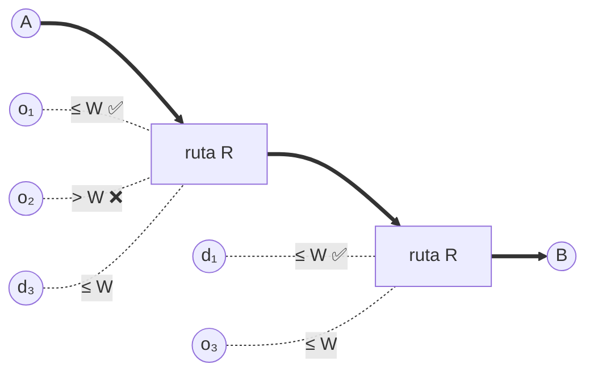

- **Carga 1** (`o₁ → d₁`): ambos extremos dentro del corredor, en sentido A→B → **candidata**.
- **Carga 2** (`o₂ → …`): el origen está fuera del corredor → descartada por C1.
- **Carga 3** (`o₃ → d₃`): ambos extremos dentro del corredor, pero va de B hacia A → descartada por C3.

### 2.3 Por qué este criterio

| Propiedad | Cómo la cumple |
|---|---|
| **Claro y explicable** | "Tu carga está a 8 km de tu ruta y va en tu mismo sentido" |
| **Sigue la ruta real** | El corredor copia cada curva de la polilínea; no incluye áreas lejanas del camino |
| **Independiente de la orientación** | Un viaje norte-sur y uno diagonal de igual longitud reciben el mismo trato |
| **Indexado** | C1 y C2 usan el índice GiST; C3 solo se evalúa sobre lo que ya pasó C1 y C2 |
| **Cubre el carril exacto** | Una carga de A a B cumple trivialmente C1–C3; el dominio le da mayor score |

### 2.4 Qué NO decide el filtro (lo decide el score)

El filtro solo dice **quién califica**. Las medidas que devuelve la query alimentan el score del dominio:

| Medida | Origen | Criterio de score |
|---|---|---|
| `vial(A,o) + vial(o,d) + vial(d,B) − vial(A,B)` | Etapa 2 (ruteo) | **Desvío real**: km extra respecto de ir directo de A a B |
| `vial(A,o) + vial(d,B)` | Etapa 2 (ruteo) | **Km en vacío** |
| `vial(o,d)` | Guardado al publicar la carga | **Km cargado** |
| `recta(A,o) + recta(o,d) + recta(d,B) − recta(A,B)` | Dominio (haversine sobre las coordenadas de la carga) | Desvío **estimado**, solo si la etapa 2 no está disponible |

> El filtro de PostGIS solo decide **quién califica** y devuelve cargas (`list[Load]`). No hace falta que devuelva medidas: los km reales salen de la etapa 2 y el respaldo lo calcula el dominio (ver sección 13.2).
| `posición(d, R) − posición(o, R)` | **Aprovechamiento**: fracción del viaje recorrida con carga |
| Cercanía de `o` a A y de `d` a B | **Carril exacto** (bonificación) |

---

## 3. Datos necesarios

### 3.1 Modelo de datos

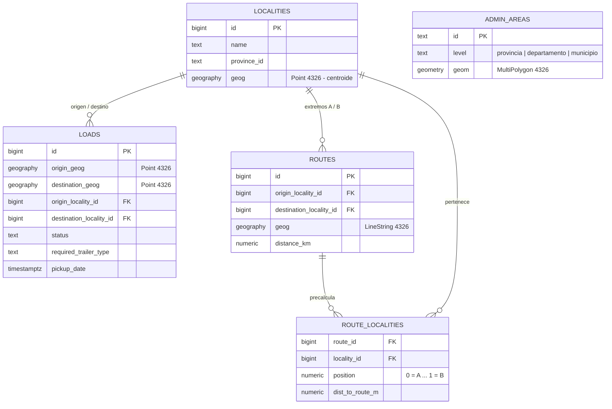

### 3.2 Origen de cada dato

| Dato | Forma | Fuente | ¿Obligatorio? |
|---|---|---|---|
| A y B de la búsqueda | Punto | Localidad elegida o dirección geocodificada que ingresa el transportista | ✅ |
| Origen / destino de cada carga | Punto | Geocodificación de la dirección que carga el dador (Nominatim / Mapbox) | ✅ |
| Ruta A→B | Línea (polilínea) | `microservice-routes`, OSRM o Valhalla | ✅ |
| Localidades | Punto (centroide) | [Georef AR](https://www.argentina.gob.ar/georef/descarga-de-la-base-completa) (INDEC / IGN / BAHRA) | Recomendado (selector de A/B y estrategia E5) |
| Provincias, departamentos, municipios | Polígono | [Georef AR](https://www.argentina.gob.ar/georef/descarga-de-la-base-completa) (GeoJSON) o [IGN](https://atlas.co/data-portals/ign-argentina/) (Shapefile / GeoPackage) | Opcional (filtros por región, visualización) |

> Verificar en la descarga de Georef qué unidades vienen con polígono y cuáles solo con centroide antes de diseñar en base a eso.

### 3.3 Carga inicial

```sql
CREATE EXTENSION IF NOT EXISTS postgis;

ALTER TABLE loads
  ADD COLUMN origin_geog geography(Point, 4326),
  ADD COLUMN destination_geog geography(Point, 4326);

CREATE INDEX ix_loads_origin_geog      ON loads USING GIST (origin_geog);
CREATE INDEX ix_loads_destination_geog ON loads USING GIST (destination_geog);
```

```bash
# Capas oficiales (una sola vez)
ogr2ogr -f PostgreSQL PG:"dbname=smartruck" localidades.geojson -nln localities_raw
ogr2ogr -f PostgreSQL PG:"dbname=smartruck" departamentos.geojson -nln admin_areas_raw
# Alternativa para Shapefile
shp2pgsql -s 4326 -I provincias.shp public.provincias_raw | psql -d smartruck
```

Las columnas `geography` pueden poblarse desde la aplicación al geocodificar, o como columna generada a partir de `lat/lon`. Si el motor rechaza la columna generada, usar un trigger.

---

## 4. Caja de herramientas de PostGIS

| Función / operador | Qué hace | Uso en el filtrado | ¿Usa índice? |
|---|---|---|---|
| `ST_DWithin(a, b, m)` | ¿Están a ≤ m metros? | Corredor (C1, C2), radios | ✅ |
| `ST_LineLocatePoint(línea, p)` | Posición 0..1 de un punto sobre una línea | Sentido del viaje (C3), aprovechamiento | ❌ (sobre `geometry`) |
| `ST_Distance(a, b)` | Distancia exacta | Medidas para el score (no para filtrar) | ❌ |
| `a <-> b` | Distancia para ordenar (KNN) | Localidad más cercana a un punto | ✅ solo en `ORDER BY` |
| `ST_MakeLine(a, b)` | Recta entre dos puntos | Rectángulo rotado (respaldo) | — |
| `ST_Buffer(g, m, estilo)` | Área alrededor de una forma | Rectángulo rotado, visualizar el corredor | — |
| `ST_Intersects(a, b)` | ¿Se tocan / solapan? | Áreas que atraviesa la ruta | ✅ |
| `ST_Contains(área, p)` | ¿El punto está adentro? | Filtro por provincia | ✅ |
| `ST_Touches(a, b)` | ¿Comparten borde? | Unidades limítrofes | ✅ |

---

## 5. Implementación del criterio (estrategia principal: corredor sobre la ruta)

En todos los ejemplos, `:a` y `:b` son puntos `geography` construidos como:

```sql
ST_SetSRID(ST_MakePoint(:lon, :lat), 4326)::geography   -- ¡orden (lon, lat)!
```

### 5.1 Query

```sql
WITH r AS (
  SELECT geog                AS ruta,
         geog::geometry      AS ruta_geom,
         LEAST(GREATEST(:k * distance_km * 1000, :w_min_m), :w_max_m) AS w_m
  FROM routes
  WHERE id = :route_id
)
SELECT l.id,
       ST_Distance(l.origin_geog, r.ruta)                             AS dist_origen_ruta_m,
       ST_Distance(l.destination_geog, r.ruta)                        AS dist_destino_ruta_m,
       ST_Distance(l.origin_geog, :a)                                 AS dist_origen_a_m,
       ST_LineLocatePoint(r.ruta_geom, l.origin_geog::geometry)       AS pos_origen,
       ST_LineLocatePoint(r.ruta_geom, l.destination_geog::geometry)  AS pos_destino
FROM loads l, r
WHERE l.status = 'AVAILABLE'
  AND l.required_trailer_type = ANY(:trailer_types)                          -- filtros duros no geográficos
  AND l.pickup_date BETWEEN :fecha_desde AND :fecha_hasta
  AND ST_DWithin(l.origin_geog, r.ruta, r.w_m)                                -- C1
  AND ST_DWithin(l.destination_geog, r.ruta, r.w_m)                           -- C2
  AND ST_LineLocatePoint(r.ruta_geom, l.origin_geog::geometry)
    < ST_LineLocatePoint(r.ruta_geom, l.destination_geog::geometry);          -- C3
```

> `ST_LineLocatePoint` trabaja sobre `geometry`. En SRID 4326 la fracción es aproximada (grados), suficiente para **ordenar** origen vs. destino. Si se necesita precisión métrica, transformar a una proyección de Argentina (fajas POSGAR) con `ST_Transform`; verificar el SRID correspondiente a la zona.

### 5.2 Secuencia

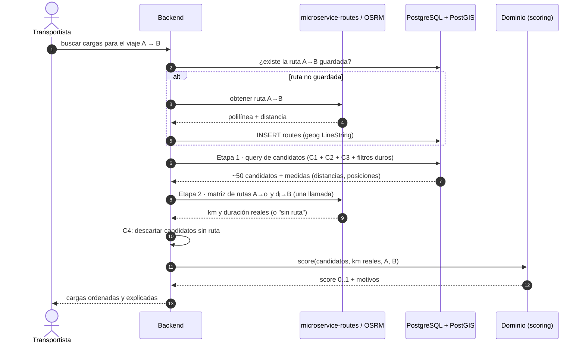

### 5.3 Respaldo sin ruta

Si la ruta no puede obtenerse (servicio caído, par de ciudades sin ruta), se aplica la **elipse de desvío** (E2, sección 6) con los mismos parámetros. El resultado se marca como "estimado" en los motivos.

### 5.4 Etapa 2: ruta real (C4) y desvío vial

#### Por qué hace falta

La etapa 1 mide **en línea recta**. Una carga puede estar a 15 km de la ruta en el mapa y a 80 km por camino:

```
                 río Paraná (sin puente cercano)
   ~~~~~~~~~~~~~~~~~~~~~~~~~~~~~~~~~~~~~~~~~~~~~~~~~~~~~~~~
        ▲ o  (15 km en línea recta de la ruta)
   ~~~~~~~~~~~~~~~~~~~~~~~~~~~~~~~~~~~~~~~~~~~~~~~~~~~~~~~~
   A ●━━━━━━━━━━━━━━━━━━━━ ruta R ━━━━━━━━━━━━━━━━━━━━━● B
           puente ┃
                  ┗━━━━━━ 80 km por camino hasta o ━━━━━┛
```

C1 la acepta (está a 15 km de la ruta en línea recta), pero en la práctica el transportista haría 160 km extra, ida y vuelta, para buscarla.

#### El embudo de dos etapas

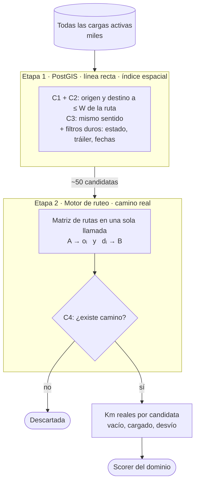

#### Por qué la combinación es segura

La distancia por camino **nunca es menor** que la distancia en línea recta:

```
vial(x, y) ≥ línea_recta(x, y)
```

En consecuencia:

| Caso | Etapa 1 (línea recta) | Etapa 2 (camino real) | Resultado |
|---|---|---|---|
| Carga lejos de la ruta | Descartada | — | ✅ Correcto: por camino también estaría lejos |
| Carga cerca y con camino directo | Pasa | Pasa con desvío bajo | ✅ Candidata con buen score |
| Carga cerca en el mapa pero sin camino práctico (el río) | Pasa | Desvío alto, o sin ruta | ✅ Penalizada por el score o descartada por C4 |

La etapa 1 **nunca descarta una carga válida**; solo puede dejar pasar falsos positivos, y la etapa 2 los corrige. Por eso se puede usar la etapa 1, barata, sobre miles de cargas, y la etapa 2, cara, solo sobre unas decenas.

#### Cálculo del desvío y los km en vacío

```
A ──vacío──► o ══cargado══► d ──vacío──► B

km vacíos  = vial(A, o) + vial(d, B)            ← etapa 2, en cada búsqueda
km cargado = vial(o, d)                          ← se calcula UNA vez al publicar la carga
desvío     = vial(A, o) + vial(o, d) + vial(d, B) − vial(A, B)
vial(A, B) = distancia de la ruta R              ← ya disponible al obtener la ruta
```

En cada búsqueda solo se calculan los tramos **A → oᵢ** y **dᵢ → B**.

#### Una sola llamada al motor de ruteo

El servicio *Table* de OSRM calcula una **matriz** de distancias y duraciones entre varios puntos en una sola llamada:

```
coordenadas:  [A, d₁, d₂, …, dₙ, o₁, o₂, …, oₙ, B]
sources:      A, d₁ … dₙ          (filas)
destinations: o₁ … oₙ, B          (columnas)

            o₁     o₂    …    oₙ      B
   A     │ A→o₁   A→o₂   …   A→oₙ  │  ·
   d₁    │  ·      ·     …    ·    │ d₁→B
   d₂    │  ·      ·     …    ·    │ d₂→B
   …     │                         │  …
   dₙ    │  ·      ·     …    ·    │ dₙ→B
```

```
GET /table/v1/driving/{A};{d₁};…;{dₙ};{o₁};…;{oₙ};{B}
    ?sources=0;1;…;n
    &destinations=n+1;…;2n+1
    &annotations=distance,duration
```

De la matriz solo se usan la **primera fila** (A → oᵢ) y la **última columna** (dᵢ → B). Si OSRM no encuentra camino entre dos puntos, la celda viene vacía (`null`) y la carga se descarta por **C4**.

#### Secuencia de la etapa 2

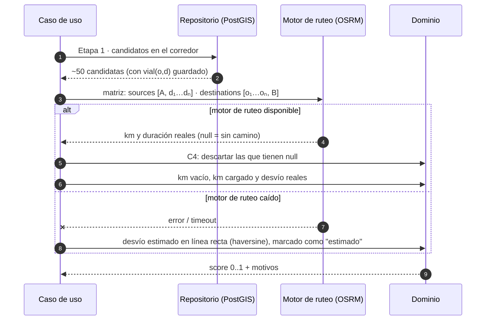

#### Tiempos (duración) además de distancias

La misma matriz devuelve **duraciones**, que habilitan filtros de factibilidad temporal sin otra llamada:

- **¿Llega al retiro?** salida desde A + duración(A → o) ≤ fin de la ventana de retiro.
- **¿Llega a tiempo a destino?** retiro + duración(o → d) ≤ fecha límite de entrega.

#### Requisitos sobre `microservice-routes`

Hoy `microservice-routes` resuelve rutas **entre ciudades**. La etapa 2 necesita rutas **entre puntos** y en **matriz**. Hay dos opciones:

| Opción | Ventaja | Costo |
|---|---|---|
| Extender `microservice-routes` con un endpoint de matriz entre coordenadas | Un único punto de acceso al ruteo; reutiliza su caché | Desarrollo en el microservicio |
| Consumir OSRM directamente desde el backend, mediante un adaptador del puerto `RouteMatrixProvider` | Más simple y directo | Un servicio más del cual depender |

En ambos casos el dominio no cambia: depende del puerto, no del proveedor.

---

## 6. Estrategias alternativas (comparadas con el criterio principal)

### E1 · Radio en ambos extremos (carril exacto)

```sql
SELECT l.id
FROM loads l
WHERE l.status = 'AVAILABLE'
  AND ST_DWithin(l.origin_geog, :a, :radio_m)
  AND ST_DWithin(l.destination_geog, :b, :radio_m);
```

| ✅ | ❌ |
|---|---|
| Lo más simple; no necesita ruta | Solo encuentra cargas de "cerca de A" a "cerca de B"; ignora todo lo que está en el camino. Es un subconjunto del criterio principal |

### E2 · Elipse de desvío (respaldo sin ruta)

Una carga es candidata si pasar por su origen y su destino no alarga el viaje más de un α %. El conjunto de puntos que cumple eso es una **elipse con focos en A y B**.

```sql
WITH q AS (SELECT ST_Distance(:a, :b) AS d_ab)
SELECT l.id
FROM loads l, q
WHERE l.status = 'AVAILABLE'
  -- prefiltro indexado (la desigualdad de la elipse no usa índice)
  AND ST_DWithin(l.origin_geog, :a, (1 + :alpha) * q.d_ab)
  AND ST_DWithin(l.destination_geog, :a, (1 + :alpha) * q.d_ab)
  -- elipse exacta para origen y destino
  AND ST_Distance(:a, l.origin_geog) + ST_Distance(l.origin_geog, :b)           <= (1 + :alpha) * q.d_ab
  AND ST_Distance(:a, l.destination_geog) + ST_Distance(l.destination_geog, :b) <= (1 + :alpha) * q.d_ab
  -- sentido: el origen más cerca de A que el destino
  AND ST_Distance(:a, l.origin_geog) < ST_Distance(:a, l.destination_geog);
```

| ✅ | ❌ |
|---|---|
| No necesita la ruta; independiente de la orientación; α es un parámetro de negocio claro | Asume línea recta: falla con ríos, montañas o rutas muy curvas |

### E3 · Rectángulo rotado sobre A→B

```sql
WITH r AS (
  SELECT ST_Buffer(ST_MakeLine(:a::geometry, :b::geometry)::geography,
                   :ancho_m, 'endcap=square') AS area
)
SELECT l.id
FROM loads l, r
WHERE l.status = 'AVAILABLE'
  AND ST_Intersects(r.area, l.origin_geog)
  AND ST_Intersects(r.area, l.destination_geog)
  AND ST_Distance(:a, l.origin_geog) < ST_Distance(:a, l.destination_geog);
```

| ✅ | ❌ |
|---|---|
| Intuitivo; rota según el rumbo A→B, así que no depende de la orientación | No sigue curvas. El criterio principal es este mismo rectángulo aplicado a cada tramo de la ruta |

> Un rectángulo **sin rotar** (alineado a los ejes) no es recomendable: en un viaje diagonal de 700 km admite cargas a ~350 km de la ruta, contra 70 km en uno norte-sur con el mismo margen.

### E5 · Localidades precalculadas sobre la ruta (optimización del criterio principal)

Mismo criterio (C1–C3), pero con la geometría resuelta **una vez por ruta** y aplicada a localidades. En cada búsqueda solo hay joins.

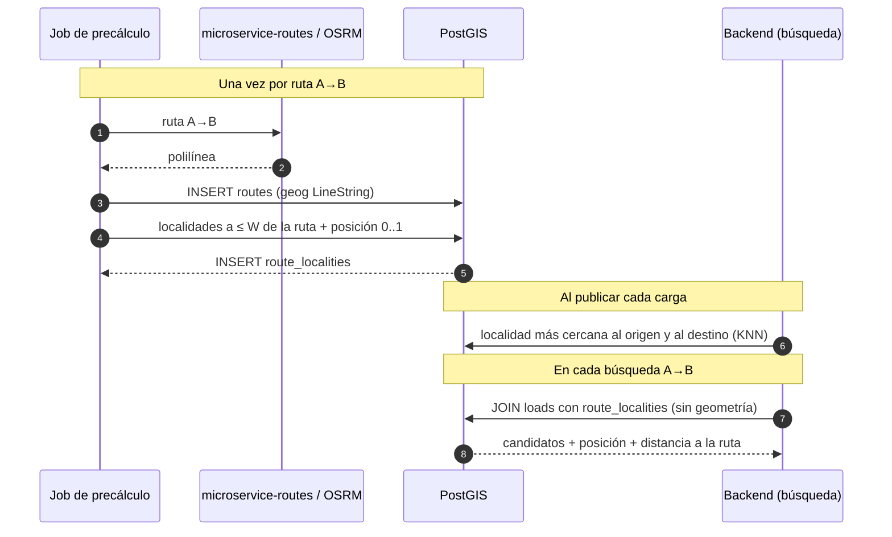

```sql
-- Precálculo (una vez por ruta)
INSERT INTO route_localities (route_id, locality_id, position, dist_to_route_m)
SELECT r.id, loc.id,
       ST_LineLocatePoint(r.geog::geometry, loc.geog::geometry),
       ST_Distance(loc.geog, r.geog)
FROM routes r
JOIN localities loc ON ST_DWithin(loc.geog, r.geog, :w_m)
WHERE r.id = :route_id;

-- Asignar localidad a una carga (al publicarla)
SELECT id FROM localities ORDER BY geog <-> :origen LIMIT 1;

-- Búsqueda (cada pedido): C1 y C2 por pertenencia, C3 por posición
SELECT l.*, ro.position AS pos_origen, rd.position AS pos_destino,
       ro.dist_to_route_m + rd.dist_to_route_m AS desvio_aprox_m
FROM loads l
JOIN route_localities ro ON ro.route_id = :route_id AND ro.locality_id = l.origin_locality_id
JOIN route_localities rd ON rd.route_id = :route_id AND rd.locality_id = l.destination_locality_id
WHERE l.status = 'AVAILABLE'
  AND ro.position < rd.position;
```

| ✅ | ❌ |
|---|---|
| Muy rápido; explicable ("carga en San Nicolás, sobre tu ruta, a 4 km"); encaja con rutas ciudad-a-ciudad | Precisión limitada a la localidad; requiere precálculo y la tabla de localidades |

### E6 · Polígonos administrativos y limítrofes (complementario)

```sql
-- Departamentos limítrofes al de origen
SELECT n.id
FROM admin_areas d
JOIN admin_areas n ON n.level = d.level AND ST_Touches(d.geom, n.geom)
WHERE d.id = :departamento_origen;

-- Departamentos que atraviesa la ruta
SELECT d.id
FROM admin_areas d, routes r
WHERE r.id = :route_id AND d.level = 'departamento'
  AND ST_Intersects(d.geom, r.geog::geometry);

-- Cargas con origen en una provincia
SELECT l.id FROM loads l JOIN admin_areas p ON ST_Contains(p.geom, l.origin_geog::geometry)
WHERE p.id = :provincia;
```

| ✅ | ❌ |
|---|---|
| Natural para el usuario ("cargas en Córdoba"); bueno para filtros por región y visualización | **Tamaños muy desiguales** (partidos del AMBA de pocos km² vs. departamentos patagónicos de decenas de miles): "limítrofe" no equivale a una distancia consistente. Que dos polígonos se toquen no implica conexión vial (ríos sin puente, montaña). Pierde el gradiente de distancia |

> Recomendación: usar polígonos para **filtros por región y para el mapa**, no como criterio principal de cercanía.

---

## 7. Comparativa

| Estrategia | Necesita ruta | Encuentra cargas "en el camino" | Precisión | Rendimiento por búsqueda | Complejidad |
|---|---|---|---|---|---|
| **Criterio principal · Corredor (C1–C3)** | Sí | ✅ | 🟢 | 🟡 | 🟡 Media |
| E1 · Radio en extremos | No | ❌ solo carril exacto | 🟢 | 🟢 | 🟢 Baja |
| E2 · Elipse | No | ✅ | 🟡 línea recta | 🟡 | 🟢 Baja |
| E3 · Rectángulo rotado | No | ✅ | 🟡 sin curvas | 🟢 | 🟢 Baja |
| E5 · Localidades precalculadas | Sí | ✅ | 🟡 por localidad | 🟢 joins | 🟡 Media |
| E6 · Polígonos | Opcional | ⚠️ | 🔴 como cercanía | 🟢 | 🟡 Media |

---

## 8. Recomendación

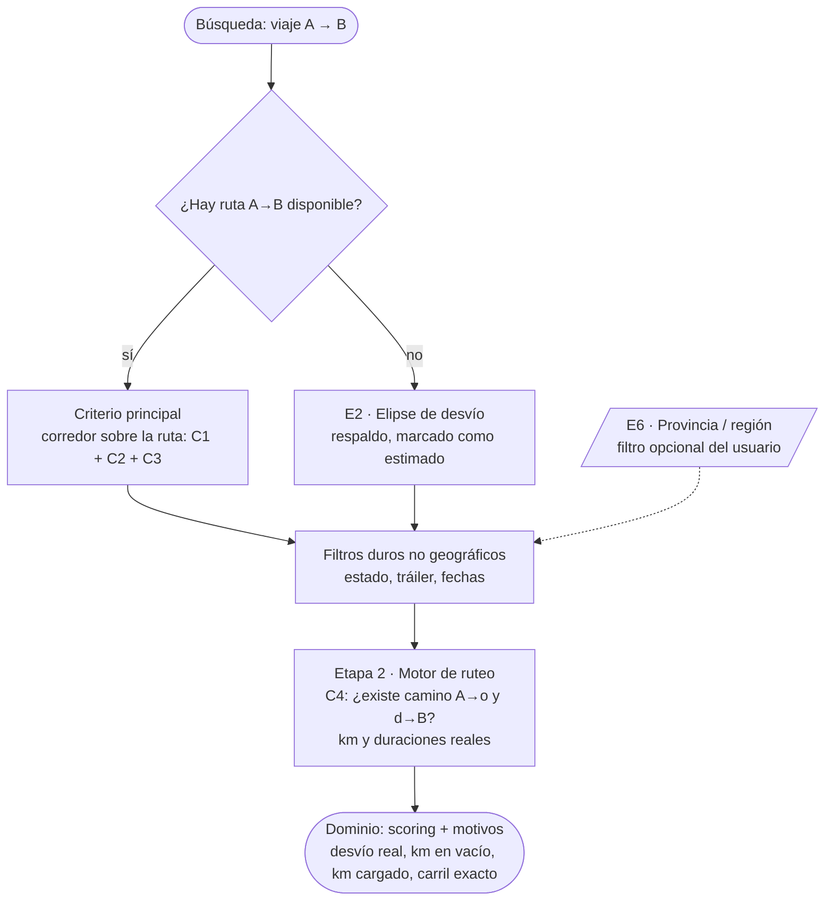

1. **MVP:** el **criterio principal** en dos etapas: corredor sobre la ruta con C1, C2 y C3 en PostGIS (ancho `W` proporcional y acotado), y C4 + km reales con el motor de ruteo sobre los candidatos. **E2** como respaldo cuando no se pueda obtener la ruta.
2. **Optimización** (cuando el volumen lo justifique): implementar el mismo criterio con **E5**, precalculando las localidades de cada ruta frecuente.
3. **Polígonos (E6):** solo como filtro opcional por región y para visualización.
4. Las **medidas** que devuelve la query son la entrada del score del dominio (sección 2.4).

---

## 9. Evolución futura: posición GPS del camión

Fuera de alcance en esta etapa. Cuando se incorpore:

- **Nuevo modo de búsqueda "desde mi posición":** candidatos con `ST_DWithin(origin_geog, :posicion, :radio_m)` ordenados con `origin_geog <-> :posicion`.
- **Km en vacío reales:** desde la posición reportada en lugar de desde el A declarado.
- **Matcheo inverso proactivo:** al publicarse una carga, buscar camiones cercanos a su origen.
- **Dato nuevo:** tabla `truck_positions (truck_id, geog Point, reported_at)` con índice GiST.

El criterio principal (C1–C3) no cambia: A pasa a poder ser la posición actual del camión.

---

## 10. Trampas frecuentes

| Trampa | Consecuencia | Cómo evitarla |
|---|---|---|
| `ST_MakePoint(lat, lon)` | Puntos en el océano o en otro continente | El orden es **(lon, lat)** |
| Usar `geometry` en SRID 4326 para distancias | Resultados en **grados**, no metros | Usar `geography`, o transformar a una proyección métrica |
| `ST_Distance(...) < X` en el `WHERE` | No usa el índice: escaneo completo | Filtrar con `ST_DWithin` |
| `<->` fuera de `ORDER BY` | No usa el índice | Usarlo solo para ordenar |
| Rectángulo alineado a los ejes | Depende de la dirección del viaje | Rotarlo (E3) o usar el corredor (criterio principal) |
| Imagen `postgres:*-alpine` | No incluye la extensión PostGIS | Usar `postgis/postgis:<versión>` en desarrollo y tests |
| Construir figuras en grados y rotarlas | Deformación (1° de longitud ≈ 0,83 × 1° de latitud a 34° S) | Operar en metros (`geography` o SRID proyectado) |
| Ancho de corredor fijo para todo viaje | Demasiado estrecho en viajes largos, demasiado ancho en cortos | `W` proporcional y acotado (sección 2.1) |
| Asumir que "cerca en línea recta" implica "se puede llegar" | Cargas del otro lado de un río o una montaña, con desvíos reales enormes | Etapa 2 con motor de ruteo: C4 + km reales (sección 5.4) |
| Calcular rutas reales contra todas las cargas | Miles de llamadas al motor de ruteo por búsqueda | Ruteo solo sobre los candidatos de la etapa 1, en una sola llamada de matriz |

---

## 11. ¿Qué se gana con PostGIS? Beneficio frente a no usarlo

### 11.1 El problema sin índice espacial

Pregunta: *"¿qué cargas tienen el origen a ≤ 30 km de la ruta Rosario → Córdoba?"*

Sin soporte espacial, la base no puede responder eso por sí sola. Hay que traer **todas** las cargas activas y, para cada una, calcular la distancia a **cada tramo** de la polilínea (una ruta real tiene cientos o miles de vértices):

```
costo ≈ N cargas × S segmentos de la ruta   (en cada búsqueda, en Python)
```

Además, todas las filas viajan de la base a la aplicación aunque el 99 % se descarte.

### 11.2 Cómo lo resuelve PostGIS: índice espacial R-tree (sobre GiST)

El índice **no guarda las formas, guarda sus cajas** (*bounding boxes*), organizadas en una jerarquía de cajas que contienen cajas:

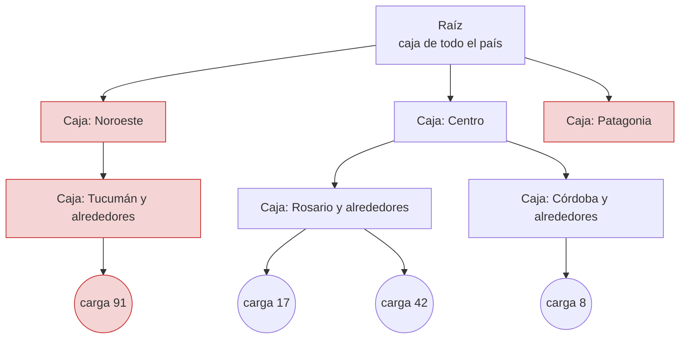

*En rojo: ramas que el índice descarta sin mirarlas, porque su caja no toca la caja del corredor de búsqueda.*

Cada consulta se resuelve en **dos fases**, y `ST_DWithin` las hace automáticamente:

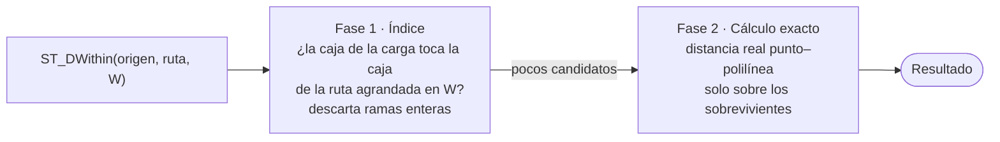

Resultado: el costo deja de crecer con el total de cargas del país y pasa a depender de **cuántas cargas hay cerca de la ruta**. Y el filtrado ocurre dentro de la base: solo viajan a la aplicación los candidatos.

> La "caja" que se pensó originalmente como filtro (rectángulo sobre A→B) es, en esencia, lo que hace la **fase 1** del índice. PostGIS la aplica sobre cada tramo de la ruta y la complementa con el cálculo exacto de la fase 2.

### 11.3 ¿Es "clustering"? Tres conceptos distintos

| Concepto | Qué es | ¿Lo necesita el MVP? |
|---|---|---|
| **Índice espacial (GiST / R-tree)** | La jerarquía de cajas de la sección 11.2. **Es el beneficio principal** | ✅ Sí (`CREATE INDEX … USING GIST`) |
| **`CLUSTER` físico sobre el índice** | Reordena las filas **en disco** según el índice, para que cargas cercanas en el mapa queden cercanas en disco y se lean juntas | ❌ Solo con mucho volumen. Es una operación puntual que hay que repetir periódicamente |
| **Clustering analítico** (`ST_ClusterDBSCAN`, `ST_ClusterKMeans`) | Agrupa cargas en zonas ("polos de demanda") | ❌ No para filtrar. Útil para análisis y mapas de calor (11.5) |

### 11.4 Comparativa: con y sin PostGIS

| Enfoque | Radio alrededor de un punto | Corredor sobre una ruta | Sentido sobre la ruta | Polígonos (provincias) | Rendimiento | Complejidad |
|---|---|---|---|---|---|---|
| **Traer todo y calcular en Python** | ✅ | ✅ (a mano) | ✅ (a mano) | ✅ (con Shapely) | 🔴 crece con el total de cargas | 🟡 código geométrico propio |
| **Postgres sin PostGIS**: `lat BETWEEN … AND lng BETWEEN …` con índice B-tree | ⚠️ solo una caja | ❌ | ❌ | ❌ | 🟡 un B-tree solo acota bien una dimensión | 🟢 |
| **Postgres + `earthdistance`** | ✅ | ❌ | ❌ | ❌ | 🟢 | 🟢 |
| **PostgreSQL + PostGIS** | ✅ | ✅ `ST_DWithin` | ✅ `ST_LineLocatePoint` | ✅ `ST_Contains` | 🟢 índice R-tree | 🟡 una extensión y una librería |

**Conclusión honesta:** si el único criterio fuese "radio alrededor de un punto", PostGIS sería prescindible. Se justifica porque el criterio de Smartruck usa **líneas** (la ruta), **sentido sobre la línea** y, opcionalmente, **polígonos**. Ahí las alternativas no llegan o obligan a reimplementar geometría a mano.

### 11.5 Cómo sacarle más jugo (además del filtro)

| Uso | Función | Valor para Smartruck |
|---|---|---|
| **Mostrar el corredor al usuario** | `ST_Buffer(ruta, W)` + `ST_AsGeoJSON` | Explicabilidad visual: "estas cargas están dentro de tu corredor" |
| **Enviar geometrías al frontend** | `ST_AsGeoJSON` | El mapa del front consume GeoJSON directo, sin conversiones |
| **Aligerar polilíneas** | `ST_Simplify` / `ST_SimplifyPreserveTopology` | Rutas más livianas para guardar, enviar y comparar |
| **Zonas de demanda** | `ST_ClusterDBSCAN` | Detectar polos de carga, sugerir corredores frecuentes |
| **Filtros por región** | `ST_Contains` con provincias | "Cargas con origen en Córdoba" |
| **Validación de datos** | `ST_IsValid`, restricciones de SRID en el tipo de columna | Evita coordenadas invertidas o geometrías rotas |
| **Mapas a escala** (futuro) | `ST_AsMVT` (vector tiles) | Mapas de calor con miles de cargas sin saturar el front |

---

## 12. Verlo gráficamente

Para entender y depurar el filtrado conviene **ver** ruta, corredor y cargas sobre un mapa.

| Herramienta | Cómo se usa | Comentario |
|---|---|---|
| **pgAdmin** (ya está en el `docker-compose` del backend) | Ejecutar la consulta y abrir el visor de geometrías sobre la columna resultante | Lo más rápido: no requiere instalar nada |
| **QGIS** (open source) | *Capa → Añadir capa PostGIS*, o *DB Manager → SQL → Cargar como nueva capa* | Lo más completo: estilos por tipo, varias capas, mapa base de OpenStreetMap |
| **geojson.io** | Pegar el resultado de `ST_AsGeoJSON` | Útil para compartir un caso puntual |

Consulta de depuración que devuelve **todo junto**, con una columna `tipo` para darle un estilo distinto a cada cosa:

```sql
WITH r AS (SELECT geog, :w_m AS w FROM routes WHERE id = :route_id)
SELECT 'ruta'     AS tipo, NULL::bigint AS load_id, r.geog::geometry                AS geom FROM r
UNION ALL
SELECT 'corredor',          NULL,                  ST_Buffer(r.geog, r.w)::geometry         FROM r
UNION ALL
SELECT CASE WHEN ST_DWithin(l.origin_geog, r.geog, r.w) THEN 'origen dentro' ELSE 'origen fuera' END,
       l.id, l.origin_geog::geometry
FROM loads l, r
UNION ALL
SELECT CASE WHEN ST_DWithin(l.destination_geog, r.geog, r.w) THEN 'destino dentro' ELSE 'destino fuera' END,
       l.id, l.destination_geog::geometry
FROM loads l, r;
```

Lo que se ve:

```
            ░░░░░░░░░░░░ corredor (ancho W) ░░░░░░░░░░░░
   A ●━━━━━━━━━━━━━━━━━━━━━━ ruta ━━━━━━━━━━━━━━━━━━━━━━━● B
            ░░  ▲ o₁ ░░░░░░░░░░░░░░░░░░░░ ■ d₁  ░░░░░░░
                                  ▲ o₂ (fuera)
   ▲ origen   ■ destino   ░ corredor   ━ ruta
```

---

## 13. Integración en la arquitectura hexagonal del backend

### 13.1 Regla: el dominio no conoce PostGIS

PostGIS es un **detalle de infraestructura**. El dominio habla de cargas, rutas y coordenadas; nunca de `geography`, `WKBElement`, SQL ni funciones `ST_*`.

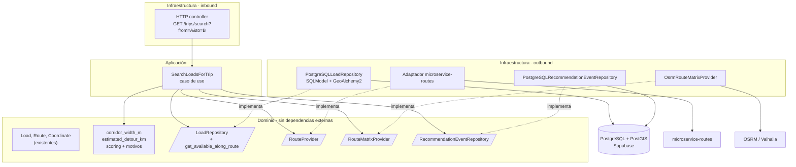

| Capa | Qué contiene | Qué NO contiene |
|---|---|---|
| **Dominio** | `Load`, `Route`, `Coordinate`, regla del ancho `W`, desvío estimado, scoring, puertos | Tipos de GeoAlchemy2, SQL, funciones `ST_*` |
| **Aplicación** | Orquestación: ruta → orientarla → `W` → cargas a lo largo de la ruta → C4 y km reales → score → eventos | Detalles de cómo se filtra |
| **Infraestructura** | Columnas `Geography`, la consulta espacial dentro del repositorio, adaptadores HTTP | Reglas de negocio (el ancho `W` llega calculado) |

### 13.2 Por qué es un método de `LoadRepository` (y no un repositorio ni una consulta aparte)

El patrón Repository expone una **colección de agregados** con lenguaje de colección (`get_all…`, `get_by…`). La búsqueda del corredor es exactamente eso:

> "Dame todas las cargas disponibles que están a lo largo de esta ruta."

- El agregado es **`Load`** y el método devuelve **`list[Load]`**. Por lo tanto pertenece a **`LoadRepository`**, igual que `get_all_by_required_trailer_type` o `get_available`.
- Un "candidato" **no es un agregado**: no tiene identidad ni se persiste. Por eso no tiene repositorio propio.
- Los repositorios se asocian a **agregados**, no a tablas. Las tablas son un detalle de infraestructura (por ejemplo, `route_localities` nunca tendría repositorio propio).
- El repositorio **no necesita devolver medidas** (distancia a la ruta, posición):
  - los km que usa el score (vacío, cargado y desvío) salen de la **etapa 2** (`RouteMatrixProvider`);
  - el desvío **estimado** de respaldo lo calcula el **dominio** con haversine sobre las coordenadas que la carga ya tiene.

| Puerto | Tipo | Agregado / responsabilidad | Cambio |
|---|---|---|---|
| `LoadRepository` | Repositorio | `Load` | **+ `get_available_along_route(...)`** |
| `RouteProvider` | Gateway | Obtener la ruta A→B (`microservice-routes`) | Existente o nuevo adaptador |
| `RouteMatrixProvider` | Gateway | Km y duraciones reales (OSRM). No persiste nada, por eso no es un repositorio | Nuevo |
| `RecommendationEventRepository` | Repositorio | `RecommendationEvent` (entidad que se guarda) | Nuevo |

### 13.3 Dominio

El sentido de la ruta ya está resuelto en el dominio existente. `routes` usa una **clave canónica simétrica** (A→B y B→A se guardan una sola vez), así que la polilínea puede venir en el sentido contrario al buscado. `Route.oriented_to(origen, destino)` la devuelve orientada (y la invierte si hace falta). El caso de uso la orienta **antes** de pasarla al repositorio, y así C3 siempre se evalúa en el sentido A→B.

```python
# domain/repositories/load_repository.py  (puerto existente, se agrega un método)
class LoadRepository(ABC):
    # ... métodos existentes ...

    @abstractmethod
    def get_available_along_route(
        self,
        route: Route,                     # ya orientada A → B
        corridor_width_m: float,
        trailer_types: Sequence[TrailerType],
    ) -> list[Load]: ...
```

```python
# domain/gateways/route_matrix_provider.py
@dataclass(frozen=True, slots=True)
class RoadLeg:
    distance_m: float
    duration_s: float


class RouteMatrixProvider(ABC):
    @abstractmethod
    def legs(
        self, sources: Sequence[Coordinate], destinations: Sequence[Coordinate]
    ) -> list[list[RoadLeg | None]]: ...   # None = no existe camino (C4)
```

Reglas de negocio puras, testeables sin base de datos:

```python
# domain/matching/corridor.py
def corridor_width_m(trip_distance_km: float, config: CorridorConfig) -> float:
    width_km = config.ratio * trip_distance_km
    return min(max(width_km, config.min_km), config.max_km) * 1000


def estimated_detour_km(a: Coordinate, o: Coordinate, d: Coordinate, b: Coordinate) -> float:
    # Respaldo cuando el motor de ruteo no está disponible (línea recta)
    return haversine_km(a, o) + haversine_km(o, d) + haversine_km(d, b) - haversine_km(a, b)
```

### 13.4 Infraestructura: columnas espaciales con SQLModel + GeoAlchemy2

[GeoAlchemy2](https://github.com/geoalchemy/geoalchemy2) agrega los tipos `Geometry` / `Geography` y las funciones `ST_*` a SQLAlchemy (y por lo tanto a SQLModel). Se declaran con `sa_column`, igual que hoy se declara la columna JSONB de `route_coordinates`:

```python
# infrastructure/outbound/persistence/models/load.py
from geoalchemy2 import Geography
from sqlalchemy import Column

class LoadRecord(SQLModel, table=True):
    __tablename__ = "loads"
    # ... columnas existentes (origin_latitude, origin_longitude, ...) ...
    origin_geog: Any = Field(
        default=None, sa_column=Column(Geography(geometry_type="POINT", srid=4326))
    )
    destination_geog: Any = Field(
        default=None, sa_column=Column(Geography(geometry_type="POINT", srid=4326))
    )
```

- `Geography` crea el **índice GiST automáticamente** (`spatial_index=True` por defecto).
- Las columnas `lat/lon` existentes se mantienen. Las `geog` se completan en el mapeo dominio → record que ya existe (`_update_record_from_load`):

```python
from geoalchemy2 import WKTElement

def _to_point(latitude: float, longitude: float) -> WKTElement:
    return WKTElement(f"POINT({longitude} {latitude})", srid=4326)   # orden (lon, lat)

# dentro de _update_record_from_load(record, load):
record.origin_geog = _to_point(load.origin_latitude, load.origin_longitude)
record.destination_geog = _to_point(load.destination_latitude, load.destination_longitude)
```

**La tabla `routes` no necesita columna espacial para el MVP.** La ruta llega al repositorio como objeto de dominio (`Route.coordinates`) y el adaptador arma la línea en la propia consulta. Una columna `geog` en `routes` solo hace falta más adelante: para precalcular localidades (E5) o para visualizar rutas guardadas.

### 13.5 Infraestructura: el método del repositorio con el ORM

Se implementa en el **`PostgreSQLLoadRepository` existente**, con el mismo `select` de SQLModel que usan los demás métodos. Las funciones espaciales se invocan con `func`:

```python
# infrastructure/outbound/persistence/repositories/postgres_load_repository.py
from geoalchemy2 import Geometry
from sqlalchemy import cast, func
from sqlmodel import select

class PostgreSQLLoadRepository(PostgreSQLRepository, LoadRepository):
    # ... métodos existentes ...

    def get_available_along_route(self, route, corridor_width_m, trailer_types):
        line_wkt = self._to_linestring_wkt(route.coordinates)
        route_geog = func.ST_GeogFromText(line_wkt)
        route_geom = func.ST_GeomFromText(line_wkt, 4326)
        origin_position = func.ST_LineLocatePoint(route_geom, cast(LoadRecord.origin_geog, Geometry))
        destination_position = func.ST_LineLocatePoint(route_geom, cast(LoadRecord.destination_geog, Geometry))

        statement = select(LoadRecord).where(
            # misma condición de disponibilidad que usa get_available()
            LoadRecord.required_trailer_type.in_([t.value for t in trailer_types]),
            func.ST_DWithin(LoadRecord.origin_geog, route_geog, corridor_width_m),        # C1
            func.ST_DWithin(LoadRecord.destination_geog, route_geog, corridor_width_m),   # C2
            origin_position < destination_position,                                        # C3
        )
        records = self._session.exec(statement).all()
        return [self._to_domain(record, ...) for record in records]   # mapeo existente

    @staticmethod
    def _to_linestring_wkt(coordinates: tuple[Coordinate, ...]) -> str:
        points = ", ".join(f"{c.longitude} {c.latitude}" for c in coordinates)   # (lon, lat)
        return f"LINESTRING({points})"
```

- Es **una consulta más** del repositorio: recibe objetos de dominio y devuelve `list[Load]`. Si no hay resultados, devuelve una lista vacía, sin excepciones.
- **No decide nada**: el ancho `W` llega calculado y la ruta llega orientada.
- Si las polilíneas son muy largas (miles de vértices), se pueden aligerar con `ST_Simplify` dentro de la consulta o al guardarlas.

### 13.6 Secuencia completa por capas

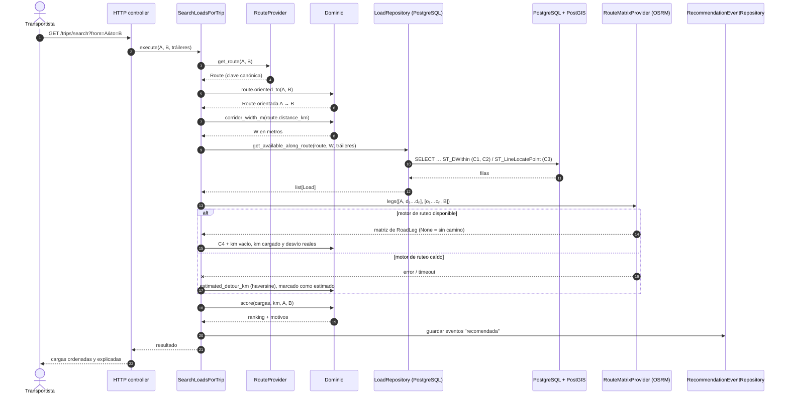

### 13.7 Migraciones (Alembic) y Supabase

1. **Migración manual inicial** que habilite PostGIS antes de cualquier columna espacial. En Supabase se recomienda instalarlo en un **schema dedicado, no en `public`**: PostGIS crea la tabla `spatial_ref_sys`, que en `public` quedaría expuesta por la Data API.

   ```python
   op.execute("CREATE EXTENSION IF NOT EXISTS postgis WITH SCHEMA extensions")
   ```

   Verificar con `SHOW search_path;` en Supabase Test que ese schema esté incluido, porque GeoAlchemy2 genera los tipos sin calificar (`geography(POINT,4326)`).
2. **Configurar los helpers de GeoAlchemy2 en `migrations/env.py`.** El backend genera migraciones con autogenerate (`auto_migrate.py`). Sin los helpers, el script generado **omite los imports de `geoalchemy2`** y **crea dos veces el índice espacial**, con lo que la migración falla:

   ```python
   from geoalchemy2 import alembic_helpers

   context.configure(
       # ...
       include_object=alembic_helpers.include_object,
       process_revision_directives=alembic_helpers.writer,
       render_item=alembic_helpers.render_item,
   )
   ```

3. **Imagen local:** `postgis/postgis:16-3.4` en el `docker-compose` de desarrollo **y de tests**, porque `postgres:16-alpine` no incluye la extensión.
4. **Datos existentes:** una migración de datos que complete `origin_geog` y `destination_geog` desde las columnas `lat/lon` actuales.
5. **RLS:** habilitar Row Level Security en las tablas nuevas (`recommendation_events`), siguiendo la convención del proyecto.

### 13.8 Estrategia de pruebas por capa

| Capa | Tipo de prueba | Qué se prueba | Base de datos |
|---|---|---|---|
| Dominio | Unitaria | `corridor_width_m`, `estimated_detour_km`, `Route.oriented_to`, scoring, motivos | No |
| Aplicación | Unitaria con dobles | Orquestación de `SearchLoadsForTrip`, incluido el respaldo sin motor de ruteo | No |
| `PostgreSQLLoadRepository.get_available_along_route` | Integración | C1, C2 y C3 con datos reales: carga dentro, fuera y en sentido contrario | **PostGIS real** (no mockear: es justamente lo que se quiere probar) |
| End-to-end | Aceptación (Gherkin) | "Dado un viaje Rosario → Córdoba y una carga Carcarañá → Villa María, cuando busco, entonces aparece como candidata" | PostGIS real + `RouteProvider` y `RouteMatrixProvider` falsos |

### 13.9 Dependencias nuevas

| Paquete | Licencia | Para qué |
|---|---|---|
| `geoalchemy2` | MIT | Tipos `Geography` / `Geometry`, funciones `ST_*`, helpers de Alembic |
| `shapely` (opcional) | BSD | Manipular geometrías en Python (`to_shape` / `from_shape`), solo si hace falta fuera de la base |

---

## 14. Fuentes

**PostGIS**
- [Workshop PostGIS – Spatial Indexing](http://postgis.net/workshops/postgis-intro/indexing.html)
- [Workshop PostGIS – Clustering on Indices](https://postgis.net/workshops/postgis-intro/clusterindex.html)
- [PostGIS FAQ – ¿Cómo uso índices espaciales?](https://postgis.net/documentation/faq/spatial-indexes/)
- [Workshop PostGIS – Nearest-Neighbour Searching](https://postgis.net/workshops/postgis-intro/knn.html)
- [ST_DWithin](https://postgis.net/docs/manual-3.4/ST_DWithin.html)
- [Operador KNN `<->`](https://postgis.net/docs/geometry_distance_knn.html)

**Datos geográficos de Argentina**
- [Georef AR – descarga de la base completa](https://www.argentina.gob.ar/georef/descarga-de-la-base-completa)
- [Georef – normalización de unidades territoriales](https://www.argentina.gob.ar/georef/normalizacion-de-unidades-territoriales)
- [Dataset Georef en datos.gob.ar](https://www.datos.gob.ar/dataset/jgm-servicio-normalizacion-datos-geograficos)
- [IGN Argentina – capas SIG](https://atlas.co/data-portals/ign-argentina/)

**Importación**
- [ogr2ogr (manual)](https://www.mankier.com/1/ogr2ogr)
- [Importar y exportar en PostGIS (manual QGIS)](https://docs.qgis.org/3.16/pt_BR/docs/training_manual/spatial_databases/import_export.html)

**Ruteo (para obtener la polilínea A→B)**
- [OSRM Table / Route API](https://blog.afi.io/blog/osrm-table-api-free-and-open-source-distance-matrix-api/)
- [Valhalla](https://github.com/Valhalla/valhalla)

**Integración con el ORM**
- [GeoAlchemy2 – repositorio y documentación](https://github.com/geoalchemy/geoalchemy2)
- [GeoAlchemy2 – uso con Alembic (helpers de autogenerate)](https://github.com/geoalchemy/geoalchemy2/blob/main/doc/alembic.rst)
- [GeoAlchemy2 – tipos (`Geography`)](https://github.com/geoalchemy/geoalchemy2/blob/main/doc/types.rst)

**Visualización**
- [Conectar QGIS a PostGIS (UW–Madison)](https://scdm.geography.wisc.edu/2020/12/08/spatial-database-connect-to-postgresql-postgis-through-qgis)

**Conceptos de diseño espacial**
- [ByteByteGo – Proximity Service (geohash, quadtree)](https://blog.bytebytego.com/p/proximity-service)
- [Uber H3](https://uber.com/blog/h3/)
