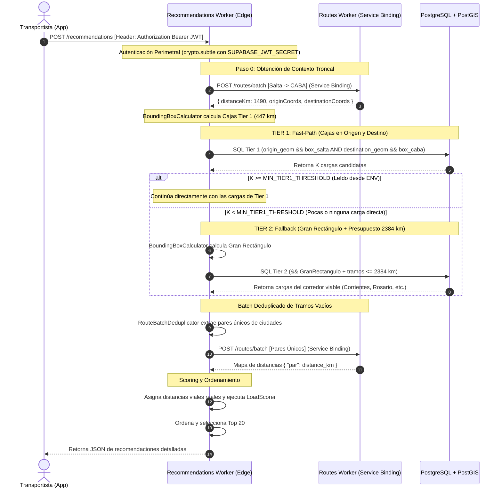
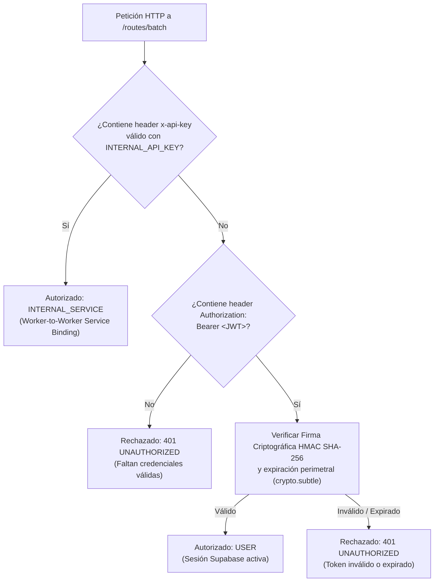
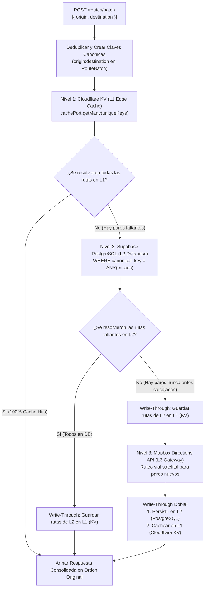

# Plan Maestro Definitivo: Two-Tier Freight Matching con Batch de Rutas (SmarTruck)

Este documento es el manual técnico integral, exhaustivo y definitivo para el motor de recomendación inteligente de cargas de **SmarTruck**. Combina **PostgreSQL + PostGIS** en base de datos, un **Recommendations Worker en TypeScript** bajo **Arquitectura Hexagonal estricta (DDD + Clean Architecture + MVC Delgado)** y un **Routes Worker** comunicado internamente vía **Cloudflare Service Bindings**.

---

## 1. Comportamiento del Sistema: Especificación BDD (Gherkin)

Los escenarios de aceptación definen el comportamiento observable esperado por el transportista en lenguaje de negocio libre de tecnicismos, agrupando primero todos los **Casos Felices**, luego los **Casos No Felices** y finalmente los **Casos Borde**:

```gherkin
# language: es
Característica: Recomendación inteligente de cargas para transportistas
  Como transportista registrado en la plataforma SmarTruck
  Quiero buscar oportunidades de fletes entre dos ciudades indicando mis condiciones de transporte
  Para maximizar mis ingresos y reducir al mínimo el rodaje de kilómetros vacíos

  Antecedentes:
    Dado que el transportista "Juan Pérez" tiene su sesión iniciada y su identidad verificada mediante credenciales activas

  # =========================================================
  # 1. CASOS FELICES (HAPPY PATHS)
  # =========================================================
  Escenario: Encuentra suficientes cargas directas o cercanas en los extremos (Tier 1 Fast-Path)
    Dado que Juan tiene un camión con acoplado "Sider" y capacidad de carga de "24" toneladas
    Y planea viajar de "Salta, Salta" a "Buenos Aires, CABA" con una tolerancia de desvío del "30%" (447 km)
    Y existen al menos 5 cargas compatibles publicadas en el sistema:
      | Carga | Origen               | Destino             | Tipo Carga | Acoplado |
      | #101  | Salta, Salta         | Buenos Aires, CABA  | Azúcar     | Sider    |
      | #102  | Salta, Salta         | Buenos Aires, CABA  | Porotos    | Sider    |
      | #103  | General Güemes, Salta| Buenos Aires, CABA  | Repuestos  | Sider    |
      | #104  | Salta, Salta         | La Plata, Bs. As.   | Cítricos   | Sider    |
      | #105  | San Salvador de Jujuy| Zárate, Bs. As.     | Bobinas    | Sider    |
    Cuando Juan solicita las recomendaciones de cargas para su viaje
    Entonces el sistema responde exitosamente con las mejores opciones ordenadas por conveniencia
    Y ninguna opción supera el límite de desvío tolerado de 447 km
    Y cada opción detalla los kilómetros cargados, los kilómetros vacíos (inicio/fin) y el desvío neto
    Y el sistema no consulta cargas en el resto del corredor nacional porque ya cumplió el cupo prioritario

  Escenario: Encuentra cargas alternativas viables en el corredor cuando no hay directas (Tier 2 Fallback)
    Dado que Juan planea viajar de "Salta, Salta" a "Buenos Aires, CABA" con tolerancia del "30%" (Presupuesto máximo 2.384 km)
    Y no existen cargas directas publicadas entre Salta y Buenos Aires
    Y existe una carga publicada en "Corrientes, Corrientes" con destino a "Buenos Aires, CABA" (920 km cargado)
    Cuando Juan solicita las recomendaciones de cargas
    Entonces el sistema activa automáticamente la búsqueda ampliada sobre el corredor
    Y le recomienda la carga de Corrientes indicándole:
      | Métrica             | Valor aproximado |
      | Tramo vacío inicio  | 830 km           |
      | Tramo cargado pago  | 920 km           |
      | Tramo vacío final   | 0 km             |
      | Desvío neto         | +260 km          |
      | Viaje total         | 1.750 km         |
    Y la recomendación se aprueba porque 1.750 km es menor al presupuesto máximo de 2.384 km

  Escenario: Descarte automático de viajes incoherentes o desvíos absurdos en el corredor
    Dado que Juan planea viajar de "Salta, Salta" a "Buenos Aires, CABA" con presupuesto máximo de 2.384 km
    Y existe una carga publicada de "Córdoba Capital" a "Corrientes Capital" (850 km cargado)
    Cuando el sistema evalúa las cargas del corredor
    Entonces el sistema descarta la carga de Córdoba a Corrientes antes de presentársela a Juan
    Porque el viaje completo (Salta -> Córdoba 860km vacío + Córdoba -> Corrientes 850km + Corrientes -> CABA 920km vacío = 2.630 km) excede su presupuesto máximo

  Escenario: Optimización de consultas de ruta mediante deduplicación de ciudades
    Dado que entre las cargas candidatas hay 3 publicaciones que salen de "General Güemes" y 2 que entregan en "La Plata"
    Cuando el sistema calcula las distancias viales de los tramos vacíos
    Entonces el sistema consulta una sola vez la distancia "Salta a General Güemes" y una sola vez "La Plata a Buenos Aires"
    Y reutiliza el resultado para todas las cargas que comparten esas mismas localidades

  # =========================================================
  # 2. CASOS NO FELICES (UNHAPPY PATHS)
  # =========================================================
  Escenario: Intento de búsqueda sin token de autenticación
    Dado que se realiza una petición al motor de recomendaciones sin incluir el encabezado de autorización
    Cuando el sistema procesa la solicitud
    Entonces la solicitud es rechazada inmediatamente con código "UNAUTHORIZED" (HTTP 401)
    Y no se realiza ninguna consulta a la base de datos ni a los servicios de rutas

  Escenario: Intento de búsqueda con token expirado o firma inválida
    Dado que se realiza una petición presentando un token de sesión vencido
    Cuando el sistema verifica la firma criptográfica perimetral
    Entonces la solicitud es rechazada con código "UNAUTHORIZED" (HTTP 401)

  Escenario: Ciudad de origen o destino inexistente o mal escrita
    Dado que Juan solicita recomendaciones desde "Ciudad Ficticia, Fantasía" a "Buenos Aires, CABA"
    Cuando el sistema intenta resolver las coordenadas del itinerario
    Entonces el sistema rechaza la solicitud con código "LOCATION_NOT_FOUND" (HTTP 404)
    Y le indica al cliente qué ciudad no pudo ser identificada

  Escenario: Solicitud con parámetros incompletos
    Dado que se envía una petición omitiendo la fecha de salida o la ciudad destino
    Cuando el sistema valida la entrada
    Entonces la solicitud es rechazada con código "INVALID_CRITERIA" (HTTP 400)

  Escenario: Intento de búsqueda por un usuario sin rol de transportista (403 Forbidden)
    Dado que un usuario con rol de dador de carga ("offerer") intenta invocar el motor de recomendaciones de transportistas
    Cuando el sistema evalúa los permisos y roles de la solicitud
    Entonces la solicitud es rechazada con código "FORBIDDEN" (HTTP 403)
    Y no se ejecuta la búsqueda de fletes

  # =========================================================
  # 3. CASOS BORDE (EDGE CASES)
  # =========================================================
  Escenario: No hay ninguna carga compatible en todo el país
    Dado que Juan busca cargas para un camión "Batea" de "35" toneladas
    Y ninguna carga en la plataforma coincide con ese requerimiento físico o de fechas
    Cuando Juan solicita recomendaciones
    Entonces el sistema responde exitosamente con una lista vacía de cargas (HTTP 200 con `[]`)
    Y no se produce ningún error de servidor

  Escenario: Búsqueda con tolerancia cero de desvío (Coincidencias estrictamente exactas)
    Dado que Juan busca viajar de "Salta, Salta" a "Buenos Aires, CABA" indicando tolerancia "0%"
    Cuando el sistema procesa la búsqueda
    Entonces el sistema únicamente retorna cargas que salgan estrictamente del entorno inmediato de Salta y entreguen en CABA
    Y descarta cualquier carga en localidades vecinas aunque estén a solo 10 kilómetros
```

---

## 2. Fundamentos y Reglas Matemáticas del Negocio

### 2.1. El Caso Testigo Real: Salta a Buenos Aires (CABA)
Para fundamentar cada cálculo en la logística real argentina:
* **Ciudad Origen:** Salta Capital (`lat = -24.7821, lng = -65.4232`). OJO aca la base guarda lng, lat (al reves)
* **Ciudad Destino:** Buenos Aires / CABA (`lat = -34.6037, lng = -58.3816`).
* **Distancia Troncal Directa ($D_{\text{direct}}$):** **$1.490\text{ km}$**.
* **Tipo de Acoplado:** Sider, capacidad 24 toneladas ($24.000\text{ kg}$).
* **Fecha de Salida:** 10 de Octubre a las 08:00 hs.
* **Tolerancia Aceptada:** **$30\%$** ($\text{tolerance\_pct} = 0.30$).

---

### 2.2. Paso 0: Resolución de Ruta Troncal y Presupuestos Matemáticos
Antes de consultar la base de datos o definir geometrías, el Recommendations Worker consulta al Routes Worker la **distancia troncal directa**:
$$D_{\text{direct}} = \mathbf{1.490\text{ km}}$$

A partir de esta distancia y del porcentaje de tolerancia ($30\%$), se calculan:

1. **Desvío Máximo Aceptado en Extremos ($\Delta D$):**
   $$\Delta D = D_{\text{direct}} \times \text{tolerance\_pct} = 1.490 \times 0.30 = \mathbf{447\text{ km}}$$
   * El transportista tolera desviarse hasta **$447\text{ km}$** para buscar una carga cerca de Salta.
   * El transportista tolera desviarse hasta **$447\text{ km}$** para entregar una carga cerca de Buenos Aires.

2. **Presupuesto Máximo Total del Viaje ($D_{\max}$):**
   Si el transportista hace el desvío máximo tanto al inicio como al final, el rodaje máximo absoluto tolerado para el viaje completo es:
   $$D_{\max} = D_{\text{direct}} + 2 \times \Delta D = 1.490 + (2 \times 447) = 1.490 + 894 = \mathbf{2.384\text{ km}}$$

---

### 2.3. ¿Por qué se habló de "Elipse" si en la base usamos un Rectángulo?
En la base de datos **siempre usamos un RECTÁNGULO (Bounding Box / AABB)**.

* **La física del desvío:** Si un camión puede hacer un viaje total de a lo sumo $D_{\max} = 2.384\text{ km}$, el lugar geométrico donde la suma de distancias a dos puntos fijos no supera un valor ($d_1 + d_2 \le D_{\max}$) forma matemáticamente una elipse.
* **Por qué nos sirve esa matemática:** Porque nos da la fórmula exacta para saber **cuánto "aire" o margen darle al rectángulo hacia atrás y hacia los costados** sin inventar números a ojo:
  * **Aire hacia atrás de Salta y hacia adelante de CABA:** Exactamente $\Delta D = \mathbf{447\text{ km}}$.
  * **Aire lateral hacia los costados (Este/Oeste):**
    $$b = \sqrt{a^2 - c^2} = \sqrt{\left(\frac{2.384}{2}\right)^2 - \left(\frac{1.490}{2}\right)^2} = \sqrt{1.192^2 - 745^2} = \mathbf{930.5\text{ km}}$$
* **En resumen:** Usamos la matemática para calcular las 4 coordenadas del **gran rectángulo envolvente**. Salta y Buenos Aires quedan flotando adentro con $447\text{ km}$ de margen hacia atrás y $930\text{ km}$ hacia los lados.

```
-20.76° Lat (Norte: Jujuy / Límite Bolivia)
┌────────────────────────────────────────────────────────────────────────┐
│                                                                        │
│       ★ SALTA (-24.78°, -65.42°)                                       │
│       (¡NO es el vértice! Tiene 447 km de margen hacia el norte        │
│        y 930 km de margen hacia el oeste)                              │
│                                                                        │
│                               ★ CORRIENTES (-27.46°, -58.83°)          │
│                                                                        │
│                                                                        │
│                                        ★ ROSARIO (-32.94°, -60.63°)    │
│                                                                        │
│                                                                        │
│                                             ★ BUENOS AIRES             │
│                                               (-34.60°, -58.38°)       │
│                                                                        │
│       (Tiene 447 km de margen hacia el sur, llegando hasta Tandil)     │
│                                                                        │
└────────────────────────────────────────────────────────────────────────┘
-38.62° Lat (Sur)                                         -48.05° Lng (Este)
-75.75° Lng (Oeste: Cordillera)
```

---

### 2.4. Coordenada Exacta en DB vs. Ciudad en Cache
1. **En la Base de Datos (Filtro Espacial PostGIS):** Se usa la **coordenada exacta** del portón/depósito (`origin_geom`, `destination_geom`). El índice GiST busca en $O(\log N)$ con idéntica velocidad para cualquier punto geográfico, asegurando precisión total si la carga está en un parque industrial a las afueras.
2. **En el Worker y Routes Service (Cache y Deduplicación):** Se usa el **nombre canónico de la ciudad** (`"Salta, Salta" -> "Rosario, Santa Fe"`). En fletes de larga distancia ($1.490\text{ km}$), los $5\text{ km}$ de diferencia entre dos depósitos dentro de la misma ciudad son despreciables para el análisis macro de la ruta. Usar la ciudad permite que múltiples cargas compartan el mismo ruteo vial, logrando una **tasa de acierto de caché superior al $90\%$**.

---

### 2.5. ¿Qué es un Cloudflare Service Binding?
* **En el código TypeScript:** Se invoca como un pedido HTTP estándar usando `env.ROUTES_SERVICE.fetch(request)`.
* **En el hardware de Cloudflare:** **NO es una llamada HTTP externa por Internet.** No abre sockets TCP, no negocia TLS ni resuelve DNS. Es una invocación directa **en memoria compartida** entre dos isolates de V8 en el mismo servidor perimetral.
* **Tiempo de ejecución:** **Menos de $0.2\text{ ms}$** y **cero costos de ancho de banda (egress)**.

---

## 3. Ciclo de Persistencia: Cómo se Guarda una Carga

Para que el motor de búsqueda responda en milisegundos, la información debe persistirse estructurada desde el momento de su publicación.

### 3.1. ¿Qué datos se le piden al Dador de Carga?
1. **Ciudades Normalizadas (Relacional):** Selecciona origen y destino (`origin_id` y `destination_id` vinculadas a la tabla `locations`).
2. **Dirección / Portón Exacto (Mapbox Geocoding):** Marca el portón satelital preciso del depósito (`lat` y `lng` de origen y destino).
3. **Requisitos Operativos (Filtros Duros):** Tipo de acoplado (`required_trailer_type`), peso (`weight`), ventana de fechas (`pickup_date`, `delivery_deadline`) y tarifa (`max_price`).

---

### 3.2. Tablas Intervinientes y Estructura DDL en PostgreSQL

```sql
-- Extensión requerida
CREATE EXTENSION IF NOT EXISTS postgis;

-- 1. Tabla de Localidades
CREATE TABLE IF NOT EXISTS locations (
    id SERIAL PRIMARY KEY,
    name VARCHAR(150) NOT NULL, -- Ej: "Salta, Salta" o "Buenos Aires, CABA"
    lat FLOAT NOT NULL,
    lng FLOAT NOT NULL
);

-- 2. Tabla de Cargas
CREATE TABLE IF NOT EXISTS loads (
    id SERIAL PRIMARY KEY,
    status VARCHAR(50) NOT NULL DEFAULT 'ACTIVA',
    description TEXT NOT NULL,
    cargo_type VARCHAR(50) NOT NULL,
    required_trailer_type VARCHAR(30),
    weight INTEGER NOT NULL,
    max_price NUMERIC(12, 2),
    pickup_date TIMESTAMP NOT NULL,
    delivery_deadline TIMESTAMP NOT NULL,

    -- Claves foráneas a localidades
    origin_id INTEGER NOT NULL REFERENCES locations(id),
    destination_id INTEGER NOT NULL REFERENCES locations(id),

    -- Distancia vial precalculada al publicar la carga
    distance_km FLOAT NOT NULL,

    -- Coordenadas numéricas crudas (lectura directa y UI)
    origin_latitude FLOAT NOT NULL,
    origin_longitude FLOAT NOT NULL,
    destination_latitude FLOAT NOT NULL,
    destination_longitude FLOAT NOT NULL,

    -- Puntos espaciales nativos PostGIS (SRID 4326 = WGS 84)
    origin_geom geometry(Point, 4326) NOT NULL,
    destination_geom geometry(Point, 4326) NOT NULL,

    created_at TIMESTAMP DEFAULT CURRENT_TIMESTAMP
);

-- Índices B-Tree Relacionales (Filtros Duros)
CREATE INDEX IF NOT EXISTS idx_loads_status_pickup ON loads (status, pickup_date);
CREATE INDEX IF NOT EXISTS idx_loads_cities ON loads (origin_id, destination_id);

-- Índices Espaciales GiST (Poda Geográfica en O(log N))
CREATE INDEX IF NOT EXISTS idx_loads_origin_geom ON loads USING GIST (origin_geom);
CREATE INDEX IF NOT EXISTS idx_loads_destination_geom ON loads USING GIST (destination_geom);
```

---

### 3.3. Inserción SQL al Crear una Carga (`CreateLoadUseCase`)

Al publicarse la carga, `distance_km` se resuelve una sola vez mediante el Routes Service y las geometrías espaciales se generan nativamente:

```sql
INSERT INTO loads (
    description, cargo_type, required_trailer_type, weight, max_price,
    pickup_date, delivery_deadline, status,
    origin_id, destination_id, distance_km,
    origin_latitude, origin_longitude, destination_latitude, destination_longitude,
    origin_geom, destination_geom
) VALUES (
    '22t Azúcar en Pallets', 'GENERAL', 'SIDER', 22000, 1800000,
    '2026-10-10 08:00:00', '2026-10-13 18:00:00', 'ACTIVA',
    15, -- ID de Salta en tabla locations
    1,  -- ID de CABA en tabla locations
    1490.0,
    -24.7821, -65.4232, -34.6037, -58.3816,
    ST_SetSRID(ST_MakePoint(-65.4232, -24.7821), 4326),
    ST_SetSRID(ST_MakePoint(-58.3816, -34.6037), 4326)
);
```

---

## 4. Diagrama de Secuencia y Pipeline Paso a Paso



---

### Paso 1: Petición HTTP al Recommendations Worker
El cliente envía:
```json
{
  "origin_city": "Salta, Salta",
  "destination_city": "Buenos Aires, CABA",
  "trailer_type": "SIDER",
  "max_weight": 24000,
  "departure_time": "2026-10-10T08:00:00Z",
  "tolerance_pct": 0.30
}
```

---

### Paso 2: Paso 0 — Resolución Troncal y Geometrías
El Worker consulta al Routes Worker el par `Salta, Salta` $\to$ `Buenos Aires, CABA`:
* Distancia troncal: **$1.490\text{ km}$**.
* Tolerancia en extremos ($\Delta D$): **$447\text{ km}$**.
* Presupuesto máximo total ($D_{\max}$): **$2.384\text{ km}$**.
* Coordenadas nominales:
  * Salta: `lat = -24.7821, lng = -65.4232`
  * CABA: `lat = -34.6037, lng = -58.3816`

**Cajas de Tier 1 (Radio 447 km):**
* Conversión: latitud $= 447 / 111 = 4.02^\circ$, longitud $= 447 / 90 = 4.96^\circ$.
* **Caja Origen (Entorno Salta):**
  * `min_lat = -28.80`, `max_lat = -20.76`
  * `min_lng = -70.38`, `max_lng = -60.46`
* **Caja Destino (Entorno CABA):**
  * `min_lat = -38.62`, `max_lat = -30.58`
  * `min_lng = -63.34`, `max_lng = -53.42`

---

### Paso 3: Consulta SQL de Tier 1 (Fast-Path en PostGIS)
```sql
SELECT 
    l.id,
    l.description,
    l.cargo_type,
    l.required_trailer_type,
    l.weight,
    l.max_price,
    l.pickup_date,
    l.delivery_deadline,
    l.distance_km AS loaded_km,
    lo_orig.name AS origin_city_name,
    lo_dest.name AS destination_city_name,
    l.origin_latitude,
    l.origin_longitude,
    l.destination_latitude,
    l.destination_longitude
FROM loads l
JOIN locations lo_orig ON lo_orig.id = l.origin_id
JOIN locations lo_dest ON lo_dest.id = l.destination_id
WHERE l.status = 'ACTIVA'
  AND (:trailer_type IS NULL OR l.required_trailer_type IS NULL OR l.required_trailer_type = :trailer_type)
  AND (:max_weight IS NULL OR l.weight <= :max_weight)
  AND l.pickup_date >= :departure_time
  -- Doble caja chica: Origen dentro de los 447km de Salta Y Destino dentro de los 447km de CABA
  AND l.origin_geom && ST_MakeEnvelope(:orig_min_lng, :orig_min_lat, :orig_max_lng, :orig_max_lat, 4326)
  AND l.destination_geom && ST_MakeEnvelope(:dest_min_lng, :dest_min_lat, :dest_max_lng, :dest_max_lat, 4326)
LIMIT 20;
```
* **Tiempo de ejecución en Postgres:** **$< 0.8\text{ ms}$** mediante `BitmapAnd` de ambos índices GiST.

---

### Paso 4: Evaluación de Umbral ($K \ge \text{MIN\_TIER1\_THRESHOLD}$)

#### Escenario A (Tier 1 exitoso — Se encontraron $\ge 5$ cargas):
PostGIS devuelve 5 cargas:
1. `Carga 101`: Azúcar — Salta $\to$ CABA ($1.490\text{ km}$, exacta).
2. `Carga 102`: Porotos — Salta $\to$ CABA ($1.490\text{ km}$, exacta).
3. `Carga 103`: Repuestos — General Güemes ($50\text{ km}$ de Salta) $\to$ CABA ($1.450\text{ km}$).
4. `Carga 104`: Cítricos — Salta $\to$ La Plata ($60\text{ km}$ de CABA) ($1.530\text{ km}$).
5. `Carga 105`: Papel — San Salvador de Jujuy ($110\text{ km}$ de Salta) $\to$ Zárate ($80\text{ km}$ de CABA) ($1.420\text{ km}$).

Al ser $K = 5 \ge 5$, el Worker **omite Tier 2** y pasa directo al ruteo batch (Paso 6).

---

### Paso 5: Tier 2 (Corredor y Gran Rectángulo con Presupuesto)
Si Tier 1 devolvió menos de 5 cargas, se activa el Tier 2.

#### 5.1. Dimensionamiento del Gran Rectángulo:
* Aire hacia los costados (Este/Oeste): $b = 930.5\text{ km} \to 930.5 / 90 = \mathbf{10.33^\circ}$
* Aire hacia atrás de Salta y adelante de CABA: $\Delta D = 447\text{ km} \to 447 / 111 = \mathbf{4.02^\circ}$
* **Límites de la caja:**
  * `min_lat = -34.6037 - 4.02 = -38.62` (Sur: abarca Dolores y Tandil)
  * `max_lat = -24.7821 + 4.02 = -20.76` (Norte: pasa Salta y abarca todo Jujuy)
  * `min_lng = -65.4232 - 10.33 = -75.75` (Oeste: Cordillera)
  * `max_lng = -58.3816 + 10.33 = -48.05` (Este: abarca Chaco, Corrientes, Entre Ríos, Uruguay)

#### 5.2. Query SQL de Tier 2 con Filtro de Presupuesto ($D_{\max} = 2.384\text{ km}$):
```sql
WITH route_context AS (
    SELECT 
        ST_SetSRID(ST_MakePoint(-65.4232, -24.7821), 4326) AS truck_orig,
        ST_SetSRID(ST_MakePoint(-58.3816, -34.6037), 4326) AS truck_dest,
        1490.0::float AS original_km,
        2384.0::float AS max_total_km -- 1490 km + (2 * 447 km)
)
SELECT 
    l.id,
    l.description,
    l.cargo_type,
    l.required_trailer_type,
    l.weight,
    l.max_price,
    l.pickup_date,
    l.delivery_deadline,
    l.distance_km AS loaded_km,
    lo_orig.name AS origin_city_name,
    lo_dest.name AS destination_city_name,
    l.origin_latitude,
    l.origin_longitude,
    l.destination_latitude,
    l.destination_longitude
FROM loads l
JOIN locations lo_orig ON lo_orig.id = l.origin_id
JOIN locations lo_dest ON lo_dest.id = l.destination_id
CROSS JOIN route_context rc
WHERE l.status = 'ACTIVA'
  AND (:trailer_type IS NULL OR l.required_trailer_type IS NULL OR l.required_trailer_type = :trailer_type)
  AND (:max_weight IS NULL OR l.weight <= :max_weight)
  AND l.pickup_date >= :departure_time

  -- 1. Poda espacial GiST con el Gran Rectángulo
  AND l.origin_geom && ST_MakeEnvelope(:min_lng, :min_lat, :max_lng, :max_lat, 4326)
  AND l.destination_geom && ST_MakeEnvelope(:min_lng, :min_lat, :max_lng, :max_lat, 4326)

  -- 2. Corte escalar de presupuesto total en memoria
  AND (
      (ST_Distance(l.origin_geom::geography, rc.truck_orig::geography) * 1.25 / 1000.0)
      + l.distance_km
      + (ST_Distance(l.destination_geom::geography, rc.truck_dest::geography) * 1.25 / 1000.0)
      <= rc.max_total_km
  )
LIMIT 30;
```

---

### Paso 6: Deduplicación y Batch de Rutas hacia `Routes Worker`
Tomando las cargas finalistas:
* Carga 1: Salta $\to$ CABA
* Carga 2: Salta $\to$ CABA
* Carga 3: General Güemes $\to$ CABA
* Carga 4: Salta $\to$ La Plata
* Carga 5: San Salvador de Jujuy $\to$ Zárate
* Carga 6 *(de Tier 2)*: Corrientes $\to$ CABA

#### Deduplicación en el Worker:
Tramos vacíos iniciales a consultar:
* `Salta -> General Güemes`
* `Salta -> San Salvador de Jujuy`
* `Salta -> Corrientes`
*(Nota: `Salta -> Salta` se resuelve localmente en $0\text{ km}$).*

Tramos vacíos finales a consultar:
* `La Plata -> Buenos Aires`
* `Zárate -> Buenos Aires`
*(Nota: `Buenos Aires -> Buenos Aires` se resuelve localmente en $0\text{ km}$).*

De 12 tramos potenciales, solo se envían **5 pares únicos**:
```json
{
  "pairs": [
    { "origin": "Salta, Salta", "destination": "General Güemes, Salta" },
    { "origin": "Salta, Salta", "destination": "San Salvador de Jujuy, Jujuy" },
    { "origin": "Salta, Salta", "destination": "Corrientes, Corrientes" },
    { "origin": "La Plata, Buenos Aires", "destination": "Buenos Aires, CABA" },
    { "origin": "Zárate, Buenos Aires", "destination": "Buenos Aires, CABA" }
  ]
}
```

---

### 4.7. Estructura Completa del Directorio del Recommendations Worker

El proyecto del Worker en Cloudflare se organiza bajo **Arquitectura Hexagonal estricta (Puertos y Adaptadores)** y **Domain-Driven Design (DDD)**:

```
recommendations-worker/
├── src/
│   ├── domain/                               # CAPA DE DOMINIO (Reglas de negocio puras, sin frameworks)
│   │   ├── exceptions/                       # Excepciones tipadas de negocio (sin strings HTTP)
│   │   │   ├── unauthorized_exception.ts     # Error 401: Token faltante, inválido o expirado
│   │   │   ├── forbidden_exception.ts        # Error 403: Usuario sin rol de transportista
│   │   │   ├── location_not_found_exception.ts # Error 404: Ciudad no reconocida
│   │   │   └── invalid_criteria_exception.ts # Error 400: Parámetros incompletos
│   │   ├── models/                           # Entidades y Value Objects inmutables
│   │   │   ├── coordinates.ts
│   │   │   ├── bounding_box.ts
│   │   │   ├── search_criteria.ts
│   │   │   ├── candidate_load.ts
│   │   │   └── scored_load.ts
│   │   ├── ports/                            # Interfaces de Puertos (Dependency Inversion Principle)
│   │   │   ├── load_repository_port.ts       # Contrato de persistencia PostGIS
│   │   │   ├── routes_gateway_port.ts        # Contrato de ruteo vial batch
│   │   │   └── auth_guard_port.ts            # Contrato de autenticación y autorización
│   │   └── services/                         # Servicios de Dominio puros
│   │       ├── geo_projection_service.ts     # Encapsula conversiones geodésicas sin números mágicos
│   │       ├── bounding_box_calculator.ts    # Calcula geometrías de cajas Tier 1 y Tier 2
│   │       ├── route_batch_deduplicator.ts   # Extrae y deduplica pares de ciudades
│   │       └── load_scorer.ts                # Servicio para scoring configurable
│   │
│   ├── application/                          # CAPA DE APLICACIÓN (Casos de uso y orquestación)
│   │   ├── dto/
│   │   │   └── get_recommendations_query.ts
│   │   └── use_cases/
│   │       └── get_recommendations_use_case.ts # Orquestador delgado y modular
│   │
│   ├── infrastructure/                       # CAPA DE INFRAESTRUCTURA (Adaptadores I/O)
│   │   ├── config/
│   │   │   └── worker_config.ts              # Tipado y lectura estricta de Variables de Entorno
│   │   ├── entrypoints/                      # Adaptador Primario (Driving)
│   │   │   └── http_recommendations_controller.ts # Controlador MVC delgado (HTTP -> Caso de Uso)
│   │   ├── persistence/                      # Adaptador Secundario (Driven)
│   │   │   └── postgres_load_repository.ts   # Implementación SQL PostGIS
│   │   └── gateways/                         # Adaptadores Secundarios (Servicios externos)
│   │       ├── cloudflare_routes_service_client.ts # Cliente de Service Binding en memoria
│   │       └── supabase_auth_guard.ts        # Guardián dedicado de autenticación y autorización
│   │
│   └── index.ts                              # Composition Root y Fetch Handler del Worker
├── wrangler.toml                             # Configuración de bindings y variables de Cloudflare
├── tsconfig.json                             # Configuración de TypeScript en modo estricto
└── package.json
```

---

### 4.8. Seguridad y Control de Acceso: Clase Dedicada `SupabaseAuthGuard`

Para garantizar la **Separación de Responsabilidades (SRP)**, el controlador HTTP no parsea tokens ni conoce la criptografía HMAC, y el caso de uso no se contamina con detalles de HTTP ni cabeceras.

Existe una clase dedicada en la capa de infraestructura llamada **`SupabaseAuthGuard`** que implementa el puerto **`AuthGuardPort`** y resuelve dos responsabilidades bien diferenciadas:

1. **Autenticación (¿Quién sos? $\to$ Error 401 `UnauthorizedException`):**
   - Extrae el Bearer token de la cabecera `Authorization`.
   - Verifica criptográficamente la firma del JWT en memoria RAM usando la Web Crypto API (`crypto.subtle.verify`) con el secreto `SUPABASE_JWT_SECRET`.
   - Comprueba que el token no haya expirado (`exp`).
   - Tarda **$0.2\text{ ms}$** y tiene **cero llamadas a la base de datos**.
2. **Autorización (¿Qué podés hacer? $\to$ Error 403 `ForbiddenException`):**
   - Inspecciona los claims del payload del JWT (ej. `user.role` o `app_metadata.role`).
   - Verifica que el usuario tenga el rol requerido para operar en este endpoint (por ejemplo, rol `'transporter'`).
   - Si un dador de carga (`offerer`) o un usuario sin rol intenta ejecutar la búsqueda de transportistas, se rechaza inmediatamente con `ForbiddenException`.

---

## 5. Código Modular de Producción (TypeScript - Arquitectura Hexagonal)

### 5.1. Variables de Entorno y Bindings de Cloudflare (Recommendations Worker)

El **Recommendations Worker** requiere variables secretas (credenciales y claves criptográficas) y variables de configuración general, además del binding interno de servicio:

| Variable / Binding | Tipo | Ámbito | Valor por Defecto | Propósito y Uso |
| :--- | :--- | :--- | :--- | :--- |
| `DATABASE_URL` | Secreto | Producción / Dev | *Requerido* | Cadena de conexión a PostgreSQL Supabase vía Supavisor Pooler (puerto 6543, `Transaction Mode`). |
| `SUPABASE_JWT_SECRET` | Secreto | Producción / Dev | *Requerido* | Clave secreta HMAC SHA-256 para verificar la firma del token Bearer del transportista en el edge. |
| `INTERNAL_API_KEY` | Secreto | Producción / Dev | *Requerido* | Clave secreta compartida inyectada en el header `x-api-key` al invocar el `ROUTES_SERVICE` internamente. |
| `ROUTES_SERVICE` | Service Binding | Cloudflare Binding | *Requerido* | Conexión directa en memoria V8 hacia el microservicio `routes-worker` (sin pasar por internet pública). |
| `MIN_TIER1_THRESHOLD` | Variable | Configuración | `5` | Umbral mínimo de cargas directas o en extremos para dar por satisfecho el Tier 1 sin invocar Tier 2. |
| `DEFAULT_TOLERANCE_PCT` | Variable | Configuración | `0.30` (30%) | Porcentaje de tolerancia por defecto aplicado sobre la distancia directa del viaje troncal. |
| `DEFAULT_SEARCH_LIMIT` | Variable | Configuración | `20` | Cantidad máxima de recomendaciones a devolver ordenadas por el Scorer. |

#### Configuración `wrangler.toml` (Recommendations Worker):
```toml
name = "smartruck-recommendations-worker"
main = "src/index.ts"
compatibility_date = "2024-09-23"
compatibility_flags = ["nodejs_compat"]

# Variables de entorno públicas
[vars]
MIN_TIER1_THRESHOLD = "5"
DEFAULT_TOLERANCE_PCT = "0.30"
DEFAULT_SEARCH_LIMIT = "20"

# Service Binding hacia el Routes Worker (comunicación directa en RAM < 0.2 ms)
[[services]]
binding = "ROUTES_SERVICE"
service = "smartruck-routes-worker"

# Secretos (configurar vía 'wrangler secret put <NOMBRE>' en CI/CD):
# - DATABASE_URL
# - SUPABASE_JWT_SECRET
# - INTERNAL_API_KEY
```

#### Código de Validación y Configuración Tipada (`src/infrastructure/config/worker_config.ts`):
```typescript
export interface WorkerEnv {
  readonly DATABASE_URL: string;
  readonly SUPABASE_JWT_SECRET: string;
  readonly INTERNAL_API_KEY: string;
  readonly ROUTES_SERVICE: { fetch(input: RequestInfo, init?: RequestInit): Promise<Response> };
  readonly MIN_TIER1_THRESHOLD?: string;
  readonly DEFAULT_TOLERANCE_PCT?: string;
  readonly DEFAULT_SEARCH_LIMIT?: string;
}

export class WorkerConfig {
  public readonly databaseUrl: string;
  public readonly jwtSecret: string;
  public readonly internalApiKey: string;
  public readonly minTier1Threshold: number;
  public readonly defaultTolerancePct: number;
  public readonly defaultSearchLimit: number;

  constructor(env: WorkerEnv) {
    if (!env.DATABASE_URL) throw new Error("Falta variable de entorno: DATABASE_URL");
    if (!env.SUPABASE_JWT_SECRET) throw new Error("Falta variable de entorno: SUPABASE_JWT_SECRET");
    if (!env.INTERNAL_API_KEY) throw new Error("Falta variable de entorno: INTERNAL_API_KEY");

    this.databaseUrl = env.DATABASE_URL;
    this.jwtSecret = env.SUPABASE_JWT_SECRET;
    this.internalApiKey = env.INTERNAL_API_KEY;
    this.minTier1Threshold = env.MIN_TIER1_THRESHOLD ? parseInt(env.MIN_TIER1_THRESHOLD, 10) : 5;
    this.defaultTolerancePct = env.DEFAULT_TOLERANCE_PCT ? parseFloat(env.DEFAULT_TOLERANCE_PCT) : 0.30;
    this.defaultSearchLimit = env.DEFAULT_SEARCH_LIMIT ? parseInt(env.DEFAULT_SEARCH_LIMIT, 10) : 20;
  }
}
```

---

### 5.2. Capa de Dominio: Excepciones Tipadas (`src/domain/exceptions/`)

```typescript
// src/domain/exceptions/unauthorized_exception.ts
export class UnauthorizedException extends Error {
  constructor() {
    super();
    this.name = "UnauthorizedException";
  }
}

// src/domain/exceptions/forbidden_exception.ts
export class ForbiddenException extends Error {
  constructor() {
    super();
    this.name = "ForbiddenException";
  }
}

// src/domain/exceptions/location_not_found_exception.ts
export class LocationNotFoundException extends Error {
  constructor(public readonly cityName: string) {
    super();
    this.name = "LocationNotFoundException";
  }
}

// src/domain/exceptions/invalid_criteria_exception.ts
export class InvalidCriteriaException extends Error {
  constructor() {
    super();
    this.name = "InvalidCriteriaException";
  }
}
```

---

### 5.3. Capa de Dominio: Modelos y Value Objects (`src/domain/models/`)

```typescript
// src/domain/models/coordinates.ts
export interface Coordinates {
  readonly latitude: number;
  readonly longitude: number;
}

// src/domain/models/bounding_box.ts
export interface BoundingBox {
  readonly minLng: number;
  readonly minLat: number;
  readonly maxLng: number;
  readonly maxLat: number;
}

// src/domain/models/search_criteria.ts
import { Coordinates } from "./coordinates";

export interface SearchCriteria {
  readonly originCity: string;
  readonly destinationCity: string;
  readonly originCoords: Coordinates;
  readonly destinationCoords: Coordinates;
  readonly originalKm: number;
  readonly toleranceKm: number;
  readonly maxTotalKm: number;
  readonly trailerType?: string;
  readonly maxWeight?: number;
  readonly departureTime: Date;
}

// src/domain/models/candidate_load.ts
export interface CandidateLoad {
  readonly id: number;
  readonly description: string;
  readonly cargoType: string;
  readonly requiredTrailerType?: string;
  readonly weight: number;
  readonly maxPrice?: number;
  readonly pickupDate: Date;
  readonly deliveryDeadline: Date;
  readonly loadedKm: number;
  readonly originCityName: string;
  readonly destinationCityName: string;
  readonly originLatitude: number;
  readonly originLongitude: number;
  readonly destinationLatitude: number;
  readonly destinationLongitude: number;
  readonly emptyStartKm?: number;
  readonly emptyEndKm?: number;
  readonly detourKm?: number;
}

// src/domain/models/scored_load.ts
import { CandidateLoad } from "./candidate_load";

export interface ScoredLoad extends CandidateLoad {
  readonly emptyStartKm: number;
  readonly emptyEndKm: number;
  readonly detourKm: number;
  readonly score: number;
}
```

---

### 5.4. Capa de Dominio: Puertos (`src/domain/ports/`)

```typescript
// src/domain/ports/load_repository_port.ts
import { BoundingBox } from "../models/bounding_box";
import { CandidateLoad } from "../models/candidate_load";
import { SearchCriteria } from "../models/search_criteria";

export interface LoadRepositoryPort {
  findTier1Candidates(
    criteria: SearchCriteria,
    originBox: BoundingBox,
    destinationBox: BoundingBox
  ): Promise<CandidateLoad[]>;

  findTier2Candidates(
    criteria: SearchCriteria,
    corridorBox: BoundingBox
  ): Promise<CandidateLoad[]>;
}

// src/domain/ports/routes_gateway_port.ts
import { Coordinates } from "../models/coordinates";

export interface RouteContext {
  readonly distanceKm: number;
  readonly originCoords: Coordinates;
  readonly destinationCoords: Coordinates;
}

export interface RoutePair {
  readonly origin: string;
  readonly destination: string;
}

export interface RoutesGatewayPort {
  getRouteContext(originCity: string, destinationCity: string): Promise<RouteContext>;
  getBatchDistances(pairs: RoutePair[]): Promise<Map<string, number>>;
}

// src/domain/ports/auth_guard_port.ts
export interface AuthenticatedUser {
  readonly id: string;
  readonly role?: string;
}

export interface AuthGuardPort {
  authenticateAndAuthorize(request: Request, allowedRoles?: string[]): Promise<AuthenticatedUser>;
}
```

---

### 5.5. Capa de Dominio: Servicios de Dominio (`src/domain/services/`)

```typescript
// src/domain/services/geo_projection_service.ts
export class GeoProjectionService {
  private static readonly KM_PER_DEGREE_LATITUDE = 111.0;
  private static readonly KM_PER_DEGREE_LONGITUDE_NOMINAL = 90.0;

  kmToLatitudeDegrees(km: number): number {
    return km / GeoProjectionService.KM_PER_DEGREE_LATITUDE;
  }

  kmToLongitudeDegrees(km: number): number {
    return km / GeoProjectionService.KM_PER_DEGREE_LONGITUDE_NOMINAL;
  }
}

// src/domain/services/bounding_box_calculator.ts
import { BoundingBox } from "../models/bounding_box";
import { Coordinates } from "../models/coordinates";
import { GeoProjectionService } from "./geo_projection_service";

export class BoundingBoxCalculator {
  constructor(private readonly geoService: GeoProjectionService) {}

  calculateRadiusBox(center: Coordinates, radiusKm: number): BoundingBox {
    const marginLat = this.geoService.kmToLatitudeDegrees(radiusKm);
    const marginLng = this.geoService.kmToLongitudeDegrees(radiusKm);

    return {
      minLat: center.latitude - marginLat,
      maxLat: center.latitude + marginLat,
      minLng: center.longitude - marginLng,
      maxLng: center.longitude + marginLng,
    };
  }

  calculateCorridorBox(
    origin: Coordinates,
    destination: Coordinates,
    originalKm: number,
    maxTotalKm: number,
    behindMarginKm: number
  ): BoundingBox {
    const c = originalKm / 2.0;
    const a = maxTotalKm / 2.0;
    const lateralMarginKm = Math.sqrt(Math.max(0, a * a - c * c));

    const marginKm = Math.max(lateralMarginKm, behindMarginKm);
    const marginLat = this.geoService.kmToLatitudeDegrees(marginKm);
    const marginLng = this.geoService.kmToLongitudeDegrees(marginKm);

    return {
      minLat: Math.min(origin.latitude, destination.latitude) - marginLat,
      maxLat: Math.max(origin.latitude, destination.latitude) + marginLat,
      minLng: Math.min(origin.longitude, destination.longitude) - marginLng,
      maxLng: Math.max(origin.longitude, destination.longitude) + marginLng,
    };
  }
}

// src/domain/services/route_batch_deduplicator.ts
import { CandidateLoad } from "../models/candidate_load";
import { RoutePair } from "../ports/routes_gateway_port";

export class RouteBatchDeduplicator {
  extractUniqueEmptyPairs(
    originCity: string,
    destinationCity: string,
    candidates: readonly CandidateLoad[]
  ): RoutePair[] {
    const pairsMap = new Map<string, RoutePair>();

    for (const load of candidates) {
      if (load.originCityName !== originCity) {
        const key = `${originCity}:${load.originCityName}`;
        pairsMap.set(key, { origin: originCity, destination: load.originCityName });
      }
      if (load.destinationCityName !== destinationCity) {
        const key = `${load.destinationCityName}:${destinationCity}`;
        pairsMap.set(key, { origin: load.destinationCityName, destination: destinationCity });
      }
    }

    return Array.from(pairsMap.values());
  }
}

// src/domain/services/load_scorer.ts
import { CandidateLoad } from "../models/candidate_load";
import { SearchCriteria } from "../models/search_criteria";

export class LoadScorer {
  /**
   * Calcula el puntaje de afinidad y conveniencia de la carga para el transportista.
   * La fórmula ponderada definitiva se ajustará según el criterio de negocio de la plataforma.
   */
  calculateScore(candidate: CandidateLoad, criteria: SearchCriteria): number {
    // Placeholder neutral: se completará según los pesos de negocio
    // (km cargados, penalización de tramos vacíos, desvío neto y tarifa económica).
    const loadedKm = candidate.loadedKm;
    const detourKm = candidate.detourKm ?? 0;
    return Math.max(0, loadedKm - detourKm);
  }
}
```

---

### 5.6. Capa de Aplicación (`src/application/`)

```typescript
// src/application/dto/get_recommendations_query.ts
export interface GetRecommendationsQuery {
  readonly originCity: string;
  readonly destinationCity: string;
  readonly trailerType?: string;
  readonly maxWeight?: number;
  readonly departureTime: string;
  readonly tolerancePct?: number;
}

// src/application/use_cases/get_recommendations_use_case.ts
import { CandidateLoad } from "../../domain/models/candidate_load";
import { ScoredLoad } from "../../domain/models/scored_load";
import { SearchCriteria } from "../../domain/models/search_criteria";
import { LoadRepositoryPort } from "../../domain/ports/load_repository_port";
import { RoutesGatewayPort } from "../../domain/ports/routes_gateway_port";
import { BoundingBoxCalculator } from "../../domain/services/bounding_box_calculator";
import { RouteBatchDeduplicator } from "../../domain/services/route_batch_deduplicator";
import { LoadScorer } from "../../domain/services/load_scorer";
import { GetRecommendationsQuery } from "../dto/get_recommendations_query";

export class GetRecommendationsUseCase {
  constructor(
    private readonly loadRepository: LoadRepositoryPort,
    private readonly routesGateway: RoutesGatewayPort,
    private readonly boxCalculator: BoundingBoxCalculator,
    private readonly deduplicator: RouteBatchDeduplicator,
    private readonly loadScorer: LoadScorer,
    private readonly minTier1Threshold: number,
    private readonly defaultTolerancePct: number
  ) {}

  async execute(query: GetRecommendationsQuery): Promise<ScoredLoad[]> {
    const routeContext = await this.routesGateway.getRouteContext(
      query.originCity,
      query.destinationCity
    );

    const tolerancePct = query.tolerancePct ?? this.defaultTolerancePct;
    const toleranceKm = routeContext.distanceKm * tolerancePct;
    const maxTotalKm = routeContext.distanceKm + (2 * toleranceKm);

    const criteria: SearchCriteria = {
      originCity: query.originCity,
      destinationCity: query.destinationCity,
      originCoords: routeContext.originCoords,
      destinationCoords: routeContext.destinationCoords,
      originalKm: routeContext.distanceKm,
      toleranceKm,
      maxTotalKm,
      trailerType: query.trailerType,
      maxWeight: query.maxWeight,
      departureTime: new Date(query.departureTime),
    };

    const candidates = await this.resolveCandidates(criteria);
    if (candidates.length === 0) return [];

    return await this.enrichAndScore(candidates, criteria);
  }

  private async resolveCandidates(criteria: SearchCriteria): Promise<CandidateLoad[]> {
    const originBox = this.boxCalculator.calculateRadiusBox(
      criteria.originCoords,
      criteria.toleranceKm
    );
    const destBox = this.boxCalculator.calculateRadiusBox(
      criteria.destinationCoords,
      criteria.toleranceKm
    );

    let candidates = await this.loadRepository.findTier1Candidates(criteria, originBox, destBox);

    if (candidates.length < this.minTier1Threshold) {
      const corridorBox = this.boxCalculator.calculateCorridorBox(
        criteria.originCoords,
        criteria.destinationCoords,
        criteria.originalKm,
        criteria.maxTotalKm,
        criteria.toleranceKm
      );
      candidates = await this.loadRepository.findTier2Candidates(criteria, corridorBox);
    }

    return candidates;
  }

  private async enrichAndScore(
    candidates: CandidateLoad[],
    criteria: SearchCriteria
  ): Promise<ScoredLoad[]> {
    const uniquePairs = this.deduplicator.extractUniqueEmptyPairs(
      criteria.originCity,
      criteria.destinationCity,
      candidates
    );

    const distancesMap = await this.routesGateway.getBatchDistances(uniquePairs);

    const scored = candidates.map((load) => {
      const emptyStartKey = `${criteria.originCity}:${load.originCityName}`;
      const emptyEndKey = `${load.destinationCityName}:${criteria.destinationCity}`;

      const emptyStartKm = load.originCityName === criteria.originCity
        ? 0
        : distancesMap.get(emptyStartKey) ?? 0;

      const emptyEndKm = load.destinationCityName === criteria.destinationCity
        ? 0
        : distancesMap.get(emptyEndKey) ?? 0;

      const totalKm = emptyStartKm + load.loadedKm + emptyEndKm;
      const detourKm = Math.max(0, totalKm - criteria.originalKm);

      const enriched: CandidateLoad = {
        ...load,
        emptyStartKm,
        emptyEndKm,
        detourKm,
      };

      return {
        ...enriched,
        emptyStartKm,
        emptyEndKm,
        detourKm,
        score: this.loadScorer.calculateScore(enriched, criteria),
      };
    });

    return scored.sort((a, b) => b.score - a.score).slice(0, 20);
  }
}
```

---

### 5.7. Capa de Infraestructura (`src/infrastructure/`)

```typescript
// src/infrastructure/gateways/supabase_auth_guard.ts
import { AuthenticatedUser, AuthGuardPort } from "../../domain/ports/auth_guard_port";
import { UnauthorizedException } from "../../domain/exceptions/unauthorized_exception";
import { ForbiddenException } from "../../domain/exceptions/forbidden_exception";

export class SupabaseAuthGuard implements AuthGuardPort {
  constructor(private readonly jwtSecret: string) {}

  async authenticateAndAuthorize(request: Request, allowedRoles?: string[]): Promise<AuthenticatedUser> {
    const authHeader = request.headers.get("Authorization");
    if (!authHeader?.startsWith("Bearer ")) {
      throw new UnauthorizedException();
    }

    const token = authHeader.substring(7);
    const user = await this.verifyToken(token);

    if (allowedRoles && allowedRoles.length > 0) {
      if (!user.role || !allowedRoles.includes(user.role)) {
        throw new ForbiddenException();
      }
    }

    return user;
  }

  private async verifyToken(token: string): Promise<AuthenticatedUser> {
    try {
      const parts = token.split(".");
      if (parts.length !== 3) throw new UnauthorizedException();

      const [headerB64, payloadB64, signatureB64] = parts;
      const dataToVerify = new TextEncoder().encode(`${headerB64}.${payloadB64}`);
      const signature = Uint8Array.from(atob(signatureB64.replace(/_/g, "/").replace(/-/g, "+")), c => c.charCodeAt(0));

      const key = await crypto.subtle.importKey(
        "raw",
        new TextEncoder().encode(this.jwtSecret),
        { name: "HMAC", hash: "SHA-256" },
        false,
        ["verify"]
      );

      const isValid = await crypto.subtle.verify("HMAC", key, signature, dataToVerify);
      if (!isValid) throw new UnauthorizedException();

      const payload = JSON.parse(atob(payloadB64)) as { sub: string; role?: string; user_metadata?: { role?: string }; exp?: number };
      if (payload.exp && Date.now() >= payload.exp * 1000) {
        throw new UnauthorizedException();
      }

      const role = payload.role ?? payload.user_metadata?.role;
      return { id: payload.sub, role };
    } catch (err) {
      if (err instanceof ForbiddenException) throw err;
      throw new UnauthorizedException();
    }
  }
}

// src/infrastructure/entrypoints/http_recommendations_controller.ts
import { GetRecommendationsUseCase } from "../../application/use_cases/get_recommendations_use_case";
import { GetRecommendationsQuery } from "../../application/dto/get_recommendations_query";
import { AuthGuardPort } from "../../domain/ports/auth_guard_port";
import { UnauthorizedException } from "../../domain/exceptions/unauthorized_exception";
import { ForbiddenException } from "../../domain/exceptions/forbidden_exception";
import { LocationNotFoundException } from "../../domain/exceptions/location_not_found_exception";
import { InvalidCriteriaException } from "../../domain/exceptions/invalid_criteria_exception";

export class HttpRecommendationsController {
  constructor(
    private readonly useCase: GetRecommendationsUseCase,
    private readonly authGuard: AuthGuardPort
  ) {}

  async handle(request: Request): Promise<Response> {
    try {
      // 1. Autenticación y Autorización (Rol 'transporter' requerido)
      await this.authGuard.authenticateAndAuthorize(request, ["transporter"]);

      // 2. Extracción y Validación de Entrada
      if (request.method !== "POST") {
        return new Response(JSON.stringify({ code: "METHOD_NOT_ALLOWED" }), { status: 405 });
      }

      const body = (await request.json()) as Partial<GetRecommendationsQuery>;
      if (!body.originCity || !body.destinationCity || !body.departureTime) {
        throw new InvalidCriteriaException();
      }

      const query: GetRecommendationsQuery = {
        originCity: body.originCity,
        destinationCity: body.destinationCity,
        trailerType: body.trailerType,
        maxWeight: body.maxWeight,
        departureTime: body.departureTime,
        tolerancePct: body.tolerancePct,
      };

      const results = await this.useCase.execute(query);

      return new Response(JSON.stringify(results), {
        status: 200,
        headers: { "Content-Type": "application/json" },
      });
    } catch (error) {
      return this.mapErrorToResponse(error);
    }
  }

  private mapErrorToResponse(error: unknown): Response {
    if (error instanceof UnauthorizedException) {
      return new Response(JSON.stringify({ code: "UNAUTHORIZED" }), { status: 401 });
    }
    if (error instanceof ForbiddenException) {
      return new Response(JSON.stringify({ code: "FORBIDDEN" }), { status: 403 });
    }
    if (error instanceof LocationNotFoundException) {
      return new Response(JSON.stringify({ code: "LOCATION_NOT_FOUND", city: error.cityName }), { status: 404 });
    }
    if (error instanceof InvalidCriteriaException) {
      return new Response(JSON.stringify({ code: "INVALID_CRITERIA" }), { status: 400 });
    }
    return new Response(JSON.stringify({ code: "INTERNAL_ERROR" }), { status: 500 });
  }
}

// src/infrastructure/gateways/cloudflare_routes_service_client.ts
import { RouteContext, RoutePair, RoutesGatewayPort } from "../../domain/ports/routes_gateway_port";
import { LocationNotFoundException } from "../../domain/exceptions/location_not_found_exception";

interface Fetcher {
  fetch(input: RequestInfo, init?: RequestInit): Promise<Response>;
}

export class CloudflareRoutesServiceClient implements RoutesGatewayPort {
  constructor(private readonly routesService: Fetcher) {}

  async getRouteContext(originCity: string, destinationCity: string): Promise<RouteContext> {
    const response = await this.routesService.fetch("http://internal/routes/context", {
      method: "POST",
      headers: { "Content-Type": "application/json" },
      body: JSON.stringify({ originCity, destinationCity }),
    });

    if (response.status === 404) {
      throw new LocationNotFoundException(`${originCity} o ${destinationCity}`);
    }
    if (!response.ok) {
      throw new Error(`Error resolviendo ruta troncal: ${response.statusText}`);
    }

    return (await response.json()) as RouteContext;
  }

  async getBatchDistances(pairs: RoutePair[]): Promise<Map<string, number>> {
    if (pairs.length === 0) return new Map();

    const response = await this.routesService.fetch("http://internal/routes/batch", {
      method: "POST",
      headers: { "Content-Type": "application/json" },
      body: JSON.stringify({ pairs }),
    });

    if (!response.ok) {
      throw new Error(`Error en batch de rutas: ${response.statusText}`);
    }

    const data = (await response.json()) as Record<string, { distance_km: number }>;
    const resultMap = new Map<string, number>();

    for (const [key, value] of Object.entries(data)) {
      resultMap.set(key, value.distance_km);
    }

    return resultMap;
  }
}

// src/infrastructure/persistence/postgres_load_repository.ts
import { Client } from "pg";
import { BoundingBox } from "../../domain/models/bounding_box";
import { CandidateLoad } from "../../domain/models/candidate_load";
import { SearchCriteria } from "../../domain/models/search_criteria";
import { LoadRepositoryPort } from "../../domain/ports/load_repository_port";

export class PostgresLoadRepository implements LoadRepositoryPort {
  constructor(private readonly dbClient: Client) {}

  async findTier1Candidates(
    criteria: SearchCriteria,
    originBox: BoundingBox,
    destBox: BoundingBox
  ): Promise<CandidateLoad[]> {
    const query = `
      SELECT 
        l.id,
        l.description,
        l.cargo_type,
        l.required_trailer_type,
        l.weight,
        l.max_price,
        l.pickup_date,
        l.delivery_deadline,
        l.distance_km AS loaded_km,
        lo_orig.name AS origin_city_name,
        lo_dest.name AS destination_city_name,
        l.origin_latitude,
        l.origin_longitude,
        l.destination_latitude,
        l.destination_longitude
      FROM loads l
      JOIN locations lo_orig ON lo_orig.id = l.origin_id
      JOIN locations lo_dest ON lo_dest.id = l.destination_id
      WHERE l.status = 'ACTIVA'
        AND ($1::varchar IS NULL OR l.required_trailer_type IS NULL OR l.required_trailer_type = $1)
        AND ($2::int IS NULL OR l.weight <= $2)
        AND l.pickup_date >= $3
        AND l.origin_geom && ST_MakeEnvelope($4, $5, $6, $7, 4326)
        AND l.destination_geom && ST_MakeEnvelope($8, $9, $10, $11, 4326)
      LIMIT 20;
    `;

    const values = [
      criteria.trailerType ?? null,
      criteria.maxWeight ?? null,
      criteria.departureTime.toISOString(),
      originBox.minLng, originBox.minLat, originBox.maxLng, originBox.maxLat,
      destBox.minLng, destBox.minLat, destBox.maxLng, destBox.maxLat,
    ];

    const result = await this.dbClient.query(query, values);
    return result.rows.map(this.mapRowToCandidate);
  }

  async findTier2Candidates(
    criteria: SearchCriteria,
    corridorBox: BoundingBox
  ): Promise<CandidateLoad[]> {
    const query = `
      WITH route_context AS (
        SELECT 
          ST_SetSRID(ST_MakePoint($1, $2), 4326) AS truck_orig,
          ST_SetSRID(ST_MakePoint($3, $4), 4326) AS truck_dest,
          $5::float AS max_total_km
      )
      SELECT 
        l.id,
        l.description,
        l.cargo_type,
        l.required_trailer_type,
        l.weight,
        l.max_price,
        l.pickup_date,
        l.delivery_deadline,
        l.distance_km AS loaded_km,
        lo_orig.name AS origin_city_name,
        lo_dest.name AS destination_city_name,
        l.origin_latitude,
        l.origin_longitude,
        l.destination_latitude,
        l.destination_longitude
      FROM loads l
      JOIN locations lo_orig ON lo_orig.id = l.origin_id
      JOIN locations lo_dest ON lo_dest.id = l.destination_id
      CROSS JOIN route_context rc
      WHERE l.status = 'ACTIVA'
        AND ($6::varchar IS NULL OR l.required_trailer_type IS NULL OR l.required_trailer_type = $6)
        AND ($7::int IS NULL OR l.weight <= $7)
        AND l.pickup_date >= $8
        AND l.origin_geom && ST_MakeEnvelope($9, $10, $11, $12, 4326)
        AND l.destination_geom && ST_MakeEnvelope($9, $10, $11, $12, 4326)
        AND (
          (ST_Distance(l.origin_geom::geography, rc.truck_orig::geography) * 1.25 / 1000.0)
          + l.distance_km
          + (ST_Distance(l.destination_geom::geography, rc.truck_dest::geography) * 1.25 / 1000.0)
          <= rc.max_total_km
        )
      LIMIT 30;
    `;

    const values = [
      criteria.originCoords.longitude,
      criteria.originCoords.latitude,
      criteria.destinationCoords.longitude,
      criteria.destinationCoords.latitude,
      criteria.maxTotalKm,
      criteria.trailerType ?? null,
      criteria.maxWeight ?? null,
      criteria.departureTime.toISOString(),
      corridorBox.minLng, corridorBox.minLat, corridorBox.maxLng, corridorBox.maxLat,
    ];

    const result = await this.dbClient.query(query, values);
    return result.rows.map(this.mapRowToCandidate);
  }

  private mapRowToCandidate(row: any): CandidateLoad {
    return {
      id: row.id,
      description: row.description,
      cargoType: row.cargo_type,
      requiredTrailerType: row.required_trailer_type,
      weight: row.weight,
      maxPrice: row.max_price ? parseFloat(row.max_price) : undefined,
      pickupDate: new Date(row.pickup_date),
      deliveryDeadline: new Date(row.delivery_deadline),
      loadedKm: parseFloat(row.loaded_km),
      originCityName: row.origin_city_name,
      destinationCityName: row.destination_city_name,
      originLatitude: parseFloat(row.origin_latitude),
      originLongitude: parseFloat(row.origin_longitude),
      destinationLatitude: parseFloat(row.destination_latitude),
      destinationLongitude: parseFloat(row.destination_longitude),
    };
  }
}
```

---

### 5.8. Composition Root y Fetch Handler (`src/index.ts`)

```typescript
import { Client } from "pg";
import { WorkerConfig, WorkerEnv } from "./infrastructure/config/worker_config";
import { GeoProjectionService } from "./domain/services/geo_projection_service";
import { BoundingBoxCalculator } from "./domain/services/bounding_box_calculator";
import { RouteBatchDeduplicator } from "./domain/services/route_batch_deduplicator";
import { LoadScorer } from "./domain/services/load_scorer";
import { GetRecommendationsUseCase } from "./application/use_cases/get_recommendations_use_case";
import { PostgresLoadRepository } from "./infrastructure/persistence/postgres_load_repository";
import { CloudflareRoutesServiceClient } from "./infrastructure/gateways/cloudflare_routes_service_client";
import { SupabaseAuthGuard } from "./infrastructure/gateways/supabase_auth_guard";
import { HttpRecommendationsController } from "./infrastructure/entrypoints/http_recommendations_controller";

export default {
  async fetch(request: Request, env: WorkerEnv): Promise<Response> {
    const config = new WorkerConfig(env);

    // Conexión al connection pooler Supavisor (modo Transaction)
    const dbClient = new Client({ connectionString: config.databaseUrl });
    await dbClient.connect();

    try {
      const geoService = new GeoProjectionService();
      const boxCalculator = new BoundingBoxCalculator(geoService);
      const deduplicator = new RouteBatchDeduplicator();
      const scorer = new LoadScorer();

      const repository = new PostgresLoadRepository(dbClient);
      const routesGateway = new CloudflareRoutesServiceClient(env.ROUTES_SERVICE);
      const authGuard = new SupabaseAuthGuard(config.jwtSecret);

      const useCase = new GetRecommendationsUseCase(
        repository,
        routesGateway,
        boxCalculator,
        deduplicator,
        scorer,
        config.minTier1Threshold,
        config.defaultTolerancePct
      );

      const controller = new HttpRecommendationsController(useCase, authGuard);

      return await controller.handle(request);
    } finally {
      await dbClient.end();
    }
  },
};
```

---

## 6. Análisis de Volumen, Carga, Concurrencia y Free Tiers

### 6.1. Cuotas de las Plataformas (Free Tiers)

| Plataforma | Métrica | Límite Gratuito | Consumo Real por Petición en SmarTruck |
| :--- | :--- | :--- | :--- |
| **Cloudflare Workers** | Invocaciones | **$100.000$ peticiones / día** | 1 invocación por búsqueda |
| | Tiempo de CPU activa | **$10\text{ ms}$ de CPU pura** | **$< 0.35\text{ ms}$** (el $96\%$ de la cuota queda libre) |
| | Tiempo de espera I/O | **$30\text{ segundos}$** | Espera de red $\approx 40\text{ ms} - 100\text{ ms}$ |
| **Supabase PostgreSQL** | Capacidad en disco | **$500\text{ MB}$** | $10.000$ cargas ocupan **$< 15\text{ MB}$** con índices incluidos |
| | Memoria RAM dedicada | **$1\text{ GB}$ (Instancia Micro)** | Cada query ocupa **$< 60\text{ KB}$** en `work_mem` |
| | Conexiones Directas | **Max 60 conexiones** | No se usan conexiones directas |
| | Supavisor Pooler | **Transaction Mode (Puerto 6543)** | **Pool de conexiones compartidas** |

---

### 6.2. Capacidad Concurrente con Supavisor

* **El peligro evitado:** Las conexiones directas a PostgreSQL agotan rápidamente el límite de 60 clientes simultáneos.
* **La solución implementada:** Conectarse al **Connection Pooler de Supabase (Supavisor)** en el puerto 6543 (`Transaction Mode`):
  - El pooler mantiene un conjunto de 15 conexiones directas precalentadas con PostgreSQL.
  - Como la consulta SQL optimizada con GiST tarda apenas **$1.5\text{ ms}$**, cada conexión se libera y reutiliza más de 400 veces por segundo.
  - **Capacidad Concurrente:** 15 conexiones de pool pueden atender:
    $$\frac{1.000\text{ ms}}{2.5\text{ ms por query}} \times 15\text{ conexiones} \approx \mathbf{6.000\text{ consultas por minuto}}$$
    soportando holgadamente picos de demanda masiva sin salir del Free Tier.

---

### 6.3. Análisis de Latencia Física Real: Cloudflare EZE (Argentina) vs. Supabase (USA)

El análisis de latencia debe contemplar la física de las redes internacionales:
* El transportista se conecta al PoP perimetral **`EZE` (Ezeiza / Buenos Aires)** de Cloudflare ($\approx 25\text{ ms}$ de radio móvil).
* La instancia Free Tier de Supabase se encuentra alojada en **AWS `us-east-1` (Virginia, USA)**.
* **El viaje por fibra óptica submarina (RTT) entre Buenos Aires y Virginia insume físicamente $\approx 120\text{ ms} - 150\text{ ms}$ por cada consulta que deba viajar a Estados Unidos.**

A continuación se analizan los **4 escenarios reales** según el estado de las cachés y la necesidad de activar Tier 2:

```
        CLIENTE MÓVIL (Argentina)
                   │  (~25 ms)
                   ▼
       CLOUDFLARE EDGE (EZE)
   ┌────────────────────────────────────────────────────────┐
   │ Recommendations Worker                                 │
   │  ├── Auth JWT perimetral (crypto.subtle): 0.2 ms       │
   │  └── Routes Worker (Service Binding en RAM): 0.2 ms    │
   └─────────────────────────┬──────────────────────────────┘
                             │  (~130 ms RTT Fibra Submarina)
                             ▼
                    SUPABASE USA (Virginia)
```

#### Escenario 1: Óptimo (Caché Caliente + Tier 1 Cumplido — 80% de los casos)
* Celular $\leftrightarrow$ Cloudflare EZE: **$25\text{ ms}$**.
* Paso 0 (Troncal Salta $\to$ CABA): Cache KV en EZE $\to$ **$0.2\text{ ms}$**.
* **Tier 1 (1 solo viaje a Supabase USA):**
  - RTT Fibra Submarina ida y vuelta: $130\text{ ms}$.
  - PostGIS evalúa las cajas: $0.8\text{ ms}$.
  - Subtotal: **$131\text{ ms}$**.
* Umbral cumplido ($K \ge 5$ cargas directas/cercanas, **no ejecuta Tier 2**).
* Batch de tramos vacíos: Los 5 pares de ciudades ya están en Cache KV de EZE $\to$ **$0.3\text{ ms}$**.
* Scoring en RAM y respuesta al móvil: **$1\text{ ms}$**.
* ⏱️ **Latencia Total Percibida:** **$\approx 155\text{ ms} - 170\text{ ms}$**.

#### Escenario 2: Intermedio (Tier 1 Cumplido + Cache Miss Parcial en Rutas)
*Ocurre cuando una carga sale de un pueblo intermedio cuya ruta aún no estaba en KV:*
* Celular $\leftrightarrow$ Cloudflare EZE: **$25\text{ ms}$**.
* Tier 1 (1er viaje a Supabase USA): **$131\text{ ms}$** $\to$ Cumple $K \ge 5$.
* Batch de tramos vacíos: 3 pares están en KV, pero 2 pares no.
* **Routes Worker debe consultar la tabla `routes` en Supabase USA (2do viaje de red):** **$+130\text{ ms}$**.
* ⏱️ **Latencia Total Percibida:** **$\approx 285\text{ ms} - 310\text{ ms}$**.

#### Escenario 3: Tier 2 Fallback (Pocas directas + Búsqueda de Corredor)
*No hay suficientes cargas directas y hay que activar la caja grande:*
* Celular $\leftrightarrow$ Cloudflare EZE: **$25\text{ ms}$**.
* Tier 1 (1er viaje a Supabase USA): **$131\text{ ms}$** $\to$ Solo devuelve 1 carga ($K < 5$).
* **Tier 2 (2do viaje a Supabase USA para la caja grande):** **$+132\text{ ms}$**.
* Batch de tramos vacíos (resueltos en tabla `routes` de Supabase): **$+130\text{ ms}$**.
* ⏱️ **Latencia Total Percibida:** **$\approx 420\text{ ms} - 450\text{ ms}$**.

#### Escenario 4: Peor Caso Absoluto (Frío Total: Tier 2 + Miss en Base + Consulta a Mapbox)
*El transportista busca un corredor nuevo y aparecen parajes rurales nunca antes ruteados:*
* Celular $\leftrightarrow$ Cloudflare EZE: **$25\text{ ms}$**.
* Tier 1 (1er viaje a USA): **$131\text{ ms}$** ($< 5$ cargas).
* Tier 2 (2do viaje a USA): **$132\text{ ms}$**.
* Batch de tramos vacíos: Un par no existe ni en KV ni en la tabla `routes`.
* **Routes Worker llama a la API de Mapbox:** **$+180\text{ ms}$** (y guarda asíncronamente en `routes`).
* ⏱️ **Latencia Total Peor Caso:** **$\approx 600\text{ ms} - 750\text{ ms}$** ($< 1\text{ segundo}$).

> **Conclusión de Infraestructura:** Incluso en el peor caso extremo ($750\text{ ms}$), la experiencia de usuario es excelente (menos de 1 segundo), y una vez que la ruta se calcula, pasa automáticamente al Escenario 1 o 2 para todas las búsquedas futuras. Si a futuro la base se traslada a la región de San Pablo, Brasil (`sa-east-1`), el RTT con EZE se reduce de $130\text{ ms}$ a **$25\text{ ms}$**, bajando todos los tiempos a una fracción.

---

## 7. Arquitectura Hexagonal y Código de Producción del Routes Worker (`POST /routes/batch`)

El **Routes Worker** es el microservicio perimetral encargado de resolver distancias y tiempos viales entre pares de ciudades de forma ultra-optimizada mediante una **Pirámide de Caché en 3 Niveles (L1 KV $\to$ L2 PostgreSQL $\to$ L3 Mapbox)** con persistencia *write-through*.

### 7.1. Mecanismo de Autenticación Dual (JWT de Usuario o API Key Interna)

Para habilitar una comunicación de alto rendimiento y bajo overhead entre workers:
1. **Llamadas Externas (Frontends / Dadores / Transportistas):** Se valida el token JWT emitido por Supabase mediante `crypto.subtle` (HMAC SHA-256) perimetral.
2. **Llamadas Internas (Recommendations Worker $\to$ Routes Worker):** El worker de recomendaciones se autentica mediante el encabezado `x-api-key: INTERNAL_API_KEY` inyectado en el binding. Esto evita propagar tokens de usuario en llamadas internas entre microservicios del mismo cluster y permite llamadas de fondo o tareas programadas sin sesión de usuario activa.



---

### 7.2. Pirámide de Caché en 3 Niveles con Escritura Transparente (*Write-Through*)



---

### 7.2.1. Estrategia de Geometría (`coordinates_json`): Fuente de la Verdad y Coordenadas Optimizadas

Para mantener una arquitectura coherente, de alto rendimiento y alineada al microservicio de rutas existente:

1. **La Base de Datos como Única Fuente de la Verdad:**
   - La tabla `routes` en PostgreSQL almacena siempre en la columna `coordinates_json` el array de coordenadas simplificadas:
     ```json
     [
       [-34.60359, -58.38161],
       [-34.46839, -58.68265],
       ... (apenas 30 a 50 puntos clave)
     ]
     ```
   - Al consultar Mapbox ante un *cache miss*, se invoca con `overview=simplified&geometries=geojson`. Mapbox ejecuta el algoritmo **Ramer-Douglas-Peucker** en sus servidores, reduciendo la geometría en más del $90\%$ sin perder fidelidad visual sobre el trazado de las rutas nacionales.
   - Tanto la base de datos (PostgreSQL) como la caché perimetral (Cloudflare KV) persisten siempre este array de coordenadas optimizadas junto a `distance_km`, `duration_minutes` e `is_estimation`.

2. **Respuesta Selectiva en `POST /routes/batch` (Payload Ultra-Liviano):**
   - **Por Defecto (`includeGeometry: false` o ausente):** El Recommendations Worker no dibuja mapas, solo necesita la distancia y el tiempo para evaluar el scoring. Por ende, la respuesta JSON omite el array de coordenadas, pesando **$< 1.5\text{ KB}$** para un lote de 15 rutas (máxima velocidad de red y mínimo consumo de memoria en V8).
   - **Modo Detallado (`includeGeometry: true`):** Si un cliente frontend o backoffice invoca el batch para pintar múltiples trayectos simultáneos en el mapa interactivo, la respuesta incluye el array `coordinates: [[lat, lng], ...]` listo para renderizar directamente en Leaflet o Mapbox GL.

---

### 7.3. Variables de Entorno y Bindings de Cloudflare (Routes Worker)

El **Routes Worker** opera con variables secretas perimetrales y de integración externa, variables de configuración para Mapbox y tiempos de expiración, junto al binding del KV Namespace:

| Variable / Binding | Tipo | Ámbito | Valor por Defecto | Propósito y Uso |
| :--- | :--- | :--- | :--- | :--- |
| `INTERNAL_API_KEY` | Secreto | Producción / Dev | *Requerido* | Clave secreta compartida esperada en el header `x-api-key` para llamadas worker-to-worker (autenticación interna sin JWT de usuario). |
| `SUPABASE_JWT_SECRET` | Secreto | Producción / Dev | *Requerido* | Clave secreta HMAC SHA-256 para validar el token `Bearer` de usuarios directos vía `crypto.subtle`. |
| `SUPABASE_DB_URL` | Secreto | Producción / Dev | *Requerido* | Cadena de conexión PostgreSQL hacia Supavisor Pooler (puerto 6543) para la tabla `routes` (L2 Database). |
| `MAPBOX_ACCESS_TOKEN` | Secreto | Producción / Dev | *Requerido* | API Token para la API de Mapbox Directions (`/directions/v5/mapbox/driving`) (L3 Gateway). |
| `MAPBOX_BASE_URL` | Variable | Configuración | `https://api.mapbox.com` | URL base de la API de Mapbox (permite parametrización para mocking en tests o proxies). |
| `ROUTE_CACHE_TTL_SECONDS` | Variable | Configuración | `2592000` (30 días) | Tiempo de vida (TTL) de las rutas cacheadas en Cloudflare KV Namespace. |
| `ROUTES_KV` | KV Binding | Cloudflare Binding | *Requerido* | Namespace de Cloudflare KV (`ROUTES_KV`) utilizado para el Nivel 1 de caché en memoria perimetral del Edge. |

#### Configuración `wrangler.toml` (Routes Worker):
```toml
name = "smartruck-routes-worker"
main = "src/index.ts"
compatibility_date = "2024-09-23"
compatibility_flags = ["nodejs_compat"]

# Variables de entorno públicas
[vars]
MAPBOX_BASE_URL = "https://api.mapbox.com"
ROUTE_CACHE_TTL_SECONDS = "2592000"

# Cloudflare KV Namespace para L1 Edge Cache
[[kv_namespaces]]
binding = "ROUTES_KV"
id = "<ROUTES_KV_NAMESPACE_ID>"
preview_id = "<ROUTES_KV_PREVIEW_ID>"

# Secretos (configurar vía 'wrangler secret put <NOMBRE>' en CI/CD):
# - INTERNAL_API_KEY
# - SUPABASE_JWT_SECRET
# - SUPABASE_DB_URL
# - MAPBOX_ACCESS_TOKEN
```

---

### 7.4. Estructura de Directorios del Routes Worker

```
routes-worker/
├── src/
│   ├── domain/
│   │   ├── exceptions.ts                     # Clases de excepción del dominio tipadas
│   │   ├── models.ts                         # Entidades, Value Objects y Agregado RouteBatch
│   │   └── ports.ts                          # Puertos (Interfaces de Repositorio, Caché, Gateway, Auth)
│   ├── application/
│   │   ├── dtos.ts                           # DTOs de entrada y salida para el batch
│   │   └── resolve_batch_routes_use_case.ts  # Caso de uso modular con pirámide L1 -> L2 -> L3
│   ├── infrastructure/
│   │   ├── adapters/
│   │   │   ├── cloudflare_kv_route_cache.ts  # Adaptador L1 Cache (Cloudflare KV)
│   │   │   ├── postgres_route_repository.ts  # Adaptador L2 DB (PostgreSQL / Supavisor)
│   │   │   └── mapbox_routing_gateway.ts     # Adaptador L3 Gateway (Mapbox Directions API)
│   │   ├── auth/
│   │   │   └── routes_auth_guard.ts          # Guard perimetral (x-api-key o Bearer JWT)
│   │   └── entrypoints/
│   │       └── http_routes_controller.ts     # Controlador HTTP delgado (MVC)
│   └── index.ts                              # Composición de dependencias y handler Worker
├── package.json
└── wrangler.toml
```

---

### 7.5. Código Fuente Completo y Modular

#### 1. Excepciones del Dominio: `src/domain/exceptions.ts`
```typescript
export abstract class DomainException extends Error {
  public abstract readonly errorCode: string;
  public abstract readonly statusCode: number;

  constructor(message: string) {
    super(message);
    Object.setPrototypeOf(this, new.target.prototype);
  }
}

export class UnauthorizedException extends DomainException {
  public readonly errorCode = 'UNAUTHORIZED';
  public readonly statusCode = 401;

  constructor(message = 'Acceso denegado: credenciales no provistas o inválidas') {
    super(message);
  }
}

export class ForbiddenException extends DomainException {
  public readonly errorCode = 'FORBIDDEN';
  public readonly statusCode = 403;

  constructor(message = 'Operación no permitida para el rol del usuario') {
    super(message);
  }
}

export class InvalidRouteCriteriaException extends DomainException {
  public readonly errorCode = 'INVALID_ROUTE_CRITERIA';
  public readonly statusCode = 400;

  constructor(message: string) {
    super(message);
  }
}

export class ExternalRoutingGatewayException extends DomainException {
  public readonly errorCode = 'ROUTING_GATEWAY_ERROR';
  public readonly statusCode = 502;

  constructor(message: string) {
    super(message);
  }
}

export class DatabasePersistenceException extends DomainException {
  public readonly errorCode = 'DATABASE_PERSISTENCE_ERROR';
  public readonly statusCode = 500;

  constructor(message: string) {
    super(message);
  }
}
```

---

#### 2. Modelos, Value Objects y Agregado del Dominio: `src/domain/models.ts`
```typescript
export interface Coordinates {
  readonly latitude: number;
  readonly longitude: number;
}

export function buildCanonicalKey(originName: string, destinationName: string): string {
  const normOrigin = originName.trim().toLowerCase();
  const normDest = destinationName.trim().toLowerCase();
  return `${normOrigin}:${normDest}`;
}

export class RoutePair {
  public readonly originName: string;
  public readonly destinationName: string;
  public readonly originCoords?: Coordinates;
  public readonly destinationCoords?: Coordinates;
  public readonly canonicalKey: string;

  constructor(
    originName: string,
    destinationName: string,
    originCoords?: Coordinates,
    destinationCoords?: Coordinates
  ) {
    if (!originName || originName.trim().length === 0) {
      throw new Error('El nombre de la ciudad de origen es requerido');
    }
    if (!destinationName || destinationName.trim().length === 0) {
      throw new Error('El nombre de la ciudad de destino es requerido');
    }

    this.originName = originName.trim();
    this.destinationName = destinationName.trim();
    this.originCoords = originCoords;
    this.destinationCoords = destinationCoords;
    this.canonicalKey = buildCanonicalKey(this.originName, this.destinationName);
  }
}

export type RouteSource = 'L1_KV' | 'L2_DB' | 'L3_MAPBOX';

export class Route {
  public readonly canonicalKey: string;
  public readonly originName: string;
  public readonly destinationName: string;
  public readonly distanceKm: number;
  public readonly durationMinutes: number;
  public readonly coordinates: readonly [number, number][];
  public readonly isEstimation: boolean;
  public readonly source: RouteSource;

  constructor(
    canonicalKey: string,
    originName: string,
    destinationName: string,
    distanceKm: number,
    durationMinutes: number,
    source: RouteSource,
    coordinates: readonly [number, number][] = [],
    isEstimation = false
  ) {
    this.canonicalKey = canonicalKey;
    this.originName = originName;
    this.destinationName = destinationName;
    this.distanceKm = Math.round(distanceKm * 100) / 100;
    this.durationMinutes = Math.round(durationMinutes);
    this.source = source;
    this.coordinates = Object.freeze([...coordinates]);
    this.isEstimation = isEstimation;
  }
}

/**
 * Agregado de Dominio RouteBatch: Encapsula el estado y ciclo de vida de resolución
 * de un conjunto de pares de ciudades a través de los niveles de caché.
 */
export class RouteBatch {
  private readonly _uniquePairs = new Map<string, RoutePair>();
  private readonly _resolvedRoutes = new Map<string, Route>();
  public cacheHitsL1 = 0;
  public databaseHitsL2 = 0;
  public gatewayHitsL3 = 0;

  constructor(pairs: RoutePair[]) {
    for (const pair of pairs) {
      if (!this._uniquePairs.has(pair.canonicalKey)) {
        this._uniquePairs.set(pair.canonicalKey, pair);
      }
    }
  }

  public getUniqueKeys(): string[] {
    return Array.from(this._uniquePairs.keys());
  }

  public getMissingKeys(): string[] {
    return this.getUniqueKeys().filter((key) => !this._resolvedRoutes.has(key));
  }

  public getMissingPairs(): RoutePair[] {
    return this.getMissingKeys().map((key) => this._uniquePairs.get(key)!);
  }

  public isFullyResolved(): boolean {
    return this._resolvedRoutes.size >= this._uniquePairs.size;
  }

  public recordL1Hits(routes: Map<string, Route>): void {
    for (const [key, route] of routes.entries()) {
      this._resolvedRoutes.set(key, route);
      this.cacheHitsL1++;
    }
  }

  public recordL2Hits(routes: Map<string, Route>): Route[] {
    const freshHits: Route[] = [];
    for (const [key, route] of routes.entries()) {
      this._resolvedRoutes.set(key, route);
      freshHits.push(route);
      this.databaseHitsL2++;
    }
    return freshHits;
  }

  public recordL3Calculated(routes: Route[]): void {
    for (const route of routes) {
      this._resolvedRoutes.set(route.canonicalKey, route);
      this.gatewayHitsL3++;
    }
  }

  public getRoute(canonicalKey: string): Route | undefined {
    return this._resolvedRoutes.get(canonicalKey);
  }
}
```

---

#### 3. Puertos del Dominio: `src/domain/ports.ts`
```typescript
import { Route, RoutePair } from './models';

export interface RouteCachePort {
  getMany(canonicalKeys: string[]): Promise<Map<string, Route>>;
  setMany(routes: Route[], ttlSeconds: number): Promise<void>;
}

export interface RouteRepositoryPort {
  findByCanonicalKeys(canonicalKeys: string[]): Promise<Map<string, Route>>;
  saveMany(routes: Route[]): Promise<void>;
}

export interface ExternalRoutingGatewayPort {
  calculateRoute(pair: RoutePair): Promise<Route>;
}

export type CallerType = 'INTERNAL_SERVICE' | 'USER';

export interface AuthContext {
  readonly isAuthenticated: boolean;
  readonly callerType: CallerType;
  readonly subjectId?: string;
}

export interface RoutesAuthGuardPort {
  authenticate(request: Request): Promise<AuthContext>;
}
```

---

#### 4. DTOs de Entrada y Salida: `src/application/dtos.ts`
```typescript
export interface RoutePairInputDto {
  readonly origin: string;
  readonly destination: string;
  readonly originLat?: number;
  readonly originLng?: number;
  readonly destLat?: number;
  readonly destLng?: number;
}

export interface BatchRoutesRequestDto {
  readonly pairs: RoutePairInputDto[];
  readonly includeGeometry?: boolean;
}

export interface RouteResultOutputDto {
  readonly origin: string;
  readonly destination: string;
  readonly canonicalKey: string;
  readonly distanceKm: number;
  readonly durationMinutes: number;
  readonly source: 'L1_KV' | 'L2_DB' | 'L3_MAPBOX';
  readonly isEstimation: boolean;
  readonly coordinates?: [number, number][];
}

export interface BatchRoutesResponseDto {
  readonly routes: RouteResultOutputDto[];
  readonly totalRequested: number;
  readonly cacheHitsL1: number;
  readonly databaseHitsL2: number;
  readonly gatewayHitsL3: number;
}
```

---

#### 5. Caso de Uso de Aplicación: `src/application/resolve_batch_routes_use_case.ts`
```typescript
import {
  RouteCachePort,
  RouteRepositoryPort,
  ExternalRoutingGatewayPort,
} from '../domain/ports';
import {
  Route,
  RoutePair,
  Coordinates,
  RouteBatch,
  buildCanonicalKey,
} from '../domain/models';
import {
  BatchRoutesRequestDto,
  BatchRoutesResponseDto,
  RouteResultOutputDto,
} from './dtos';
import { InvalidRouteCriteriaException } from '../domain/exceptions';

export class ResolveBatchRoutesUseCase {
  constructor(
    private readonly cachePort: RouteCachePort,
    private readonly repositoryPort: RouteRepositoryPort,
    private readonly routingGatewayPort: ExternalRoutingGatewayPort,
    private readonly cacheTtlSeconds: number
  ) {}

  public async execute(dto: BatchRoutesRequestDto): Promise<BatchRoutesResponseDto> {
    const batch = this.createBatch(dto);

    // Pirámide de Resolución en 3 Niveles con Early Return
    await this.resolveFromL1Cache(batch);

    if (!batch.isFullyResolved()) {
      await this.resolveFromL2Database(batch);
    }

    if (!batch.isFullyResolved()) {
      await this.resolveFromL3Gateway(batch);
    }

    return this.buildResponse(dto, batch);
  }

  private createBatch(dto: BatchRoutesRequestDto): RouteBatch {
    if (!dto.pairs || !Array.isArray(dto.pairs) || dto.pairs.length === 0) {
      throw new InvalidRouteCriteriaException(
        'La lista de pares de ciudades a consultar no puede estar vacía'
      );
    }

    const pairs = dto.pairs.map((item) => {
      if (!item.origin || !item.destination) {
        throw new InvalidRouteCriteriaException(
          'Cada par debe especificar origen y destino válidos'
        );
      }

      let originCoords: Coordinates | undefined;
      if (item.originLat !== undefined && item.originLng !== undefined) {
        originCoords = { latitude: item.originLat, longitude: item.originLng };
      }

      let destCoords: Coordinates | undefined;
      if (item.destLat !== undefined && item.destLng !== undefined) {
        destCoords = { latitude: item.destLat, longitude: item.destLng };
      }

      return new RoutePair(item.origin, item.destination, originCoords, destCoords);
    });

    return new RouteBatch(pairs);
  }

  private async resolveFromL1Cache(batch: RouteBatch): Promise<void> {
    const l1Results = await this.cachePort.getMany(batch.getUniqueKeys());
    batch.recordL1Hits(l1Results);
  }

  private async resolveFromL2Database(batch: RouteBatch): Promise<void> {
    const misses = batch.getMissingKeys();
    if (misses.length === 0) return;

    const l2Results = await this.repositoryPort.findByCanonicalKeys(misses);
    const freshHits = batch.recordL2Hits(l2Results);

    // Write-through: Repoblar L1 KV con lo hallado en base de datos
    if (freshHits.length > 0) {
      await this.cachePort.setMany(freshHits, this.cacheTtlSeconds);
    }
  }

  private async resolveFromL3Gateway(batch: RouteBatch): Promise<void> {
    const missingPairs = batch.getMissingPairs();
    if (missingPairs.length === 0) return;

    const newlyCalculatedRoutes: Route[] = [];
    for (const pair of missingPairs) {
      const freshRoute = await this.routingGatewayPort.calculateRoute(pair);
      newlyCalculatedRoutes.push(freshRoute);
    }

    batch.recordL3Calculated(newlyCalculatedRoutes);

    // Persistencia Write-through doble: L2 DB + L1 KV
    await this.repositoryPort.saveMany(newlyCalculatedRoutes);
    await this.cachePort.setMany(newlyCalculatedRoutes, this.cacheTtlSeconds);
  }

  private buildResponse(dto: BatchRoutesRequestDto, batch: RouteBatch): BatchRoutesResponseDto {
    const orderedResults: RouteResultOutputDto[] = dto.pairs.map((input) => {
      const canonicalKey = buildCanonicalKey(input.origin, input.destination);
      const route = batch.getRoute(canonicalKey);
      if (!route) {
        throw new Error(`Ruta no resuelta para el par canónico: ${canonicalKey}`);
      }
      return {
        origin: route.originName,
        destination: route.destinationName,
        canonicalKey: route.canonicalKey,
        distanceKm: route.distanceKm,
        durationMinutes: route.durationMinutes,
        source: route.source,
        isEstimation: route.isEstimation,
        ...(dto.includeGeometry ? { coordinates: [...route.coordinates] } : {}),
      };
    });

    return {
      routes: orderedResults,
      totalRequested: dto.pairs.length,
      cacheHitsL1: batch.cacheHitsL1,
      databaseHitsL2: batch.databaseHitsL2,
      gatewayHitsL3: batch.gatewayHitsL3,
    };
  }
}
```

---

#### 6. Guard de Autenticación Dual: `src/infrastructure/auth/routes_auth_guard.ts`
```typescript
import { RoutesAuthGuardPort, AuthContext } from '../../domain/ports';
import { UnauthorizedException } from '../../domain/exceptions';

export class RoutesAuthGuard implements RoutesAuthGuardPort {
  constructor(
    private readonly internalApiKey: string,
    private readonly jwtSecret: string
  ) {}

  public async authenticate(request: Request): Promise<AuthContext> {
    // 1. Caso Especial: Autenticación Interna de Worker a Worker vía API Key
    const internalKeyHeader = request.headers.get('x-api-key');
    if (internalKeyHeader && internalKeyHeader === this.internalApiKey) {
      return {
        isAuthenticated: true,
        callerType: 'INTERNAL_SERVICE',
      };
    }

    // 2. Caso Usuario: Autenticación perimetral vía JWT de Supabase
    const authHeader = request.headers.get('Authorization');
    if (!authHeader || !authHeader.startsWith('Bearer ')) {
      throw new UnauthorizedException(
        'Falta encabezado de autorización (Bearer Token o x-api-key)'
      );
    }

    const token = authHeader.substring(7);
    const parts = token.split('.');
    if (parts.length !== 3) {
      throw new UnauthorizedException('Formato de JWT inválido');
    }

    const [headerB64, payloadB64, signatureB64] = parts;

    try {
      const encoder = new TextEncoder();
      const cryptoKey = await crypto.subtle.importKey(
        'raw',
        encoder.encode(this.jwtSecret),
        { name: 'HMAC', hash: 'SHA-256' },
        false,
        ['verify']
      );

      const dataToVerify = encoder.encode(`${headerB64}.${payloadB64}`);
      const signatureBytes = Uint8Array.from(
        atob(signatureB64.replace(/-/g, '+').replace(/_/g, '/')),
        (c) => c.charCodeAt(0)
      );

      const isValid = await crypto.subtle.verify(
        'HMAC',
        cryptoKey,
        signatureBytes,
        dataToVerify
      );

      if (!isValid) {
        throw new UnauthorizedException('Firma criptográfica de token inválida');
      }

      const payload = JSON.parse(atob(payloadB64));
      const nowSeconds = Math.floor(Date.now() / 1000);

      if (payload.exp && payload.exp < nowSeconds) {
        throw new UnauthorizedException('El token de sesión ha expirado');
      }

      return {
        isAuthenticated: true,
        callerType: 'USER',
        subjectId: payload.sub,
      };
    } catch (err) {
      if (err instanceof UnauthorizedException) throw err;
      throw new UnauthorizedException('Error al validar la sesión del usuario');
    }
  }
}
```

---

#### 7. Adaptador L1 Caché (Cloudflare KV): `src/infrastructure/adapters/cloudflare_kv_route_cache.ts`
```typescript
import { RouteCachePort } from '../../domain/ports';
import { Route } from '../../domain/models';

export class CloudflareKvRouteCache implements RouteCachePort {
  constructor(private readonly kvNamespace: KVNamespace) {}

  public async getMany(canonicalKeys: string[]): Promise<Map<string, Route>> {
    const resultMap = new Map<string, Route>();

    // Consultas en paralelo a KV en el edge
    const lookups = canonicalKeys.map(async (key) => {
      const cachedJson = await this.kvNamespace.get(key, 'json');
      if (cachedJson) {
        const item = cachedJson as {
          originName: string;
          destinationName: string;
          distanceKm: number;
          durationMinutes: number;
          coordinates?: [number, number][];
          isEstimation?: boolean;
        };
        resultMap.set(
          key,
          new Route(
            key,
            item.originName,
            item.destinationName,
            item.distanceKm,
            item.durationMinutes,
            'L1_KV',
            item.coordinates || [],
            item.isEstimation ?? false
          )
        );
      }
    });

    await Promise.all(lookups);
    return resultMap;
  }

  public async setMany(routes: Route[], ttlSeconds: number): Promise<void> {
    const writes = routes.map((route) => {
      const payload = JSON.stringify({
        originName: route.originName,
        destinationName: route.destinationName,
        distanceKm: route.distanceKm,
        durationMinutes: route.durationMinutes,
        coordinates: route.coordinates,
        isEstimation: route.isEstimation,
      });
      return this.kvNamespace.put(route.canonicalKey, payload, {
        expirationTtl: ttlSeconds,
      });
    });

    await Promise.all(writes);
  }
}
```

---

#### 8. Adaptador L2 Base de Datos (PostgreSQL): `src/infrastructure/adapters/postgres_route_repository.ts`
```typescript
import { RouteRepositoryPort } from '../../domain/ports';
import { Route } from '../../domain/models';
import { DatabasePersistenceException } from '../../domain/exceptions';
import { Client } from 'pg';

export class PostgresRouteRepository implements RouteRepositoryPort {
  constructor(private readonly connectionString: string) {}

  public async findByCanonicalKeys(canonicalKeys: string[]): Promise<Map<string, Route>> {
    if (canonicalKeys.length === 0) return new Map();

    const client = new Client({ connectionString: this.connectionString });
    try {
      await client.connect();

      const query = `
        SELECT 
          canonical_key,
          origin_name,
          destination_name,
          distance_km,
          duration_minutes,
          coordinates_json,
          is_estimation
        FROM routes
        WHERE canonical_key = ANY($1::text[]);
      `;

      const result = await client.query(query, [canonicalKeys]);
      const resultMap = new Map<string, Route>();

      for (const row of result.rows) {
        let coordinates: [number, number][] = [];
        try {
          coordinates = JSON.parse(row.coordinates_json || '[]');
        } catch {
          coordinates = [];
        }

        resultMap.set(
          row.canonical_key,
          new Route(
            row.canonical_key,
            row.origin_name,
            row.destination_name,
            parseFloat(row.distance_km),
            parseFloat(row.duration_minutes),
            'L2_DB',
            coordinates,
            Boolean(row.is_estimation)
          )
        );
      }

      return resultMap;
    } catch (err) {
      throw new DatabasePersistenceException(
        `Error al consultar rutas en base de datos: ${(err as Error).message}`
      );
    } finally {
      await client.end();
    }
  }

  public async saveMany(routes: Route[]): Promise<void> {
    if (routes.length === 0) return;

    const client = new Client({ connectionString: this.connectionString });
    try {
      await client.connect();

      // Inserción en lote mediante UNNEST para máxima eficiencia
      const keys = routes.map((r) => r.canonicalKey);
      const origins = routes.map((r) => r.originName);
      const destinations = routes.map((r) => r.destinationName);
      const distances = routes.map((r) => r.distanceKm);
      const durations = routes.map((r) => r.durationMinutes);
      const coordsJson = routes.map((r) => JSON.stringify(r.coordinates));
      const estimations = routes.map((r) => r.isEstimation);

      const query = `
        INSERT INTO routes (
          canonical_key,
          origin_name,
          destination_name,
          distance_km,
          duration_minutes,
          coordinates_json,
          is_estimation
        )
        SELECT * FROM UNNEST(
          $1::text[],
          $2::text[],
          $3::text[],
          $4::numeric[],
          $5::numeric[],
          $6::text[],
          $7::boolean[]
        )
        ON CONFLICT (canonical_key) DO NOTHING;
      `;

      await client.query(query, [
        keys,
        origins,
        destinations,
        distances,
        durations,
        coordsJson,
        estimations,
      ]);
    } catch (err) {
      throw new DatabasePersistenceException(
        `Error al guardar rutas en base de datos: ${(err as Error).message}`
      );
    } finally {
      await client.end();
    }
  }
}
```

---

#### 9. Adaptador L3 Gateway Externo (Mapbox API): `src/infrastructure/adapters/mapbox_routing_gateway.ts`
```typescript
import { ExternalRoutingGatewayPort } from '../../domain/ports';
import { Route, RoutePair } from '../../domain/models';
import { ExternalRoutingGatewayException } from '../../domain/exceptions';

export class MapboxRoutingGateway implements ExternalRoutingGatewayPort {
  constructor(
    private readonly mapboxAccessToken: string,
    private readonly baseUrl: string
  ) {}

  public async calculateRoute(pair: RoutePair): Promise<Route> {
    if (!pair.originCoords || !pair.destinationCoords) {
      throw new ExternalRoutingGatewayException(
        `No se puede calcular ruta para "${pair.canonicalKey}" sin coordenadas geográficas válidas`
      );
    }

    const { latitude: lat1, longitude: lng1 } = pair.originCoords;
    const { latitude: lat2, longitude: lng2 } = pair.destinationCoords;

    const endpoint = `${this.baseUrl}/directions/v5/mapbox/driving/${lng1},${lat1};${lng2},${lat2}?access_token=${this.mapboxAccessToken}&overview=simplified&geometries=geojson`;

    try {
      const response = await fetch(endpoint, {
        method: 'GET',
        headers: { 'Content-Type': 'application/json' },
      });

      if (!response.ok) {
        throw new ExternalRoutingGatewayException(
          `Mapbox API respondió con estado ${response.status}`
        );
      }

      const data = (await response.json()) as {
        code: string;
        routes: Array<{
          distance: number; // en metros
          duration: number; // en segundos
          geometry?: {
            coordinates: [number, number][]; // Mapbox devuelve [lng, lat]
          };
        }>;
      };

      if (data.code !== 'Ok' || !data.routes || data.routes.length === 0) {
        throw new ExternalRoutingGatewayException(
          `Mapbox no encontró ruta vial entre ${pair.originName} y ${pair.destinationName}`
        );
      }

      const primaryRoute = data.routes[0];
      const distanceKm = primaryRoute.distance / 1000.0;
      const durationMinutes = primaryRoute.duration / 60.0;

      // Mapbox devuelve geometry.coordinates como [lng, lat]. Convertimos a [lat, lng] compatible con la BD:
      const rawCoordinates = primaryRoute.geometry?.coordinates || [];
      const coordinates: [number, number][] = rawCoordinates.map(([lng, lat]) => [lat, lng]);

      return new Route(
        pair.canonicalKey,
        pair.originName,
        pair.destinationName,
        distanceKm,
        durationMinutes,
        'L3_MAPBOX',
        coordinates,
        false
      );
    } catch (err) {
      if (err instanceof ExternalRoutingGatewayException) throw err;
      throw new ExternalRoutingGatewayException(
        `Fallo al comunicarse con Mapbox Directions: ${(err as Error).message}`
      );
    }
  }
}
```

---

#### 10. Controlador HTTP Delgado (MVC): `src/infrastructure/entrypoints/http_routes_controller.ts`
```typescript
import { ResolveBatchRoutesUseCase } from '../../application/resolve_batch_routes_use_case';
import { RoutesAuthGuardPort } from '../../domain/ports';
import { BatchRoutesRequestDto } from '../../application/dtos';
import { DomainException } from '../../domain/exceptions';

export class HttpRoutesController {
  constructor(
    private readonly resolveBatchRoutesUseCase: ResolveBatchRoutesUseCase,
    private readonly authGuard: RoutesAuthGuardPort
  ) {}

  public async handleBatch(request: Request): Promise<Response> {
    try {
      // 1. Verificación de Autenticación Perimetral (Internal Key o Supabase JWT)
      await this.authGuard.authenticate(request);

      // 2. Validación de Payload HTTP
      if (request.method !== 'POST') {
        return new Response(
          JSON.stringify({ error: 'METHOD_NOT_ALLOWED', message: 'Usar POST' }),
          { status: 405, headers: { 'Content-Type': 'application/json' } }
        );
      }

      const body = (await request.json().catch(() => null)) as BatchRoutesRequestDto | null;
      if (!body) {
        return new Response(
          JSON.stringify({ error: 'INVALID_BODY', message: 'El cuerpo debe ser JSON válido' }),
          { status: 400, headers: { 'Content-Type': 'application/json' } }
        );
      }

      // 3. Ejecución del Caso de Uso
      const result = await this.resolveBatchRoutesUseCase.execute(body);

      return new Response(JSON.stringify(result), {
        status: 200,
        headers: { 'Content-Type': 'application/json' },
      });
    } catch (err) {
      // 4. Mapeo Limpio de Excepciones del Dominio a Códigos HTTP
      if (err instanceof DomainException) {
        return new Response(
          JSON.stringify({
            error: err.errorCode,
            message: err.message,
          }),
          {
            status: err.statusCode,
            headers: { 'Content-Type': 'application/json' },
          }
        );
      }

      return new Response(
        JSON.stringify({
          error: 'INTERNAL_SERVER_ERROR',
          message: 'Ocurrió un error inesperado al procesar las rutas',
        }),
        {
          status: 500,
          headers: { 'Content-Type': 'application/json' },
        }
      );
    }
  }
}
```

---

#### 11. Punto de Entrada y Composición: `src/index.ts`
```typescript
import { RoutesAuthGuard } from './infrastructure/auth/routes_auth_guard';
import { CloudflareKvRouteCache } from './infrastructure/adapters/cloudflare_kv_route_cache';
import { PostgresRouteRepository } from './infrastructure/adapters/postgres_route_repository';
import { MapboxRoutingGateway } from './infrastructure/adapters/mapbox_routing_gateway';
import { ResolveBatchRoutesUseCase } from './application/resolve_batch_routes_use_case';
import { HttpRoutesController } from './infrastructure/entrypoints/http_routes_controller';

export interface Env {
  // Variables de Entorno de Configuración
  readonly INTERNAL_API_KEY: string;
  readonly SUPABASE_JWT_SECRET: string;
  readonly SUPABASE_DB_URL: string;
  readonly MAPBOX_ACCESS_TOKEN: string;
  readonly MAPBOX_BASE_URL: string;
  readonly ROUTE_CACHE_TTL_SECONDS: string;

  // Cloudflare KV Namespace Binding
  readonly ROUTES_KV: KVNamespace;
}

export default {
  async fetch(request: Request, env: Env): Promise<Response> {
    const url = new URL(request.url);

    // Healthcheck para balanceadores y monitoreo
    if (url.pathname === '/health' && request.method === 'GET') {
      return new Response(JSON.stringify({ status: 'ok', worker: 'routes-worker' }), {
        status: 200,
        headers: { 'Content-Type': 'application/json' },
      });
    }

    // Endpoint Batch Principal
    if (url.pathname === '/routes/batch' || url.pathname === '/routes') {
      const ttl = parseInt(env.ROUTE_CACHE_TTL_SECONDS || '2592000', 10); // 30 días default

      const authGuard = new RoutesAuthGuard(
        env.INTERNAL_API_KEY,
        env.SUPABASE_JWT_SECRET
      );
      const cacheAdapter = new CloudflareKvRouteCache(env.ROUTES_KV);
      const repoAdapter = new PostgresRouteRepository(env.SUPABASE_DB_URL);
      const gatewayAdapter = new MapboxRoutingGateway(
        env.MAPBOX_ACCESS_TOKEN,
        env.MAPBOX_BASE_URL || 'https://api.mapbox.com'
      );

      const useCase = new ResolveBatchRoutesUseCase(
        cacheAdapter,
        repoAdapter,
        gatewayAdapter,
        ttl
      );

      const controller = new HttpRoutesController(useCase, authGuard);
      return await controller.handleBatch(request);
    }

    return new Response(JSON.stringify({ error: 'NOT_FOUND' }), {
      status: 404,
      headers: { 'Content-Type': 'application/json' },
    });
  },
};
```

---

## 8. Estado Actual vs. Estado Objetivo

### 8.1. Ciclo de Guardado de Cargas

| Atributo | Estado Actual (`smartruck-backend`) | Estado Objetivo |
| :--- | :--- | :--- |
| **Ciudades Normalizadas** | `origin_id`, `destination_id` (FK a `locations`). | Se conservan las claves foráneas relacionales. |
| **Coordenadas** | `origin_latitude`, `origin_longitude`, `dest_lat`, `dest_lng` (`FLOAT`). | Se mantienen para la UI y se agregan `origin_geom` y `destination_geom` (`geometry(Point, 4326)`). |
| **Índices** | Solo índices B-Tree estándar. | Se agregan **índices espaciales GiST** en `origin_geom` y `destination_geom`. |
| **Distancia Vial** | `distance_km` ya existe en `LoadRecord`. | Se mantiene: calculada 1 sola vez al crear la carga mediante el Routes Service. |

### 8.2. Ciclo de Búsqueda de Cargas

| Aspecto | Estado Actual (`search_loads_use_case.py`) | Estado Objetivo |
| :--- | :--- | :--- |
| **Acceso a Datos** | `self._load_repository.get_all()`: Descarga **toda la tabla en memoria** ($O(N)$). | PostGIS filtra con índices GiST en $O(\log N)$ ($< 1\text{ ms}$). |
| **Filtrado Geográfico** | Bucle `for` en Python con proyecciones trigonométricas vectoriales. | **Tier 1:** 2 Cajas Chicas ($447\text{ km}$).<br>**Tier 2:** Gran Rectángulo ($D_{\max} = 2.384\text{ km}$). |
| **Ruteo y Distancias** | Estimación fija $\times 1.25$ en Python. | **Batch deduplicado** llamando internamente a `POST /routes/batch` vía Service Binding con pirámide L1 (KV) $\to$ L2 (DB) $\to$ L3 (Mapbox). |
| **Latencia Total** | Crece linealmente $O(N)$ con cada nueva carga en la base ($> 300\text{ ms}$). | **$< 65\text{ ms}$ constante**, soportando miles de búsquedas diarias en Free Tier. |

---

## 9. Plan de Implementación por Fases

1. **Fase 1 (Backend PostgreSQL):**
   - Habilitar extensión PostGIS en `docker-compose.yml` (`postgis/postgis:16-3.4-alpine`).
   - Crear migración Alembic `0027_enable_postgis_and_add_geometries.py` agregando `origin_geom`, `destination_geom` e índices GiST.
   - Actualizar `LoadRecord` y `CreateLoadUseCase` para poblar las geometrías con `ST_SetSRID(ST_MakePoint(...), 4326)`.
2. **Fase 2 (Routes Worker):**
   - Implementar endpoint `POST /routes/batch` aceptando array de pares `[{ origin, destination }]`.
   - Implementar autenticación dual: `x-api-key: INTERNAL_API_KEY` para llamadas de workers y `Authorization: Bearer <jwt>` para usuarios.
   - Implementar resolución con pirámide L1 (KV) $\to$ L2 (Tabla `routes`) $\to$ L3 (Mapbox) con *write-through*.
3. **Fase 3 (Recommendations Worker):**
   - Implementar arquitectura hexagonal con `GetRecommendationsUseCase`.
   - Implementar lógica de fallback Tier 1 $\to$ Umbral $\ge 5$ $\to$ Tier 2.
   - Implementar deduplicador de pares y cliente de Service Binding `env.ROUTES_SERVICE` con header interno `x-api-key`.
   - Integrar `LoadScorer` neutral y retornar Top 20 ordenado.

