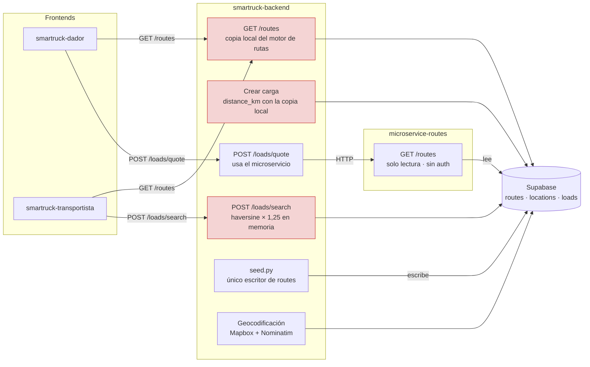
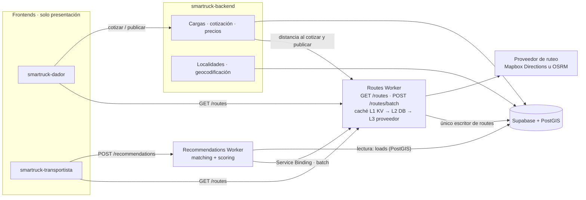
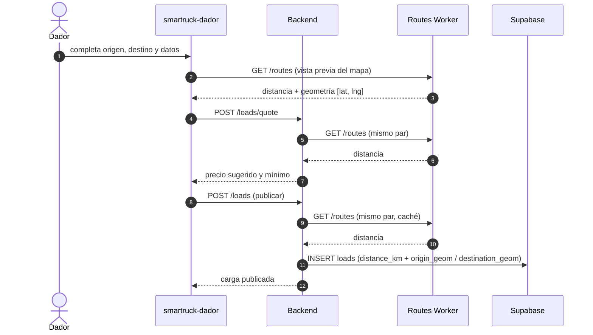
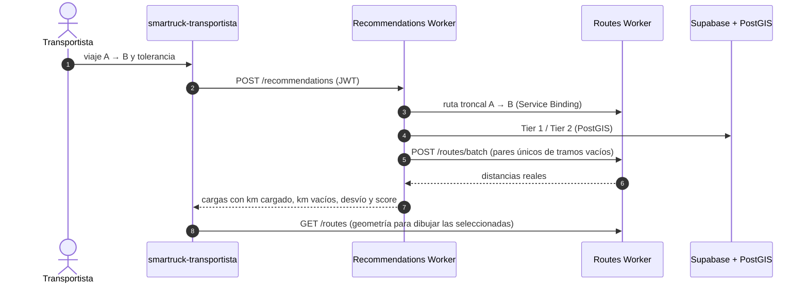
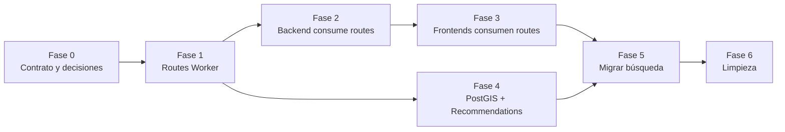
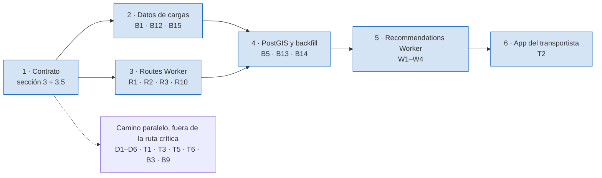

# Plan de centralización: `routes` como única fuente de verdad geográfico-vial

> Plan para que cada responsabilidad geográfica viva en **un solo lugar**, alineado con el diseño definido en [plan-busqueda.md](plan-busqueda.md) (Recommendations Worker + Routes Worker con `POST /routes/batch`).
> Fecha: 2026-10-05 · **Actualizado 2026-10-09 contra `origin/main`** de cada repo (las copias locales usadas en el primer relevamiento estaban atrasadas). Basado en el relevamiento del código de `microservice-routes`, `smartruck-backend`, `smartruck-dador`, `smartruck-transportista`, `smartruck-navigation` y `smartruck-audit`.

---

## 0. Resumen ejecutivo

1. **Hoy hay dos servicios de rutas.** `smartruck-backend` tiene una copia línea por línea del motor de `microservice-routes` (su propio `GET /routes`, con la misma cascada). Los **dos frontends usan la copia del backend**. El microservicio solo lo usa la cotización (`POST /loads/quote`).
2. **La misma distancia sale de dos implementaciones.** Crear una carga calcula `distance_km` con la copia local del backend; cotizarla usa el microservicio. Hoy suelen coincidir porque las dos leen la misma tabla y aplican la misma fórmula, pero son dos copias del mismo código que pueden divergir con cualquier cambio.
3. **La estimación `haversine × 1,25` está implementada al menos 9 veces** entre el microservicio, el backend y los dos frontends.
4. **El `plan-busqueda.md` tiene cuatro decisiones que contradicen el sistema actual** y conviene corregir antes de implementar: la autenticación, la clave canónica, el orden de las coordenadas y quién escribe la tabla `routes` (sección 3).
5. **Además hay cinco incompatibilidades de datos** entre el plan y el modelo actual (estado de la carga, tipo de tráiler, peso, distancia y coordenadas de las ciudades) que harían que el matching **devuelva cero resultados sin dar error** (sección 3.5). La **ruta crítica** para implementar el plan está en la sección 8.1.
6. **Propuesta:** `routes` pasa a ser el **único dueño del ruteo** (distancia, duración, geometría, estimación, clave canónica y caché). El backend conserva cargas, localidades, geocodificación de direcciones y precios. El Recommendations Worker hace el matching. Los frontends solo presentan.

---

## 1. Alcance

| Incluido | Fuera de alcance |
|---|---|
| Distancias y duraciones viales, geometría de rutas, estimaciones, clave canónica de ciudades, caché de rutas | Rediseño visual de los mapas |
| Quién llama a quién para obtener rutas y distancias | Lógica de pagos (salvo cuándo usa distancias) |
| Contrato del `POST /routes/batch` del plan de búsqueda | Implementación del Recommendations Worker (ya detallada en `plan-busqueda.md`) |
| Catálogo de localidades y geocodificación (dónde viven) | Migración a otro proveedor de mapas base |
| Constantes de negocio duplicadas en los frontends | |

---

## 2. Diagnóstico: estado actual

### 2.1 Quién llama a quién hoy

*En rojo: lógica de rutas duplicada fuera de `routes`.*

### 2.2 Fuentes de verdad múltiples

| Responsabilidad | `microservice-routes` | `smartruck-backend` | `smartruck-dador` | `smartruck-transportista` |
|---|---|---|---|---|
| **Resolver una ruta** (distancia, duración, geometría) | `get-route.use-case.ts` | Copia en `get_route_use_case.py` + `postgres_route_repository.py` + `GET /routes` (`routes_controller.py:72`) | Consume el backend | Consume el backend |
| **Distancia de la carga** (`distance_km`) | — | `use_cases/loads/create_load_use_case.py:132-141` usa la **copia local** (misma tabla `routes` y misma fórmula × 1,25 que el microservicio) y, si no encuentra la ciudad, haversine **sin** factor | Muestra el valor del backend | Muestra el valor del backend |
| **Distancia de la cotización** | Sí (vía HTTP) | `quote_load_use_case.py` → `routes_service_distance.py` | — | — |
| **Estimación `haversine × 1,25`, 60 km/h** | `geo-distance.ts` + `get-route.use-case.ts` | `get_route_use_case.py`, `search_loads_use_case.py` (4 copias), `create_load_use_case.py`, `load_http_mapper.py:140-142`, `unlock_fee.py`, `domain/geo.py` | `route-map-preview.tsx:15-25`, stub `in-memory-route-repository.ts` | Stub `in-memory-route-repository.ts` |
| **Normalización de ciudad y clave canónica** | `city-name.ts` (NFKD + quita diacríticos, `\s+` → `_`) | `domain/models/route.py` `CityName` (ASCII-ignore, solo espacios simples) + `split(",")` en 3 archivos | — | Normalización propia en el stub |
| **Tabla `routes`** | Solo lectura | Dueño del esquema (Alembic `0003`) y **único escritor** (`seed.py:237-270` desde `seed_rutas.json`) | — | — |
| **Catálogo de localidades** | Lee `locations` completa en cada búsqueda | Dueño de `locations` (`0001`), seed de 11 ciudades, `LocationResolver` inserta ciudades geocodificadas | `CITIES` hardcodeado (11) en `views/corridor-map-client.tsx:67`, usado solo por la vista `/map` (fuera del menú); datos de ejemplo del modo stub (`data/stub-loads.ts`) | `CITIES` (9) en `data/mock-data.ts`, usado por los stubs |
| **Geocodificación** | — | Único: `FallbackGeocoder(Mapbox, Nominatim)`, reverse geocoding | Usa endpoints del backend | Usa endpoints del backend |
| **Geometría de rutas** | Lee `coordinates_json` | Decodifica polylines en el seed; proyección plana en `search_loads_use_case.py`; `route_coordinates` por carga **enviado por el cliente** (decisión de D.2.1.7, #128) | `GET /routes` del backend (si no hay geometría, línea recta entre localidades geocodificadas); polilíneas de ejemplo hardcodeadas (RN7, RN9…) en `corridor-map-client.tsx:83-110`, solo en la vista `/map` | `GET /routes` del backend y `loaded_route` / `empty_*_route` de la búsqueda |
| **Costos y precios** | — | `pricing.py` (2.000/km, piso 50.000), `RATE_PER_KM`, combustible en `search_loads_use_case.py`, `unlock_fee.py` (distancia en línea recta entre ciudades) | Solo valida contra el mínimo recomendado | `empty-return-cost.ts`: valores fijos ("provisional") en el dashboard; en la calculadora son valores iniciales editables |
| **Autenticación** | **Ninguna** (endpoint público) | Supabase **ES256 vía JWKS** (`authentication.py:33,88-96`) | Supabase | Supabase |

### 2.3 Consecuencias concretas

| Problema | Ejemplo |
|---|---|
| Distancia calculada por dos caminos | Al **cotizar**, la distancia sale del microservicio; al **publicar**, de la copia local del backend. Hoy suelen coincidir porque las dos leen la misma tabla `routes` y aplican la misma fórmula, pero es código duplicado: cualquier cambio en una sola de las dos (fórmula, normalización, catálogo) las hace divergir. Si la copia local no encuentra la ciudad, publicar cae a línea recta sin factor |
| Normalización distinta | El backend y el microservicio normalizan espacios múltiples y caracteres especiales de forma diferente, así que la misma ciudad puede generar dos claves canónicas distintas |
| Cambiar la regla de estimación exige tocar 4 repos | Si mañana el factor vial pasa de 1,25 a 1,3, hay que encontrar todas las copias |
| El microservicio está casi sin uso | Toda la inversión en caché perimetral no se aprovecha, porque los frontends no lo llaman |
| Constantes de negocio en el frontend | El costo de retorno vacío del transportista usa precios de diésel y peajes hardcodeados en la app |

---

## 3. Correcciones al `plan-busqueda.md` antes de implementar

El plan es la referencia definitiva del matching. Aun así, estos cuatro puntos chocan con el sistema real y conviene ajustarlos **antes** de escribir código:

| # | El plan dice | El sistema real | Riesgo si no se corrige | Corrección propuesta |
|---|---|---|---|---|
| **3.1** | Validar el JWT con `SUPABASE_JWT_SECRET` (HMAC SHA-256) en ambos workers | Supabase firma con **ES256** (claves asimétricas) y el backend valida vía **JWKS**. El README del backend aclara que no hace falta `SUPABASE_JWT_SECRET` | Todos los tokens reales serían rechazados (401) | Validar ES256 contra `{SUPABASE_URL}/auth/v1/.well-known/jwks.json` con `crypto.subtle` (ECDSA P-256), cacheando las claves; mismo `audience` e `issuer` que el backend |
| **3.2** | `buildCanonicalKey` **direccional** (`origen:destino`) y solo `trim().toLowerCase()` | La tabla `routes` usa una clave **simétrica** (ciudades ordenadas, sin tildes, solo la parte antes de la coma, espacios → `_`) | **Ninguna** búsqueda en L2 coincidiría con las claves guardadas: todo sería un miss y se llamaría al proveedor externo para rutas ya calculadas | Mantener la clave simétrica existente (`city-name.ts`) como **única especificación** y orientar la geometría al leer (`Route.orientedTo` ya existe) |
| **3.3** | Ejemplo de `coordinates_json` en `[lat, lng]` | La base guarda `[lng, lat]` (estilo GeoJSON) y las dos APIs responden `[lat, lng]` | Rutas dibujadas en el océano o espejadas | Documentar el contrato: **almacenamiento `[lng, lat]`**, **respuesta HTTP `[lat, lng]`** (como hoy) |
| **3.4** | El Routes Worker persiste en L2 (*write-through*) | El microservicio es **solo lectura** (`GRANT SELECT`) y el único escritor de `routes` es el seed del backend | Fallarían los inserts; o, si se habilitan sin acordar, habría dos escritores de la misma tabla | Pasar la **escritura en tiempo de ejecución** de `routes` al Routes Worker; el backend deja de escribirla (sección 4.2) |

Otros puntos a decidir, que no bloquean:

- **Proveedor L3 (Mapbox Directions).** Hoy **ningún componente rutea con un proveedor externo**: Mapbox se usa solo para geocodificar. Antes de adoptarlo, verificar en los términos de uso de Mapbox si se permite **almacenar** resultados de Directions en base de datos y KV durante 30 días, y estimar el costo por volumen. La alternativa sin esa restricción es OSRM self-hosted (ver [filtrado-geografico-candidatos-postgis.md](filtrado-geografico-candidatos-postgis.md), sección 5.4).
- **Conexión de los workers a Postgres.** El plan usa `SUPABASE_DB_URL` (conexión TCP), mientras que el microservicio actual usa el cliente REST de Supabase. Para TCP desde Workers hace falta un driver compatible y, idealmente, Cloudflare Hyperdrive para el pool de conexiones. Hay que elegir una sola opción para los dos workers.
- **El Recommendations Worker lee `loads`, que es del backend.** Es aceptable, pero conviene declararlo como **contrato de solo lectura**: una vista o un rol con `SELECT` sobre las columnas necesarias, para que un cambio de esquema en el backend no rompa el worker sin aviso.
- **`locations.findByName` lee la tabla completa** en cada búsqueda del microservicio. Con el batch esto se multiplica, así que hay que reemplazarlo por una consulta indexada por nombre normalizado.

### 3.5 Incompatibilidades de contrato de datos entre el plan y el modelo actual

Estas diferencias no producen errores: hacen que las consultas del plan **devuelvan cero resultados o resultados incompletos en silencio**. Son las más peligrosas, porque el sistema parece funcionar.

| # | El plan asume | El modelo actual | Efecto en el matching | Resolución propuesta |
|---|---|---|---|---|
| **3.5.1** | `WHERE l.status = 'ACTIVA'` (SQL de Tier 1 y Tier 2) | `LoadStatus.ACTIVE = "activa"` (`smartruck-backend/src/domain/load_status.py`) | Postgres compara textos distinguiendo mayúsculas: **ninguna carga califica** | El worker no hardcodea estados: lee de una **vista de solo lectura** del backend (por ejemplo `matching_loads`) que ya filtra las cargas activas (W4). Así, el valor del estado queda en un solo lugar |
| **3.5.2** | Tipo de acoplado `"SIDER"` (Gherkin y SQL) | `TrailerType` solo tiene `SEMIRREMOLQUE`, `ACOPLADO`, `BITREN` | El filtro de tráiler **nunca coincide** | El plan mezcla dos dimensiones distintas: la **configuración** del tráiler (semirremolque, acoplado, bitren) y el **tipo de carrocería** (sider, batea, tolva, furgón, cisterna). Hay que decidir si se agrega la dimensión "carrocería" al modelo (el formulario del tarifario ya la releva) o si el plan se adapta a `TrailerType`. El Gherkin del plan se actualiza en cualquiera de los dos casos |
| **3.5.3** | `weight NOT NULL` y filtro `l.weight <= :max_weight` | `weight` es opcional; además existe `weight_unit_code` (unidad variable) | Las cargas sin peso **quedan excluidas en silencio** (`NULL <= x` no es verdadero), y comparar pesos en distintas unidades da resultados incorrectos | Peso **obligatorio y normalizado a kg** al publicar; para cargas existentes, filtro tolerante (`l.weight IS NULL OR l.weight <= :max_weight`) hasta completar el backfill |
| **3.5.4** | `distance_km NOT NULL` (es el "km cargado" del score) | Opcional, y hoy calculado con la copia local del backend | Cargas sin km cargado, o con un valor distinto del que usa la cotización | `distance_km` **obligatorio**, obtenido de `routes` al publicar (B1); backfill de las cargas existentes con `POST /routes/batch` (B13) |
| **3.5.5** | El Routes Worker devuelve `originCoords` y `destinationCoords` en el Paso 0 (diagrama de secuencia del plan) | El DTO de `POST /routes/batch` del propio plan **no incluye** coordenadas de las ciudades, salvo pidiendo la geometría completa | El worker **no tiene con qué calcular las cajas de Tier 1** | Agregar `originCoords` y `destinationCoords` (las del catálogo `locations`, que `routes` ya lee) a `RouteResultOutputDto` (R10) |

---

## 4. Principio de responsabilidad: qué vive dónde

### 4.1 Asignación

| Responsabilidad | Dueño único | Consumidores | Justificación |
|---|---|---|---|
| Distancia, duración y geometría entre ciudades | **`routes`** | Backend, Recommendations Worker, frontends | Es el núcleo del servicio y ya tiene la caché perimetral |
| Estimación cuando no hay ruta (`haversine × factor`, velocidad media) | **`routes`** | Todos (vía `is_estimation`) | Una sola regla, un solo factor configurable |
| Normalización de ciudad y clave canónica | **`routes`** | El resto envía nombres; nunca calcula claves | La clave solo tiene sentido para la caché y la tabla de rutas |
| Tabla `routes` (escritura en tiempo de ejecución) | **`routes`** | Nadie más escribe | Elimina el doble escritor |
| Proveedor de ruteo externo (L3) | **`routes`** | — | Encapsulado detrás de un puerto |
| Catálogo de localidades (`locations`) | **Backend** | `routes` (lectura) | Es un concepto del dominio de cargas: el dador elige localidades al publicar |
| Geocodificación de direcciones y reverse geocoding | **Backend** | Frontends | Es sobre direcciones y lugares, no sobre rutas. Moverlo amplía el alcance sin beneficio inmediato (ver 4.3) |
| Cargas (`loads`), incluida la foto de `distance_km` al publicar | **Backend** | Recommendations Worker (lectura) | El agregado `Load` es del backend; la distancia la **pide** a `routes` |
| Precio sugerido, tarifa de desbloqueo, costos | **Backend** | Frontends, Recommendations Worker | Reglas de negocio de precios en un solo `Pricing` |
| Matching, tiers, scoring y deduplicación de pares | **Recommendations Worker** | Frontend transportista | Definido en `plan-busqueda.md` |
| Dibujar mapas, animaciones e interpolación visual | **Frontends** | — | Es presentación, no negocio |

### 4.2 Propiedad de la tabla `routes`

| Aspecto | Hoy | Objetivo |
|---|---|---|
| Esquema (migraciones) | Alembic del backend | **Se mantiene en Alembic**: una sola historia de migraciones para la base compartida de Supabase evita conflictos de versiones. El esquema se acuerda con `routes` |
| Escritura en tiempo de ejecución | Seed del backend | **Solo el Routes Worker** (write-through desde L3) |
| Carga inicial (`seed_rutas.json`) | `seed.py` del backend | Migración de datos única, o un script dentro de `routes` |
| Lectura | Backend (copia local) y microservicio | **Solo el Routes Worker** |
| Permisos | El microservicio con `SELECT` | El Routes Worker con `SELECT` + `INSERT` (y `UPDATE` si se recalculan rutas); RLS habilitado, como el resto de las tablas |

### 4.3 Alternativa descartada por ahora: un "geo-service" completo

Se podría mover también la geocodificación y el catálogo de localidades a `routes` y convertirlo en un servicio geográfico general. Tiene sentido a futuro, pero hoy implicaría mover Mapbox, Nominatim, el `LocationResolver` y sus endpoints sin resolver ninguna duplicación real: la geocodificación **ya vive en un solo lugar**, el backend. Queda como evolución posible.

---

## 5. Contrato unificado del servicio `routes`

### 5.1 Endpoints

| Método y ruta | Uso | Estado |
|---|---|---|
| `GET /routes?origin=&destination=` | Un par de ciudades (frontends, cotización, publicación) | Existe; se mantiene por compatibilidad |
| `POST /routes/batch` | Varios pares en una llamada (Recommendations Worker, mapas con muchas rutas) | **Nuevo** (`plan-busqueda.md`, sección 7) |
| `GET /routes/health`, `GET /routes/version` | Monitoreo | Existen |

### 5.2 Reglas del contrato

| Regla | Definición |
|---|---|
| **Entrada** | Nombres de ciudad tal como los muestra el catálogo (`"Rosario, Santa Fe"`). Los consumidores **nunca** calculan claves canónicas |
| **Clave canónica** | Simétrica, especificada en un solo lugar (`city-name.ts`). Se documenta con ejemplos y tests de contrato |
| **Sentido** | La respuesta siempre viene orientada `origin → destination`, aunque se guarde una sola vez por par |
| **Coordenadas** | Almacenamiento `[lng, lat]`; respuesta HTTP `[lat, lng]` |
| **Estimación** | `is_estimation: true` cuando la ruta no es vial real. El consumidor muestra "estimado", pero **no recalcula** |
| **Geometría** | Opcional en el batch (`includeGeometry`), siempre presente en `GET` |
| **Errores** | `404` ciudad o ruta no encontrada, `400`/`422` parámetros inválidos, `401` sin credenciales |
| **Autenticación** | Usuarios: JWT de Supabase validado con ES256 vía JWKS. Servicios internos: Service Binding + `x-api-key` |
| **Caché** | El consumidor no cachea por su cuenta; `routes` define `Cache-Control` |

---

## 6. Estado objetivo

### 6.1 Publicar una carga

Las tres consultas obtienen **la misma** distancia porque salen del mismo servicio, y la segunda y la tercera se resuelven en caché.

### 6.2 Buscar cargas (transportista)

---

## 7. Cambios por subsistema

### 7.1 `microservice-routes` → Routes Worker

| # | Cambio | Detalle |
|---|---|---|
| R1 | Agregar `POST /routes/batch` | Según `plan-busqueda.md` §7, pero con las correcciones de la sección 3 |
| R2 | Autenticación dual | JWT de Supabase **ES256 vía JWKS** para usuarios; `x-api-key` / Service Binding para servicios internos. Hoy el servicio es público |
| R3 | Clave canónica única | Mantener la simétrica actual; tests de contrato con casos borde (tildes, espacios múltiples, "Ciudad, Provincia") |
| R4 | Escritura en `routes` | Write-through desde L3; permisos `INSERT` en Supabase |
| R5 | Proveedor L3 | Puerto `ExternalRoutingGatewayPort` con un adaptador (Mapbox u OSRM, según la decisión de la sección 3) |
| R6 | Caché L1 | Hoy usa `caches.default` (por PoP); el plan propone KV (global). Elegir una sola opción y documentarla |
| R7 | Búsqueda de localidades indexada | Reemplazar `findByName` → `listAll()` por una consulta por nombre normalizado |
| R8 | Estimación como única implementación | El factor vial y la velocidad media pasan a configuración (`ROAD_FACTOR`, `AVERAGE_SPEED_KMH`) |
| R9 | Contrato documentado | Coordenadas, sentido, `is_estimation`, errores (sección 5) |
| R10 | Coordenadas de las ciudades en el batch | `originCoords` y `destinationCoords` en cada resultado, para que el Recommendations Worker arme las cajas de Tier 1 (sección 3.5.5) |

### 7.2 `smartruck-backend`

| # | Cambio | Archivos |
|---|---|---|
| B1 | **Publicar deja de usar la copia local del motor de rutas** | `use_cases/loads/create_load_use_case.py:132-141`. Respetando D.2.1.4 (#32) y D.2.1.6 (#127), la distancia se calcula al cotizar: publicar la reutiliza en lugar de recalcularla |
| B2 | Eliminar el fallback haversine de publicar | `create_load_use_case.py`: si `routes` no responde, devolver error (o publicar con `is_estimation`, que `routes` ya informa), no recalcular |
| B3 | **Deprecar y eliminar la copia del motor de rutas** | `routes_controller.py` (`GET /routes`), `get_route_use_case.py`, `postgres_route_repository.py`, `RouteRecord` como modelo de lectura. Durante una transición, `GET /routes` puede redirigir al servicio |
| B4 | Enviar credenciales a `routes` | `routes_service_distance.py`: API key interna (o el JWT del usuario) |
| B5 | Agregar geometrías PostGIS a `loads` | Fase 1 de `plan-busqueda.md` (`origin_geom`, `destination_geom`, índices GiST) |
| B6 | ~~`route_coordinates` de la carga~~ | **Descartado:** se respeta la decisión de D.2.1.7 (#128), que persiste las coordenadas de la cotización enviadas por el cliente |
| B7 | Eliminar `haversine × 1,25` restantes | `load_http_mapper.py:140-142` (si falta `distance_km`, informar `null`, no inventar), `domain/geo.py` donde se use para distancias viales |
| B8 | ~~Tarifa de desbloqueo con distancia real~~ | **Fuera de este plan:** `unlock_fee.py` usa la distancia en línea recta entre ciudades. Pasar a distancia vial sube la tarifa (~25 %) y es una **decisión de precios**: se evalúa en el trabajo del tarifario (S.2, #127) |
| B9 | **Retirar `POST /loads/search`** | Lo reemplaza el Recommendations Worker. Sus constantes (`RATE_PER_KM`, combustible) pasan a `Pricing` o a la configuración del worker |
| B10 | Seed de `routes` | Mover la carga de `seed_rutas.json` a una migración de datos o a `routes`; `seed.py` deja de escribir rutas en tiempo de ejecución |
| B11 | `CityName` del dominio | Ya no calcula claves canónicas; queda solo como value object de nombre si se sigue usando |
| B12 | Peso obligatorio y en kg | Validación al publicar en `create_load_use_case.py`; normalizar `weight_unit_code` (sección 3.5.3) |
| B13 | Backfill de cargas existentes | Completar `distance_km` (vía `POST /routes/batch`), `origin_geom` y `destination_geom` en las cargas ya publicadas |
| B14 | Vista de lectura para el matching | Vista `matching_loads` (o rol con `SELECT` limitado) con las cargas activas y las columnas que necesita el worker (secciones 3.5.1 y W4) |
| B15 | Decisión sobre la carrocería | Agregar la dimensión "tipo de carrocería" o adaptar el plan a `TrailerType` (sección 3.5.2) |

### 7.3 Recommendations Worker (nuevo)

| # | Cambio | Detalle |
|---|---|---|
| W1 | Implementar según `plan-busqueda.md` | Fase 3 del plan |
| W2 | Aplicar correcciones de la sección 3 | Auth ES256/JWKS, sin calcular claves canónicas propias: envía nombres al batch |
| W3 | Precios y costos | Si muestra pago estimado o costo de combustible, los obtiene de la misma regla de `Pricing` (configuración compartida o endpoint del backend), no de constantes propias |
| W4 | Contrato de lectura de `loads` | Vista o rol de solo lectura acordado con el backend |

### 7.4 `smartruck-dador`

| # | Cambio | Archivos |
|---|---|---|
| D1 | Consumir `GET /routes` del servicio `routes` | `http-axios-route-repository.ts:16`: nueva variable de entorno (por ejemplo `VITE_ROUTES_API`) con el JWT de la sesión |
| D2 | Eliminar el fallback `haversine × 1,25` | `route-map-preview.tsx:15-25,93`: si no hay geometría, mostrar el estado "estimado" que informa `routes`, sin calcular |
| D3 | **Eliminar la vista `/map` huérfana** | La vista `/map` ya no está en el menú (`views/layout/topbar.tsx`: Panel, Mis cargas, Publicar Carga, Perfil), pero su código sigue en `origin/main`: `routes/_app.map.tsx`, `views/map/map-and-loads-view.tsx`, `views/corridor-map.tsx` y `views/corridor-map-client.tsx` (11 ciudades y rutas RN7/RN9 hardcodeadas). Eliminarla quita el catálogo hardcodeado y la dependencia de Leaflet (D6) |
| D4 | Variable sin uso | `VITE_CARTO_API_KEY` (`configuration.ts:55-56,88`) |
| D5 | Stub coherente | `in-memory-route-repository.ts`: devolver respuestas fijas de ejemplo, sin implementar otra fórmula |
| D6 | (Opcional) Una sola librería de mapas | Leaflet solo lo usa `corridor-map-client.tsx` (vista `/map`); el resto usa MapLibre. Con D3, Leaflet se puede quitar de `package.json` |

### 7.5 `smartruck-transportista`

| # | Cambio | Archivos |
|---|---|---|
| T1 | Consumir `GET /routes` del servicio `routes` | `http-axios-route-repository.ts:16`, igual que D1 |
| T2 | Migrar la búsqueda al Recommendations Worker | `http-axios-load-search-repository.ts:15` (`POST loads/search` → `POST /recommendations`), adaptar `load-search-http-mapper.ts` al nuevo DTO; enviar ciudades del catálogo (hoy envía nombres de texto libre del autocompletado) |
| T3 | Costos del dashboard fuera del frontend | `domain/empty-return-cost.ts`: el dashboard muestra el costo de retorno vacío con valores fijos ("provisional hasta que lo calcule la API"). En la calculadora esos valores son solo iniciales y editables, lo cual es correcto. Los costos de referencia dependen del tarifario (S.2) |
| T4 | ~~Quitar el fallback de 240 km~~ | **Resuelto en `origin/main`:** el fallback ya no existe en `checkout-flow.tsx` |
| T5 | Mantener la interpolación del camión | `corridor-map-client.tsx:39-55` es animación (presentación), no negocio: no se mueve |
| T6 | Stub coherente | Igual que D5, y unificar el `CITIES` de `mock-data.ts` con datos de ejemplo compartidos |

### 7.6 Otros

| Subsistema | Cambio |
|---|---|
| `smartruck-navigation` | Ninguno: es una maqueta estática sin llamadas a APIs |
| `smartruck-audit` | Opcional: sumar los logs de los dos workers al stack de Loki/Grafana |
| Supabase | Permisos de escritura de `routes` para el Routes Worker; rol de solo lectura sobre `loads` para el Recommendations Worker; extensión PostGIS en un schema dedicado (ver `filtrado-geografico-candidatos-postgis.md`, sección 13.7) |

---

## 8. Plan por fases

Cada fase deja el sistema **funcionando** y se puede desplegar sola.

| Fase | Objetivo | Cambios | Criterio de salida |
|---|---|---|---|
| **0 · Contrato** | Acordar reglas antes de tocar código | Correcciones de la sección 3; contrato de la sección 5; decisión del proveedor L3 y de la caché L1; ADRs | Contrato escrito y aprobado por el equipo |
| **1 · Routes Worker** | `routes` como único dueño | R1–R10 | `POST /routes/batch` en test; autenticación activa; tests de contrato de la clave canónica |
| **2 · Backend** | Una sola fuente para `distance_km` | B1, B2, B4, B7, B11, B12, B15; `GET /routes` del backend redirige al servicio | Cotizar y publicar devuelven la misma distancia para el mismo par |
| **3 · Frontends** | Los mapas usan `routes` | D1–D5, T1, T3, T6 | Ningún frontend calcula distancias ni tiene constantes de costos |
| **4 · PostGIS + Recommendations** | Motor de matching del plan | B5, B13, B14, W1–W4 (fases 1 y 3 de `plan-busqueda.md`) | Gherkin del plan en verde contra el entorno de test |
| **5 · Migrar búsqueda** | El transportista usa el nuevo motor | T2 | La app del transportista usa `POST /recommendations` |
| **6 · Limpieza** | Eliminar duplicados | B3, B9, B10, D6 (opcional) | Ninguna copia del motor de rutas ni de `haversine × 1,25` fuera de `routes` |

> Las fases 1–3 resuelven la duplicación **sin depender** del Recommendations Worker. Pero si el objetivo es implementar `plan-busqueda.md` cuanto antes, el orden conveniente es el de la ruta crítica (8.1): ahí la limpieza de los frontends sale del camino principal.

### 8.1 Ruta crítica para implementar `plan-busqueda.md`

El orden de la tabla anterior prioriza **eliminar duplicaciones**. Si la prioridad es **poner en marcha el matching con PostGIS y el Recommendations Worker**, el orden cambia: primero va todo lo que el worker necesita para devolver resultados correctos, y la limpieza de los frontends pasa a un camino paralelo.

| Paso | Qué | Por qué está en la ruta crítica |
|---|---|---|
| **1 · Contrato** | Correcciones de la sección 3 y de la 3.5; decisión del proveedor L3 | Sin esto, el worker rechaza todos los tokens, no encuentra rutas guardadas o no encuentra cargas |
| **2 · Datos de cargas** | `distance_km` desde `routes` al publicar (B1); peso obligatorio en kg (B12); decisión sobre la carrocería (B15) | El score usa el km cargado y los filtros duros usan peso y tráiler: si esos datos están mal, el ranking también lo está |
| **3 · Routes Worker** | Batch (R1), autenticación (R2), clave canónica compatible (R3), coordenadas de las ciudades (R10) | El worker depende del batch para la ruta troncal, las cajas de Tier 1 y los tramos vacíos |
| **4 · PostGIS y backfill** | Geometrías e índices GiST (B5); backfill de cargas existentes (B13); vista `matching_loads` (B14) | Sin geometrías no hay filtro espacial; sin backfill, las cargas ya publicadas no aparecen |
| **5 · Recommendations Worker** | W1–W4 | Es el objetivo del plan |
| **6 · App del transportista** | Migrar la búsqueda a `POST /recommendations` (T2) | Pone el motor en manos del usuario |

**Fuera de la ruta crítica** (se puede hacer en paralelo o después): que los frontends consuman `routes` directamente y quitar sus fórmulas y constantes (D1–D6, T1, T3–T6), eliminar la copia del motor de rutas del backend (B3) y retirar `POST /loads/search` (B9). Aportan consistencia, pero no bloquean el matching.

**Criterio de "listo para empezar el worker"** (salida del paso 4):

- Una carga recién publicada tiene `distance_km`, peso en kg, `origin_geom` y `destination_geom`.
- Las cargas que ya existían tienen los mismos datos, completados por el backfill.
- `POST /routes/batch` responde con autenticación interna, distancias consistentes con las de la cotización y coordenadas de las ciudades.
- La vista `matching_loads` devuelve las cargas activas sin que el worker conozca los valores de estado.

---

## 9. Riesgos

| Riesgo | Impacto | Mitigación |
|---|---|---|
| `routes` se vuelve dependencia crítica de publicar y cotizar | Si se cae, no se puede publicar | Timeouts claros, respuesta `is_estimation` desde el propio servicio y monitoreo en `smartruck-audit` |
| Cambiar la clave canónica invalida datos existentes | Todas las rutas guardadas serían misses | Mantener la clave simétrica actual (corrección 3.2) |
| Términos de uso o costo del proveedor L3 | Incumplimiento o costos inesperados | Verificar antes de la Fase 1; OSRM como alternativa |
| Dos versiones del contrato durante la transición | Consumidores rotos | `GET /routes` del backend redirige al servicio durante la Fase 2; quitarlo recién en la Fase 6 |
| El Recommendations Worker depende del esquema de `loads` | Un cambio en el backend rompe el matching | Vista de solo lectura como contrato (W4) |

---

## 10. Verificación final: una sola fuente de verdad por responsabilidad

| Responsabilidad | Dueño | Prohibido en |
|---|---|---|
| Distancia, duración y geometría vial | `routes` | Backend, workers de negocio, frontends |
| Estimación (`haversine × factor`) | `routes` | Todos los demás |
| Clave canónica de ciudades | `routes` | Todos los demás |
| Escritura de la tabla `routes` | `routes` | Backend (excepto migraciones de esquema) |
| Catálogo de localidades | Backend | Frontends (sin listas hardcodeadas) |
| Geocodificación | Backend | Frontends |
| `distance_km` de una carga | Backend, **obtenida de `routes`** | Cálculos locales |
| Precios, tarifas y costos | Backend (`Pricing`) | Frontends (sin constantes de costos) |
| Matching y scoring | Recommendations Worker | Backend (tras la Fase 6), frontends |
| Mapas y animaciones | Frontends | — |

---

## Anexo: referencias del relevamiento

**`microservice-routes`:** `src/index.ts:82-146` (endpoints y cascada), `src/application/use-cases/get-route.use-case.ts`, `src/domain/models/city-name.ts`, `src/domain/services/geo-distance.ts`, `src/infrastructure/adapters/supabase-route-repository.ts`, `src/infrastructure/adapters/supabase-location-repository.ts`, `src/infrastructure/mappers/route-http.mapper.ts`.

**`smartruck-backend`:** `src/application/ports/route_distance.py`, `src/infrastructure/outbound/http_client/routes_service_distance.py`, `src/infrastructure/inbound/http_controllers/routes_controller.py:72`, `src/application/use_cases/routes/get_route_use_case.py`, `src/domain/models/route.py`, `src/domain/geo.py`, `src/application/use_cases/loads/create_load_use_case.py:132-141`, `quote_load_use_case.py`, `search_loads_use_case.py`, `src/domain/unlock_fee.py`, `src/domain/models/pricing.py`, `src/infrastructure/inbound/dependencies/authentication.py:33,88-96`, `src/infrastructure/outbound/persistence/seed.py:41-52,237-270`, migraciones `0001`, `0003`, `0026`.

**`smartruck-dador`:** `infrastructure/outbound/http/http-axios-route-repository.ts:16`, `views/create-load-view/route-map-preview.tsx:15-25,93`, `views/corridor-map-client.tsx:67-110` (vista `/map`, fuera del menú), `views/layout/topbar.tsx`, `infrastructure/outbound/in-memory/in-memory-route-repository.ts`, `infrastructure/outbound/profile/address-api.ts`, `infrastructure/config/configuration.ts:55-56,88`.

**`smartruck-transportista`:** `infrastructure/outbound/http/http-axios-route-repository.ts:16`, `http-axios-load-search-repository.ts:15`, `mappers/load-search-http-mapper.ts`, `domain/empty-return-cost.ts`, `views/calculator/calculator-view.tsx`, `views/map/corridor-map-client.tsx:39-55`, `data/mock-data.ts:7-17`.
