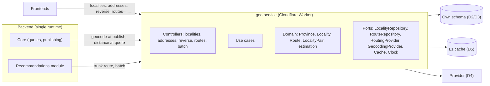
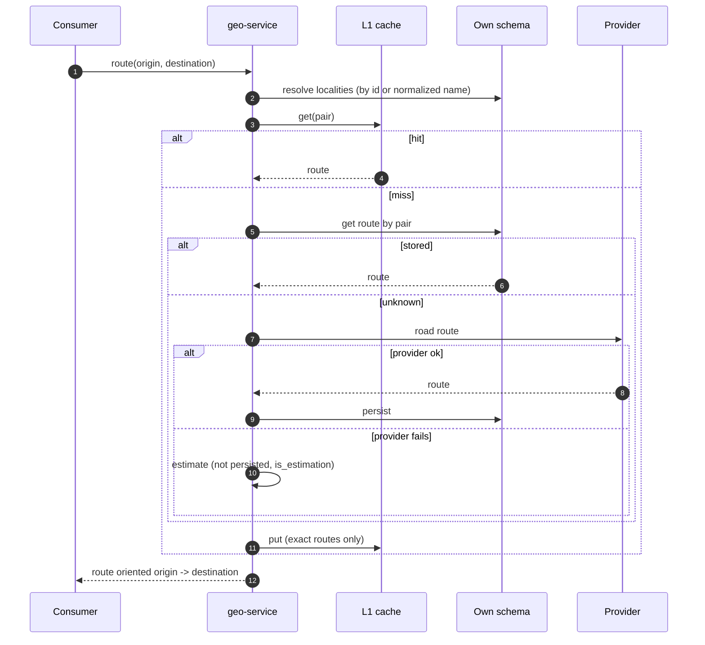

# Design: geo-service

> Status: **DONE (2026-10-10).** D1 and D4 decided after analysis (see each section); D2, D3, D5, D6 and D7 confirmed by the user as recommended. Pending execution checks, not decisions: D1 spike (RUT 01 under the workers pool).

## 1. Target architecture

Hexagonal layering stays as today. Composition moves out of `fetch` into a single composition function (removes the duplicated block in `src/index.ts`).

## 2. Data model (own schema)

| Table | Key columns |
|---|---|
| `provinces` | `id`, `name`, `normalized_name` (unique) |
| `localities` | `id`, `province_id`, `name`, `display_name`, `normalized_name` (unique with `province_id`), `lat`, `lng`, `source` (georef / geocoded), `external_id` |
| `routes` | `id`, `locality_a_id`, `locality_b_id` (unique pair, `a < b`), `distance_km`, `duration_minutes`, `path` (A -> B), `source` (preloaded / provider), `created_at`, `updated_at` |

Estimates are never stored. Storage order of coordinates is part of D-coords (fixed below).

**Fixed (no alternatives worth analysing):** storage keeps `[lng, lat]` (GeoJSON order, as today); HTTP responses keep `[lat, lng]` (as today, consumed by both frontends). Changing either would break existing consumers for no benefit.

## 3. Resolution flow

## 3.1 Runtime: stays a Cloudflare Worker (2026-10-10)

The geo-service keeps running as a Worker (serverless; no cold start, near-zero cost and operation). Docker is used only for local development and tests (`docker-compose.yml` with Postgres + PostgREST, task 1.A.0), following the other repositories' conventions.

Revisit and move to a container (for example Cloud Run, like the backend) when any of these happens:

1. Spatial queries (PostGIS, "nearest locality") that PostgREST cannot express well.
2. Batch resolution (R.1.3) hits the Worker CPU limit per request (10 ms on the free plan; network waits do not count).
3. A self-hosted routing engine (OSRM/Valhalla, see D4) should run next to the service.

The move only replaces the inbound adapter (`fetch` handler -> HTTP server) and the deploy; domain and use cases are runtime-independent.

## 4. Decisions

| ID | Outcome |
|---|---|
| D1 | B: `@amiceli/vitest-cucumber@4.7.0`, `@wip` excluded. Spike (2026-10-11): fails inside `workerd` (`No such module "node:readline"`), so acceptance runs as a separate Node project (`vitest.acceptance.config.ts` in `vitest.workspace.ts`); unit tests stay in the workers pool |
| D2 | A: `geo` schema + own role in the existing Supabase project |
| D3 | A: `@supabase/supabase-js`; remove the unused `postgres` dependency |
| D4 | Mapbox Directions, not stored nor cached; estimate as last resort |
| D5 | A: keep `caches.default`; only stored exact routes are cached |
| D6 | B: `/geo/*` in parallel; retire `/routes*` when unused |
| D7 | A: shared API key header, for good. Recommendations lives inside the backend as a module (2026-10-12), not a separate Worker, so Service Binding does not apply; the backend (core and recommendations alike) authenticates with the same internal credential |

### D1 · Executable acceptance scenarios with work-in-progress exclusion (blocks every story)

Today `.feature` files are not executed and nothing can exclude a red scenario from the pipeline, so the BDD cadence (push the red acceptance scenario first) cannot be followed.

| Option | How | Pros | Cons / risks |
|---|---|---|---|
| **A. Keep hand-written vitest mirrors; WIP = `it.skip` / `describe.skip` with a `[wip]` prefix** | The `.feature` stays as documentation; each `it("RUT NN")` starts as `it.skip`, becomes `it` when green | Zero new tooling; works today inside workerd | `.feature` and spec can drift (two sources); no real Gherkin execution |
| **B. Gherkin runner inside vitest** (e.g. `@amiceli/vitest-cucumber`, which parses `.feature` files and supports tag filtering) | `.feature` is executed; steps in TypeScript; `@wip` excluded by tag filter | Single source of truth, same cadence as the backend (`pytest-bdd`) | New dependency; must be verified to run under `@cloudflare/vitest-pool-workers`; learning curve |
| **C. `@cucumber/cucumber` as a separate runner** | Outside vitest, in Node | Mature, native tag expressions | Does not run inside workerd: acceptance would need a different harness than unit tests (wrangler dev / Miniflare) |

**Recommendation:** B if it runs under the workers pool (spike of one scenario, RUT 01, before committing to it); otherwise A with a lint/check that every scenario ID in the `.feature` has a matching `it`.

**Decision (2026-10-10): B with `@amiceli/vitest-cucumber`, confirmed by a RUT 01 spike.** Verified facts:

| Fact | Impact |
|---|---|
| `@amiceli/vitest-cucumber@4.7.0` depends on `vitest ^2.1.8` (5.x needs vitest 3, 6.x-8.x need vitest 4) | Pin `4.7.0`; no vitest upgrade needed |
| `setVitestCucumberConfiguration({ excludeTags: ['wip'] })` skips tagged scenarios | `@wip` cadence works inside `vitest run` |
| `loadFeature(path, { language: 'es' })` parses Spanish keywords | Existing `.feature` files are reused as-is |
| `loadFeature` reads the `.feature` file from the host filesystem | May not work inside `workerd` (`@cloudflare/vitest-pool-workers`): the spike decides |

Spike outcome determines the harness:
- **Runs in the workers pool:** acceptance stays in the same vitest config.
- **Does not:** a second vitest project (`vitest.workspace.ts`) runs `test/acceptance/**` in the Node environment (the controller is exercised with `Request` objects and in-memory fakes, which Node 20 supports); unit tests stay in the workers pool. `scripts/run_all_tests` runs both.

The hand-written mirror `test/acceptance/consultar-rutas.spec.ts` is migrated scenario by scenario to step definitions and then removed (single source of truth).

**Test layers and CI database (2026-10-10):**

| Layer | Runs against | Purpose |
|---|---|---|
| Acceptance (`.feature`, vitest-cucumber) | Controller + use cases + Postgres adapters over the test database (from 1.B.6; in-memory before that) | Behavior of the whole service on its own data |
| Adapter integration (`Postgres*Repository`) | Real Postgres + PostgREST in CI | `geo` schema, role grants, real queries of each adapter |
| Post-deploy (`scripts/acceptance_test.sh`) | Deployed `test` environment | End-to-end smoke check |

CI runs the `build` job on the team's single self-hosted runner (Azure VM, one runner instance, so jobs are queued and never concurrent). The database comes from two GitHub Actions `services:` (`postgres:16` + `postgrest/postgrest`), following the backend pattern, instead of `supabase start`: lighter, and cleaned up by GitHub even when a job is cancelled. Supabase built-in roles do not exist there, so the `geo` schema migration creates the service role and its grants explicitly. Connection values come from environment variables; no hostnames are hardcoded.

### D2 · Where the own data lives (gates R.1.1)

| Option | Pros | Cons / risks |
|---|---|---|
| **A. New schema (`geo`) + role in the existing Supabase project** | No extra cost; same backups; clear ownership enforced by role grants | Shared instance resources (fine at current volume) |
| **B. Separate Supabase project** | Full isolation | Free-tier project limits and cost; separate migrations and secrets per environment |
| **C. Cloudflare D1 (SQLite)** | Native to Workers, low latency at the edge | New technology; no PostGIS; another data migration path |

**Recommendation:** A.

### D3 · How the Worker reaches its data (gates R.1.1)

| Option | Pros | Cons / risks |
|---|---|---|
| **A. `@supabase/supabase-js` (REST/PostgREST), as today** | Already used; no connection management in Workers | Custom schema must be exposed through PostgREST (`db: { schema: 'geo' }`) and granted; limited query shapes |
| **B. `postgres` driver over TCP + Cloudflare Hyperdrive** | Full SQL, pooling at the edge | New infra (Hyperdrive config per env); the `postgres` package is installed but unused today |

**Recommendation:** A now (smaller change); revisit B if queries outgrow PostgREST. Remove the unused `postgres` dependency either way.

### D4 · External provider (gates R.1.2)

| Option | Pros | Cons / risks |
|---|---|---|
| **A. Mapbox Directions + Geocoding** | Hosted, the backend already has a token, truck-agnostic but good coverage | Terms of use may restrict **storing** results (must be verified before persisting); per-request cost |
| **B. OSRM self-hosted (Argentina extract)** | No storage restriction, no per-request cost | Needs hosting/operation outside Workers; no geocoding (Nominatim needed separately) |

**Recommendation:** verify Mapbox's storage terms first; if storing is allowed, A; otherwise B for routing.

**Decision (2026-10-10): Mapbox Directions without storing, behind the `RoutingProvider` port.** Full analysis and alternatives: `smartruck-ar/docs/decision-proveedor-rutas.md`.

- Mapbox terms do not grant storage rights for Directions responses (temporary geocoding explicitly forbids it), so provider routes are neither persisted nor cached.
- Cascade: stored routes -> Mapbox (not stored) -> estimate (`is_estimation: true`, not stored).
- The 10,879 preloaded routes (150 cities, 97% of their pairs) were generated with OSRM (confirmed by the seed's author; matches the OSRM demo within 0-2%); they are OpenStreetMap data (ODbL) and are migrated as-is in R.1.1 with OSM attribution.
- Revisit (self-hosted OSRM or Valhalla, which allow storage) when volume outside the preloaded pairs approaches Mapbox's free tier, when all distances must come from one engine, or when truck-specific routing is needed. That change is a new adapter plus a cascade reorder; the domain does not change.
- Consequence: provider routes are persisted only when the provider's license allows it. RUT 14 now states that a provider route is not stored (roadmap #141 updated).

### D5 · L1 cache (affects R.1.2, R.1.3)

| Option | Pros | Cons / risks |
|---|---|---|
| **A. `caches.default`, as today** | Already implemented; free | Per data center; must not cache estimates |
| **B. Cloudflare KV** | Global; shared across data centers | Eventual consistency; write limits on the free tier |

**Recommendation:** A (keep), with the rule "only exact routes are cached".

### D6 · Public path and naming

| Option | Pros | Cons / risks |
|---|---|---|
| **A. Keep `/routes*` and add new resources under it** (`/routes/localities`) | No consumer changes | Misleading names (localities under "routes") |
| **B. Add `/geo/*` in parallel (`/geo/routes`, `/geo/localities`, ...) and retire `/routes*` when unused** | Clear naming; no breaking change | Two route patterns during the transition |

**Recommendation:** B. The Worker name (`smartruck-routes-service-*`) is invisible to consumers and can stay.

### D7 · Internal service credential (affects R.1.4)

| Option | Pros | Cons / risks |
|---|---|---|
| **A. Shared API key header** | Works for the backend on Cloud Run and for Workers | Secret rotation across services |
| **B. Service Binding (Worker-to-Worker) + API key for non-Worker callers** | No network hop and no secret for Workers | Two mechanisms to maintain |

**Recommendation:** A now (the only internal caller today is the backend); add B when the recommendations Worker exists.

## 5. Next step

Once D1-D7 are confirmed, write `tasks.md` (one task group per acceptance scenario, outside-in cadence) starting with the D1 enabler and R.1.1 #140.
