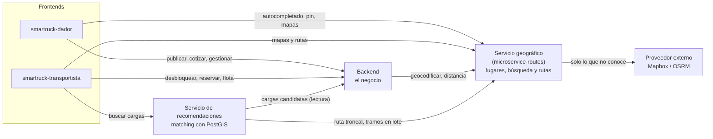
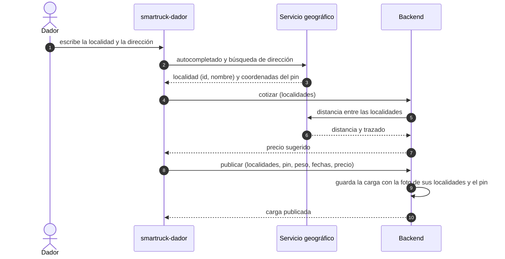
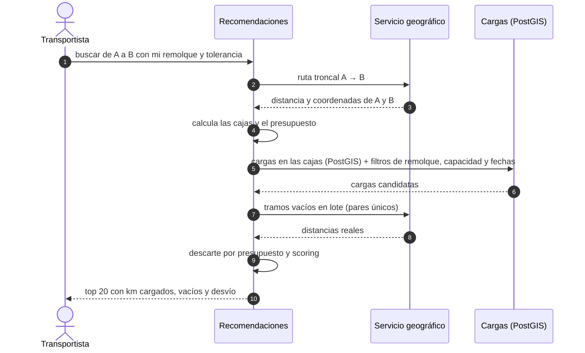
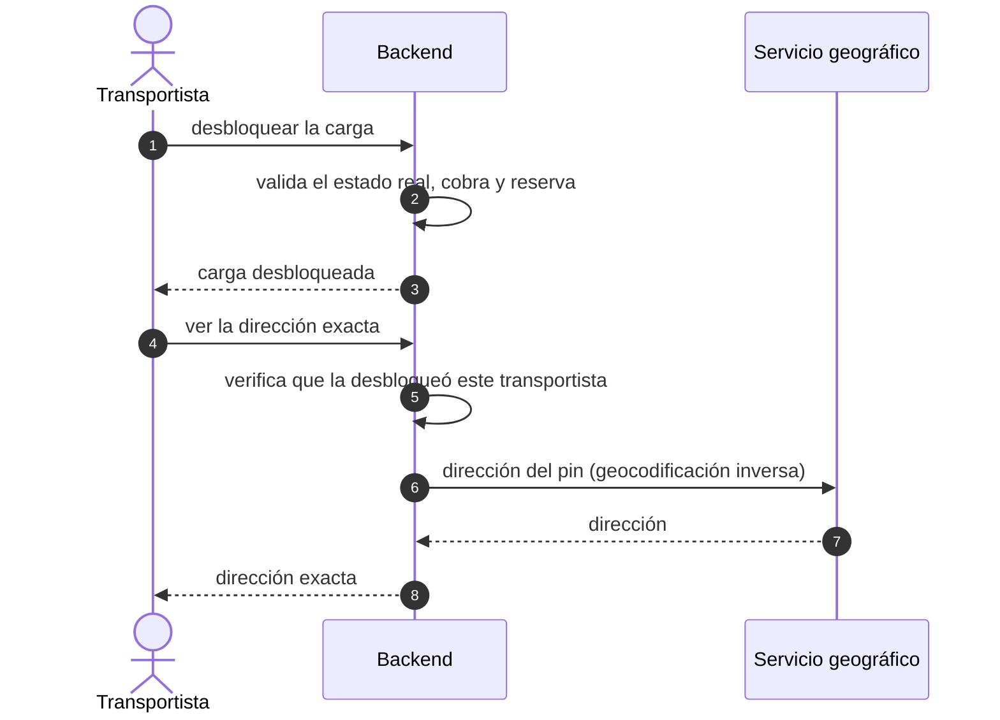
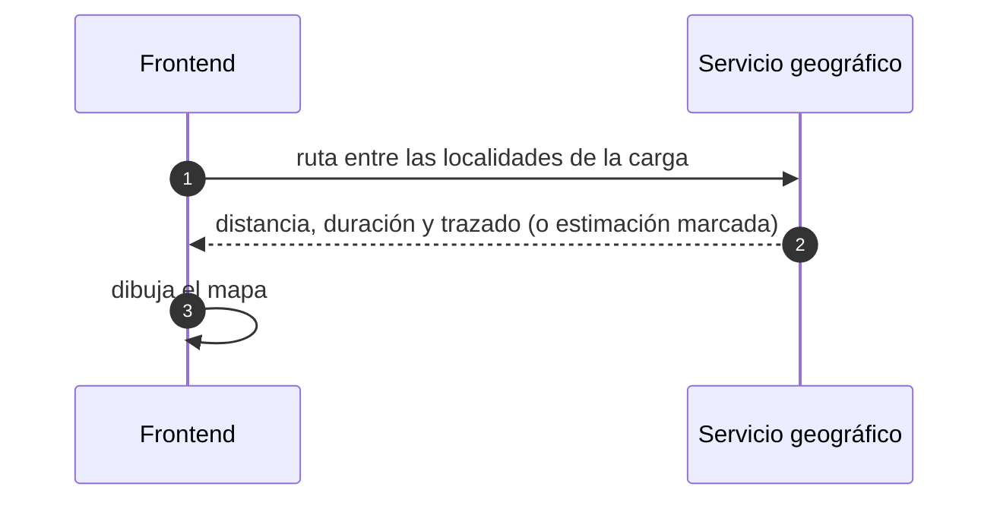

# Responsabilidades de los servicios: backend, geografía y recomendaciones

> Qué hace cada parte del sistema, qué no le corresponde y cómo se comunican entre sí.
> Fecha: 2026-10-10 · Complementa a [plan-busqueda.md](plan-busqueda.md) y [plan-centralizacion-routes.md](plan-centralizacion-routes.md).

---

## 1. Visión general

### Regla para decidir dónde va algo

| Si el dato o la lógica… | Es de… |
|---|---|
| Describe el mundo y es igual para todos (dónde está una ciudad, cómo se llega de una a otra) | **Servicio geográfico** |
| Pertenece a una carga, a un usuario o a una regla del negocio (precio, estado, quién pagó) | **Backend** |
| Decide qué cargas le convienen a un transportista | **Servicio de recomendaciones** |

---

## 2. Backend: el negocio

### Debe hacer

| Responsabilidad | Detalle |
|---|---|
| **Cargas** | Publicar, editar, eliminar y cambiar de estado; es el **único escritor** y la fuente de verdad |
| **Datos de la carga** | Guarda la **foto de sus localidades** (id y nombre del servicio geográfico), el **pin exacto** de retiro y entrega, el peso en toneladas, el tipo de remolque, las fechas, el precio y la distancia cotizada |
| **Reglas del negocio** | Desbloqueo, reserva, pagos, calificaciones y notificaciones |
| **Acceso a la dirección exacta** | Solo la muestra después del desbloqueo; el cálculo de la dirección se lo pide al servicio geográfico |
| **Precios y tarifas** | Precio sugerido, tarifa de desbloqueo y costos, usando la distancia del servicio geográfico |
| **Flota y usuarios** | Transportistas, oferentes, camiones, remolques (con capacidad y disponibilidad) y centros de carga |
| **Validación final** | Al desbloquear o reservar, valida el estado real de la carga, aunque una búsqueda la haya mostrado unos segundos antes |

### No debe hacer

- Guardar o mantener un catálogo de localidades ni geocodificar por su cuenta.
- Calcular distancias ni estimaciones (`haversine × 1,25`).
- Resolver rutas (deja de tener la copia del motor de rutas).
- Decidir qué cargas recomendar.

---

## 3. Servicio geográfico (`microservice-routes`): los lugares y las rutas

### Debe hacer

| Responsabilidad | Detalle |
|---|---|
| **Catálogo geográfico** | Es dueño de provincias y localidades con sus coordenadas (inicializable con Georef) |
| **Búsqueda** | Autocompletado de localidades y búsqueda de direcciones **dentro de la localidad elegida** |
| **Geocodificación** | Dirección → coordenadas, y punto del mapa → localidad o dirección (inversa) |
| **Rutas** | Distancia, duración y trazado entre dos localidades, identificadas por el **par de localidades**, orientadas en el sentido pedido |
| **Rutas desconocidas** | Las busca en el proveedor externo (Mapbox u OSRM) y **las guarda**; las siguientes consultas salen de su base o de su caché |
| **Estimación** | Si el proveedor falla, estima (factor vial y velocidad configurables), la devuelve marcada como estimación y **no la guarda** |
| **Consultas en lote** | Muchas rutas en una sola llamada, con geometría opcional |
| **Sus datos** | Schema y rol propios; es el **único escritor** de sus tablas |
| **Seguridad** | Usuarios con el JWT de Supabase (ES256 vía JWKS) y servicios internos con credencial propia |

### No debe hacer

- Guardar el pin exacto de cada carga ni saber quién puede verlo.
- Conocer cargas, precios o reglas del negocio.
- Decidir qué cargas recomendar.

### Datos

| Tabla | Contenido |
|---|---|
| `provinces` | Provincias |
| `localities` | Localidades con provincia, nombre normalizado y coordenadas |
| `routes` | Ruta por par de localidades: distancia, duración, trazado y origen (precargada o proveedor) |

PostGIS es opcional en este servicio (por ejemplo, para "localidad más cercana a un punto").

---

## 4. Servicio de recomendaciones: el matching

> Corre como un módulo del backend, no como un Worker aparte (2026-10-12). Las responsabilidades de esta sección no cambian por eso; sí cambia que no necesita Service Binding ni credencial propia para llamar al servicio geográfico — usa la misma credencial interna que el resto del backend (ver `plan-geo-service/design.md` D7).

### Debe hacer

| Responsabilidad | Detalle |
|---|---|
| **Ruta troncal y presupuesto** | Pide al servicio geográfico la ruta A → B y calcula el desvío máximo y el presupuesto del viaje |
| **Construir las cajas** | Calcula las cajas de Tier 1 (entorno de origen y destino) y, si no alcanza, el gran rectángulo de Tier 2 |
| **Filtro espacial con PostGIS** | Busca las cargas cuyo origen y destino caen en esas cajas, con índices espaciales |
| **Filtros del matching** | Tipo de remolque, capacidad (peso en toneladas), carrocería si se incorpora, y fechas |
| **Tramos vacíos** | Deduplica los pares de localidades y pide sus distancias al servicio geográfico en **una sola llamada** |
| **Descarte y scoring** | Descarta las cargas que superan el presupuesto, puntúa y devuelve el top 20 con km cargados, km vacíos y desvío |
| **Seguridad** | JWT de Supabase y rol de transportista |

### No debe hacer

- Escribir cargas ni cambiar su estado.
- Calcular distancias viales por su cuenta (se las pide al servicio geográfico).
- Validar el desbloqueo o la reserva (lo hace el backend).

### Decisión pendiente: sobre qué tabla corre la consulta espacial

| Opción | Cómo | Implica |
|---|---|---|
| **A. Plan literal** (`plan-busqueda.md`) | Geometrías en `loads` del backend; recomendaciones las consulta con un rol de **solo lectura** sobre una vista | Sin datos duplicados; geometrías en la tabla del backend; los tickets T.2.12 (#139), T.2.13 (#148) y T.2.14 (#149) ya están así |
| **B. Tabla propia** | Recomendaciones mantiene `load_index` con geometrías, actualizado por avisos del backend y una reconciliación periódica | Más independencia; datos duplicados de forma intencional; hay que reescribir esos tres tickets |

Se decide en S.3 (#137).

---

## 5. Cómo se comunican

### Resumen

| Origen → destino | Medio | Para qué | Frecuencia | Credencial |
|---|---|---|---|---|
| Frontends → Backend | API | Operar el negocio | Alta | JWT del usuario |
| Frontends → Servicio geográfico | API | Autocompletado, pin, mapas y rutas | Media | JWT del usuario |
| Transportista → Recomendaciones | API | Buscar cargas | Alta | JWT del usuario |
| Backend → Servicio geográfico | API | Geocodificar al publicar, distancia al cotizar | Baja | Credencial interna |
| Recomendaciones → Servicio geográfico | API (Service Binding) | Ruta troncal y tramos vacíos en lote | Por cada búsqueda | Credencial interna |
| Recomendaciones → Backend | Lectura de la base (opción A) o avisos del backend (opción B) | Cargas candidatas | Por cada búsqueda (A) o por cada cambio de carga (B) | Rol de solo lectura (A) o credencial interna (B) |
| Servicio geográfico → Proveedor externo | API | Rutas y geocodificación que no conoce | Baja | Token del proveedor |
| Servicio geográfico → otros servicios | — | Nunca: solo responde | — | — |

### Publicar una carga

### Buscar cargas (transportista)

### Desbloquear una carga y ver la dirección exacta

### Ver una ruta en el mapa

---

## 6. Correspondencia con los tickets

| Parte | Tickets |
|---|---|
| Servicio geográfico | S.3 (#137), R.1.1 (#140) a R.1.6 (#145 / #152); historias nuevas R-LOC y D-FOTO en `borrador-cambios-sprint-6.md` |
| Recomendaciones | T.2.12 (#139), T.2.13 (#148), T.2.14 (#149), T.2.15 (#150 / #155), T.2.16 (#151) |
| Datos del matching en el backend | T.3.12 (#146 / #153) capacidad del remolque, D.2.9 (#147 / #154) peso en toneladas, S.4 (#138) atributos del remolque |
| Flota | T.3.13 (#159 / #160) liberación manual, T.3.14 (#161 / #162) disponibilidad por fechas |

> El borrador `borrador-cambios-sprint-6.md` también proponía filtrar por localidad sin PostGIS. Esa parte queda descartada para seguir el plan original; siguen valiendo las historias del servicio geográfico (R-LOC, D-FOTO y la reescritura de #144).
