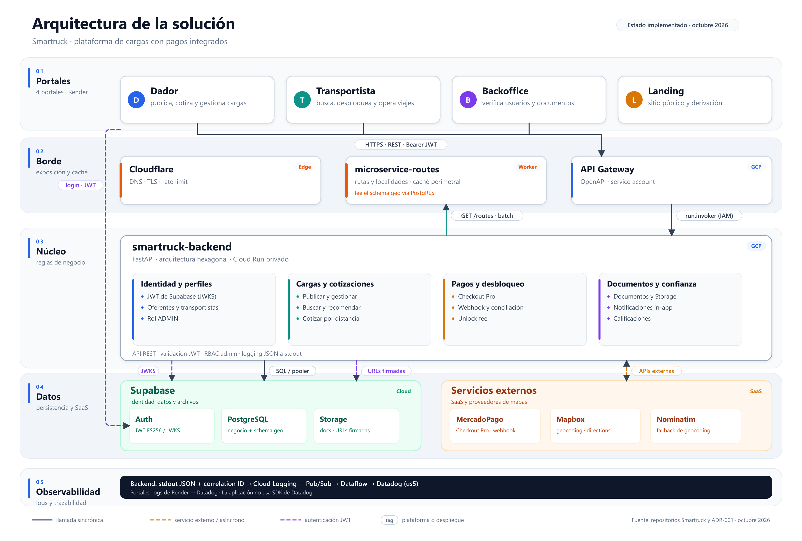

# Arquitectura

Esta página describe la arquitectura **implementada** de Smartruck a octubre de 2026. Se apoya en el código de los repositorios, la infraestructura Terraform de `smartruck-infra` y el ADR-001 del repositorio de trabajo. Cuando el ADR propone una decisión que todavía no está en el código, se marca en [Estado implementado vs. anteproyecto](#estado-implementado-vs-anteproyecto).

## Vista general

*Figura 1. Componentes desplegados por banda. Versión editable: [SVG](arquitectura/diagrams/arquitectura-solucion.svg).*

| Banda | Componentes | Responsabilidad |
|-------|-------------|-----------------|
| **01 · Portales** | Dador, Transportista, Backoffice, Landing | Interfaz web por rol. Los tres portales autenticados consumen la API; la landing es pública y deriva a los portales. |
| **02 · Borde** | Cloudflare (DNS, TLS, rate limit de `/routes`), `microservice-routes` (Worker) y API Gateway | Exposición pública, caché perimetral y ruteo geográfico. El API Gateway es la puerta de entrada al backend privado. |
| **03 · Núcleo** | `smartruck-backend` | Reglas de negocio y transacciones de cargas, usuarios, pagos, documentos y notificaciones. |
| **04 · Datos e integraciones** | Supabase (Auth, PostgreSQL, Storage), MercadoPago, Mapbox, Nominatim | Identidad, persistencia, archivos y servicios externos. |
| **05 · Observabilidad** | stdout JSON + correlation ID, Cloud Logging, Pub/Sub, Dataflow, Datadog (us5) y logs de Render | Trazabilidad del backend y de los portales. |

La topología de test y de prod vive en `smartruck-infra` (módulos `artifact_registry`, `cloud_run`, `api_gateway`, `wif`, `cloudflare_dns`, `cloudflare_waf`, `datadog_log_forwarding` y `render_datadog_log_stream`).

### Portales

- **Dador** (`smartruck-dador`): publica cargas, cotiza, gestiona ofertas y sigue pagos.
- **Transportista** (`smartruck-transportista`): busca cargas, calcula viajes, desbloquea ofertas con pago y gestiona flota y viajes.
- **Backoffice** (`smartruck-backoffice`): administración de usuarios, verificación de documentos y rol `ADMIN`.
- **Landing** (`landing-page`): sitio público con derivación al dador y al transportista.

Los tres portales autenticados usan TanStack Start + React y consumen el backend a través de `VITE_SMARTRUCK_BACKEND_API`. La autenticación se apoya en Supabase Auth (`VITE_SUPABASE_URL` y `VITE_SUPABASE_ANON_KEY`).

### Borde

- **Cloudflare**: DNS de `smartruck.tech`, TLS y rate limiting sobre el endpoint de rutas (120 req/min por IP y host, con ventana de 10 s).
- **`microservice-routes`** (Cloudflare Worker, TypeScript): resuelve rutas y localidades.
  - Endpoints: `/geo/routes` (y el alias legacy `/routes`), `/geo/routes/batch`, `/geo/localities/*`, `/geo/health` y `/geo/version`.
  - Cascada de resolución: caché de Cloudflare (`caches.default`) → tabla `routes` del schema `geo` en Supabase (vía PostgREST con `supabase-js`) → proveedor Mapbox Directions (si hay token) → estimación geodésica marcada con `is_estimation`.
  - Los proveedores y las estimaciones no se cachean (`no-store`).
  - `AUTH_REQUIRED=true` exige un JWT de Supabase (ES256, JWKS, `audience=authenticated`); los healthchecks y `/version` quedan públicos.
- **API Gateway** (GCP): expone el backend en HTTPS y lo invoca con `run.invoker` sobre Cloud Run privado.

### Núcleo

`smartruck-backend` es un monolito hexagonal en Python 3.12 con FastAPI, SQLModel y Alembic sobre PostgreSQL (Supabase). El código se organiza en:

| Capa | Rol |
|------|-----|
| `domain/` | Modelos, puertos, excepciones y reglas de negocio. |
| `application/` | Casos de uso, DTOs y `LogManager`. |
| `infrastructure/inbound/` | Adaptadores de entrada: HTTP controllers, DTOs, mappers y middlewares. |
| `infrastructure/outbound/` | Adaptadores de salida: persistencia PostgreSQL, Storage, gateways de pago y clientes HTTP. |

Agrupa funcionalmente identidad y perfiles, cargas y cotizaciones, pagos y desbloqueo, y documentos y confianza. Corre en Cloud Run privado detrás del API Gateway.

### Datos e integraciones

- **Supabase Auth**: emite JWT firmados con ES256 y publica JWKS.
- **Supabase PostgreSQL**: datos de negocio y schema `geo` con las tablas `provinces`, `localities` y `routes` que consume el Worker.
- **Supabase Storage**: bucket privado `documents`; el backend firma URLs de subida y de lectura.
- **MercadoPago**: Checkout Pro, webhook y consulta de pagos.
- **Mapbox**: geocodificación y Directions. **Nominatim**: fallback de geocodificación.

### Observabilidad

- El backend emite logs JSON a stdout con `LogManager`. Un middleware agrega un correlation ID por request.
- En Cloud Run, los logs van a Cloud Logging y se reenvían por Pub/Sub y Dataflow a Datadog (`us5`).
- Los portales desplegados en Render envían sus logs a Datadog mediante un log stream de workspace.

## Componentes por repositorio

| Repositorio | Stack | Despliegue | Rol |
|-------------|-------|------------|-----|
| [smartruck-backend](https://github.com/smartruck-ar/smartruck-backend) | Python 3.12 · FastAPI · SQLModel · Alembic | Cloud Run privado detrás de API Gateway | API REST y reglas de negocio. |
| [microservice-routes](https://github.com/smartruck-ar/microservice-routes) | TypeScript · Cloudflare Workers · `supabase-js` · `jose` | Cloudflare Workers | Ruteo, distancias y localidades. |
| [smartruck-dador](https://github.com/smartruck-ar/smartruck-dador) | TanStack Start · React | Render | Portal del dador. |
| [smartruck-transportista](https://github.com/smartruck-ar/smartruck-transportista) | TanStack Start · React | Render | Portal del transportista. |
| [smartruck-backoffice](https://github.com/smartruck-ar/smartruck-backoffice) | TanStack Start · React | Render | Administración, verificación y documentos. |
| [landing-page](https://github.com/smartruck-ar/landing-page) | React · Vite | Render | Sitio público y derivación. |
| [smartruck-infra](https://github.com/smartruck-ar/smartruck-infra) | Terraform (GCP, Cloudflare, Render) | — | Infraestructura como código. |

`smartruck-ai` y los templates (`cloud-template`, `infra-template`) son herramientas de proceso del equipo, no componentes del runtime del producto.

## Flujos principales

### Autenticación y autorización

1. Supabase Auth emite un JWT ES256 para el usuario.
2. Los frontends envían `Authorization: Bearer <token>` a `VITE_SMARTRUCK_BACKEND_API`.
3. El backend valida firma, issuer y vigencia contra el JWKS de Supabase. El backoffice exige además rol `ADMIN`.
4. El Worker puede validar el mismo JWT cuando `AUTH_REQUIRED=true`; los endpoints de salud y versión quedan públicos.

### Cotización, publicación y ruteo

Hay dos caminos distintos según la operación:

- **Cotizar** (`POST /loads/quote`): `QuoteLoadUseCase` usa el puerto `RouteDistance` a través de `RoutesServiceDistance`, que llama al Worker (`ROUTES_SERVICE_BASE_URL`). El precio sugerido sale de `Pricing`.
- **Publicar** (`POST /loads/offerer/{offerer_id}`): `CreateLoadUseCase` resuelve origen y destino con `LocationResolver` y obtiene `distance_km` / `distance_is_estimation` con el motor **local** `GetRouteUseCase` (tabla `routes` de negocio con fallback geodésico). La distancia queda como foto inmutable en `loads`.
- **`GET /routes` del backend**: sigue atendido por el motor local, no es un proxy del Worker.

Esta convivencia es conocida: la cotización ya usa el servicio geográfico, pero la publicación y el endpoint legacy todavía no. El ADR-001 propone unificar todo en `microservice-routes`.

### Búsqueda de cargas

`SearchLoadsUseCase` (expuesto como `POST /loads/search`) resuelve el matching de forma naive: obtiene todas las localidades y todas las cargas, filtra las activas, calcula distancias con `haversine × 1.25` y puntúa en memoria. No usa PostGIS, ni la vista `matching_loads`, ni `POST /routes/batch`. La mejora con poda espacial y scoring sobre el servicio geográfico está planificada en el ADR, pero todavía no implementada.

### Desbloqueo y pago

*Figura 2. Camino crítico desde la creación de la preferencia de pago hasta la reserva de la carga. Versión editable: [SVG](arquitectura/diagrams/flujo-desbloqueo.svg).*

1. El transportista bloquea la oferta (`POST /loads/{load_id}/transporters/{transporter_id}/lock`) y consulta el costo de desbloqueo (`GET /loads/{load_id}/unlock-fee`).
2. El frontend pide el pago (`POST /payments`). El backend crea un `Payment` en estado `PENDING` y una preferencia en MercadoPago Checkout Pro, y devuelve `checkout_url`.
3. El transportista paga en Checkout Pro. MercadoPago envía el webhook `POST /payments/mercadopago/webhook`; el backend valida la firma y consulta el pago al proveedor.
4. El frontend reconcilia con `POST /payments/{payment_id}/sync`.
5. El transportista confirma el desbloqueo (`POST /loads/{load_id}/transporters/{transporter_id}/unlock`). `UnlockLoadUseCase` **revalida contra MercadoPago** el estado, la referencia externa, el importe y la moneda; recién entonces marca el pago como aprobado y la carga como `RESERVED`.
6. El backend crea una notificación in-app para el dador.

El backend no confía en el estado que informa el cliente: la reserva exige un pago efectivamente aprobado por MercadoPago.

### Documentos y verificación

1. El usuario pide una URL de subida (`POST /documents/upload-url`) y el backend registra la intención y firma la URL.
2. El cliente sube el archivo directo a Supabase Storage (bucket privado `documents`).
3. El cliente confirma (`POST /documents/{document_id}/confirm`); el backend valida tamaño y tipo.
4. El usuario puede obtener una URL de lectura firmada (`GET /documents/{document_id}/read-url`); el backoffice verifica los documentos desde sus propios endpoints de administración.

## Estado implementado vs. anteproyecto

El ADR-001 está en estado **Propuesto**. Esta tabla contrasta lo decidido con lo que hoy está en el código.

| Decisión ADR-001 | Estado actual |
|------------------|---------------|
| **D1 · Arquitectura híbrida** (monolito hexagonal + Worker geográfico) | Implementado: `smartruck-backend` en Cloud Run y `microservice-routes` en Cloudflare Workers. |
| **D2 · El Servicio Geográfico es dueño del ruteo** | Parcial: la cotización usa el Worker; la publicación y `GET /routes` del backend siguen con el motor local. |
| **D3 · Catálogo y geocodificación en el backend, 150 ciudades** | Pendiente: `locations` conserva las 11 localidades seed, sin `canonical_name` ni `province` ni backfill con Georef (IGN). |
| **D4 · Matching con PostGIS en el backend** | Pendiente: `SearchLoadsUseCase` carga todo y puntúa en memoria; no hay PostGIS ni vista `matching_loads`. |
| **D5 · Direct-to-Storage en Supabase Storage** | Implementado con URLs firmadas de subida y lectura y bucket privado. |
| **D6 · Worker solo lectura, Hyperdrive y `x-api-key`** | Distinto: el Worker lee el schema `geo` por PostgREST con `supabase-js`; usa JWT de Supabase opcional (`AUTH_REQUIRED`), no `x-api-key`; no hay Hyperdrive ni rol `geo_worker`. |
| **D7 · Proveedor de rutas para el MVP** | Implementado con matices: 10.879 rutas precargadas + estimación marcada; Mapbox Directions como fallback en el Worker; sin OSRM propio. |

### Deuda técnica abierta

- Motor de rutas duplicado entre el backend y el Worker, con dos fuentes de distancia posibles.
- Matching sin poda espacial: no escala y no usa el batch del servicio geográfico.
- Catálogo de localidades reducido (11 frente a las 150 del ADR), con normalización pendiente.
- Worker con credenciales amplias de Supabase y autenticación opcional; falta endurecer permisos y cerrar el endpoint.
- Sin circuit breaker ni pooling HTTP en `RoutesServiceDistance` (usa `urllib`).
- Sin PWA ni service worker en los portales.

## Enlaces

- Repositorios: [smartruck-backend](https://github.com/smartruck-ar/smartruck-backend), [microservice-routes](https://github.com/smartruck-ar/microservice-routes), [smartruck-dador](https://github.com/smartruck-ar/smartruck-dador), [smartruck-transportista](https://github.com/smartruck-ar/smartruck-transportista), [smartruck-backoffice](https://github.com/smartruck-ar/smartruck-backoffice), [landing-page](https://github.com/smartruck-ar/landing-page), [smartruck-infra](https://github.com/smartruck-ar/smartruck-infra).
- Convenciones de logging: [Logging (hexagonal)](./wiki/proceso/logging.md).
- Detalle por repositorio: [Repositories](./repositories/README.md).

> **Diagrama anterior (Archify).** El archivo `arquitectura/diagrams/smartruck-architecture.html` se conserva como referencia histórica. No refleja el estado actual y no debe usarse como fuente.
