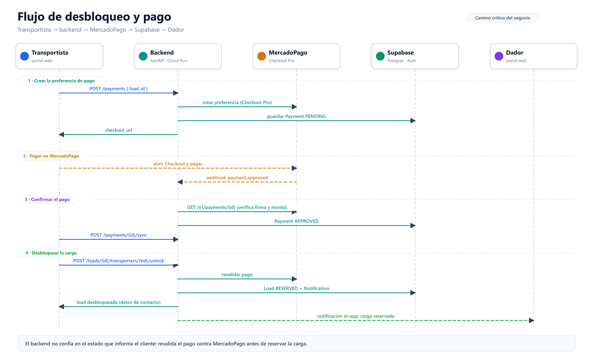

# Arquitectura

Esta página describe la arquitectura de Smartruck a octubre de 2026. Se apoya en el código de los repositorios y en la infraestructura Terraform de `smartruck-infra`: lo que sigue es lo que está desplegado y en uso, no una propuesta.

## Vista general

<iframe
  src="arquitectura/diagrams/smartruck-architecture.html"
  title="Diagrama interactivo de la arquitectura de Smartruck"
  loading="lazy"
  style="display: block; width: 100%; height: 820px; border: 1px solid #d9e0ea; border-radius: 12px;"
></iframe>

*Figura 1. Diagrama interactivo generado con Archify. [Abrir en una pestaña nueva](arquitectura/diagrams/smartruck-architecture.html) - [PNG transparente de respaldo](arquitectura/diagrams/presentacion/01-despliegue-general.png).*

| Banda | Componentes | Responsabilidad |
|-------|-------------|-----------------|
| **01 - Portales** | Dador, Transportista, Backoffice, Landing | Interfaz web por rol. Los tres portales autenticados consumen la API; la landing es pública y deriva a los portales. |
| **02 - Borde** | Cloudflare (DNS, TLS, rate limit de `/routes`), Geoservice (Worker) y API Gateway | El frontend y el backend consumen Geoservice directamente para todo lo geográfico; el API Gateway expone el backend para el resto de la API. |
| **03 - Núcleo** | `smartruck-backend` | Reglas de negocio y transacciones de cargas, usuarios, pagos, documentos y notificaciones. |
| **04 - Datos e integraciones** | Supabase (Auth, PostgreSQL, Storage), MercadoPago, Mapbox, Nominatim | Identidad, persistencia, archivos y servicios externos. |
| **05 - Observabilidad** | stdout JSON + correlation ID, Cloud Logging, Pub/Sub, Dataflow, Datadog (us5) y logs de Render | Trazabilidad del backend y de los portales. |

La topología de test y de prod vive en `smartruck-infra` (módulos `artifact_registry`, `cloud_run`, `api_gateway`, `wif`, `cloudflare_dns`, `cloudflare_waf`, `datadog_log_forwarding` y `render_datadog_log_stream`).

### Portales

- **Dador** (`smartruck-dador`): publica cargas, cotiza, gestiona ofertas y sigue pagos.
- **Transportista** (`smartruck-transportista`): busca cargas, calcula viajes, desbloquea ofertas con pago y gestiona flota y viajes.
- **Backoffice** (`smartruck-backoffice`): administración de usuarios, verificación de documentos y rol `ADMIN`.
- **Landing** (`landing-page`): sitio público con derivación al dador y al transportista.

Los tres portales autenticados usan TanStack Start + React. Cada uno consume **tres servicios por separado**, sin pasar por el backend para todo:

| Destino | Qué consume el portal | Cómo llega |
|---------|----------------------|------------|
| **Supabase Auth** | Sesión y JWT del usuario | `VITE_SUPABASE_URL` y `VITE_SUPABASE_ANON_KEY` |
| **Geoservice** | Rutas, distancias, catálogo de localidades, autocompletado de ciudades y asociación del pin a la localidad más cercana | `VITE_GEO_SERVICE_API`, o el hostname de Cloudflare según `VITE_APP_ENV` |
| **Backend** | Cargas, ofertas, pagos, documentos y perfil | `VITE_SMARTRUCK_BACKEND_API` por API Gateway |

El frontend no calcula distancias ni estimaciones: cuando Geoservice no responde, la interfaz muestra "distancia no disponible".

### Borde

- **Cloudflare**: DNS de `smartruck.tech`, TLS y rate limiting sobre el endpoint de rutas (120 req/min por IP y host, con ventana de 10 s).
- **Geoservice** (Cloudflare Worker, TypeScript; [repositorio](https://github.com/smartruck-ar/microservice-routes)): dueño de la geografía de la plataforma.
  - Endpoints: `/geo/routes` (y el alias legacy `/routes`), `/geo/routes/batch`, `/geo/localities` (búsqueda, `resolve`, `nearest` y `catalog`), `/geo/health` y `/geo/version`.
  - Catálogo cerrado de 24 provincias y 150 localidades con coordenadas, y 11.175 rutas precargadas con trazado vial.
  - Cascada de resolución: caché de Cloudflare (`caches.default`) → tabla `routes` del schema `geo` en Supabase (vía PostgREST con `supabase-js`) → proveedor Mapbox Directions (si hay token) → estimación geodésica marcada con `is_estimation`.
  - Los proveedores y las estimaciones no se cachean (`no-store`).
  - `AUTH_REQUIRED=true` exige un JWT de Supabase (ES256, JWKS, `audience=authenticated`); los healthchecks y `/version` quedan públicos.
- **API Gateway** (GCP): expone el backend en HTTPS y lo invoca con `run.invoker` sobre Cloud Run privado.

Geoservice tiene dos consumidores, y ninguno pasa por el API Gateway: el **frontend** lo llama por el hostname de Cloudflare con la sesión del usuario, y el **backend** lo llama con su propia credencial de servicio para cotizar y para sincronizar el catálogo de localidades.

### Núcleo

`smartruck-backend` es un monolito hexagonal en Python 3.12 con FastAPI, SQLModel y Alembic sobre PostgreSQL (Supabase). El código se organiza en:

| Capa | Rol |
|------|-----|
| `domain/` | Modelos, puertos, excepciones y reglas de negocio. |
| `application/` | Casos de uso, DTOs y `LogManager`. |
| `infrastructure/inbound/` | Adaptadores de entrada: HTTP controllers, DTOs, mappers y middlewares. |
| `infrastructure/outbound/` | Adaptadores de salida: persistencia PostgreSQL, Storage, gateways de pago y clientes HTTP. |

Agrupa funcionalmente identidad y perfiles, cargas y cotizaciones, pagos y desbloqueo, y documentos y confianza. Corre en Cloud Run privado detrás del API Gateway.

### Datos e integraciones

- **Supabase Auth**: emite JWT firmados con ES256 y publica JWKS.
- **Supabase PostgreSQL**: datos de negocio, tabla local con los ids válidos de localidad y schema `geo` con provincias, localidades y rutas que consume Geoservice.
- **Supabase Storage**: bucket privado `documents`; el backend firma URLs de subida y de lectura.
- **MercadoPago**: Checkout Pro, webhook y consulta de pagos.
- **Mapbox**: geocodificación y Directions. **Nominatim**: fallback de geocodificación.

### Observabilidad

- El backend emite logs JSON a stdout con `LogManager`. Un middleware agrega un correlation ID por request.
- En Cloud Run, los logs van a Cloud Logging y se reenvían por Pub/Sub y Dataflow a Datadog (`us5`).
- Los portales desplegados en Render envían sus logs a Datadog mediante un log stream de workspace.

## Componentes por repositorio

| Repositorio | Stack | Despliegue | Rol |
|-------------|-------|------------|-----|
| [smartruck-backend](https://github.com/smartruck-ar/smartruck-backend) | Python 3.12 - FastAPI - SQLModel - Alembic | Cloud Run privado detrás de API Gateway | API REST y reglas de negocio. |
| [Geoservice](https://github.com/smartruck-ar/microservice-routes) | TypeScript - Cloudflare Workers - `supabase-js` - `jose` | Cloudflare Workers | Ruteo, distancias y localidades. |
| [smartruck-dador](https://github.com/smartruck-ar/smartruck-dador) | TanStack Start - React | Render | Portal del dador. |
| [smartruck-transportista](https://github.com/smartruck-ar/smartruck-transportista) | TanStack Start - React | Render | Portal del transportista. |
| [smartruck-backoffice](https://github.com/smartruck-ar/smartruck-backoffice) | TanStack Start - React | Render | Administración, verificación y documentos. |
| [landing-page](https://github.com/smartruck-ar/landing-page) | React - Vite | Render | Sitio público y derivación. |
| [smartruck-infra](https://github.com/smartruck-ar/smartruck-infra) | Terraform (GCP, Cloudflare, Render) | — | Infraestructura como código. |

`smartruck-ai` y los templates (`cloud-template`, `infra-template`) son herramientas de proceso del equipo, no componentes del runtime del producto.

## Flujos principales

### Autenticación y autorización

1. Supabase Auth emite un JWT ES256 para el usuario.
2. Los frontends envían `Authorization: Bearer <token>` a `VITE_SMARTRUCK_BACKEND_API`.
3. El backend valida firma, issuer y vigencia contra el JWKS de Supabase. El backoffice exige además rol `ADMIN`.
4. Geoservice valida el mismo JWT cuando `AUTH_REQUIRED=true`; los endpoints de salud y versión quedan públicos.

### Cotización, publicación y ruteo

Hay tres caminos distintos según la operación:

- **Consultar rutas o distancias en la interfaz**: el frontend llama a Geoservice por el hostname de Cloudflare con la sesión del usuario, y usa el catálogo de localidades embebido en el build. La distancia no se calcula en el cliente.
- **Cotizar** (`POST /loads/quote`): `QuoteLoadUseCase` usa el puerto `RouteDistance` a través de `RoutesServiceDistance`, que llama a Geoservice (`ROUTES_SERVICE_BASE_URL`). El precio sugerido sale de `Pricing`.
- **Publicar** (`POST /loads/offerer/{offerer_id}`): `CreateLoadUseCase` resuelve origen y destino con `LocationResolver` y guarda **ids de localidad** (`origin_locality_id`, `destination_locality_id`), no nombres ni distancias. El backend valida esos ids contra su tabla local de ids válidos.

La carga es una referencia al catálogo, no una copia: la distancia y el trazado se leen siempre desde Geoservice, de modo que cotizar y mostrar coinciden.

### Búsqueda de cargas

`SearchLoadsUseCase` (expuesto como `POST /loads/search`) resuelve el matching de forma naive: obtiene todas las localidades y todas las cargas, filtra las activas, calcula distancias con `haversine × 1.25` y puntúa en memoria. No usa PostGIS ni la vista `matching_loads`. La mejora con poda espacial y scoring sobre el servicio geográfico es trabajo abierto del backend.

### Desbloqueo y pago

*Figura 2. Camino crítico desde la creación de la preferencia de pago hasta la reserva de la carga. Versión editable: [SVG](arquitectura/diagrams/flujo-desbloqueo.svg).*

1. El transportista bloquea la oferta (`POST /loads/{load_id}/transporters/{transporter_id}/lock`) y consulta el costo de desbloqueo (`GET /loads/{load_id}/unlock-fee`).
2. El frontend pide el pago (`POST /payments`). El backend crea un `Payment` en estado `PENDING` y una preferencia en MercadoPago Checkout Pro, y devuelve `checkout_url`.
3. El transportista paga en Checkout Pro. MercadoPago envía el webhook `POST /payments/mercadopago/webhook`; el backend valida la firma y consulta el pago al proveedor.
4. El frontend reconcilia con `POST /payments/{payment_id}/sync`.
5. El transportista confirma el desbloqueo (`POST /loads/{load_id}/transporters/{transporter_id}/unlock`). `UnlockLoadUseCase` **revalida contra MercadoPago** el estado, la referencia externa, el importe y la moneda; recién entonces marca el pago como aprobado y la carga como `RESERVED`.
6. El backend crea una notificación in-app para el dador.

El backend no confía en el estado que informa el cliente: la reserva exige un pago efectivamente aprobado por MercadoPago.

### Documentos y verificación

1. El usuario pide una URL de subida (`POST /documents/upload-url`) y el backend registra la intención y firma la URL.
2. El cliente sube el archivo directo a Supabase Storage (bucket privado `documents`).
3. El cliente confirma (`POST /documents/{document_id}/confirm`); el backend valida tamaño y tipo.
4. El usuario puede obtener una URL de lectura firmada (`GET /documents/{document_id}/read-url`); el backoffice verifica los documentos desde sus propios endpoints de administración.

## Trabajo pendiente

- El matching del backend sigue puntuando en memoria; la mejora es Postgres con PostGIS y el lote de Geoservice.
- Sin circuit breaker ni pooling HTTP en `RoutesServiceDistance` (usa `urllib`).
- Sin PWA ni service worker en los portales.

## Enlaces

- Repositorios: [smartruck-backend](https://github.com/smartruck-ar/smartruck-backend), [Geoservice](https://github.com/smartruck-ar/microservice-routes), [smartruck-dador](https://github.com/smartruck-ar/smartruck-dador), [smartruck-transportista](https://github.com/smartruck-ar/smartruck-transportista), [smartruck-backoffice](https://github.com/smartruck-ar/smartruck-backoffice), [landing-page](https://github.com/smartruck-ar/landing-page), [smartruck-infra](https://github.com/smartruck-ar/smartruck-infra).
- Convenciones de logging: [Logging (hexagonal)](./wiki/proceso/logging.md).
- Detalle por repositorio: [Repositories](./repositories/README.md).

## Vistas para la presentación

Estas vistas se prepararon a partir del modelo de arquitectura validado en Archify, como PNGs transparentes individuales de 3200 × 1800; muestran solo los diagramas, sin títulos ni encabezados, y usan tipografía grande. Los diagramas distinguen las llamadas directas del frontend y del backend a Geoservice.

- [01 - Vista de despliegue](arquitectura/diagrams/presentacion/01-despliegue-general.png)
- [02 - Portales y API Gateway](arquitectura/diagrams/presentacion/02-portales-y-gateway.png)
- [03 - Camino geográfico](arquitectura/diagrams/presentacion/03-ruteo-geografico.png)
- [04 - Backend e integraciones](arquitectura/diagrams/presentacion/04-backend-integraciones.png)
- [05 - Pagos con MercadoPago](arquitectura/diagrams/presentacion/05-pagos-mercadopago.png)
- [06 - Identidad, datos y archivos](arquitectura/diagrams/presentacion/06-datos-y-archivos.png)
- [07 - Observabilidad](arquitectura/diagrams/presentacion/07-observabilidad.png)
