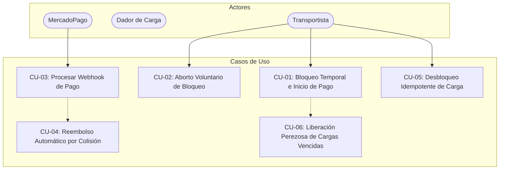
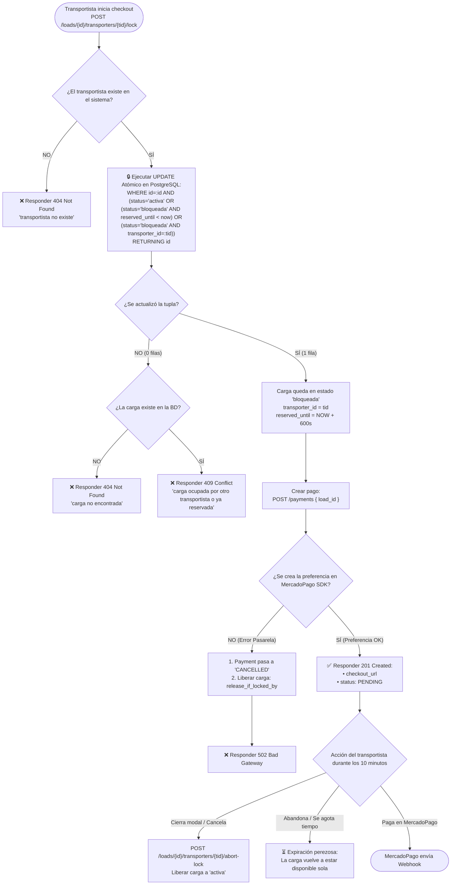
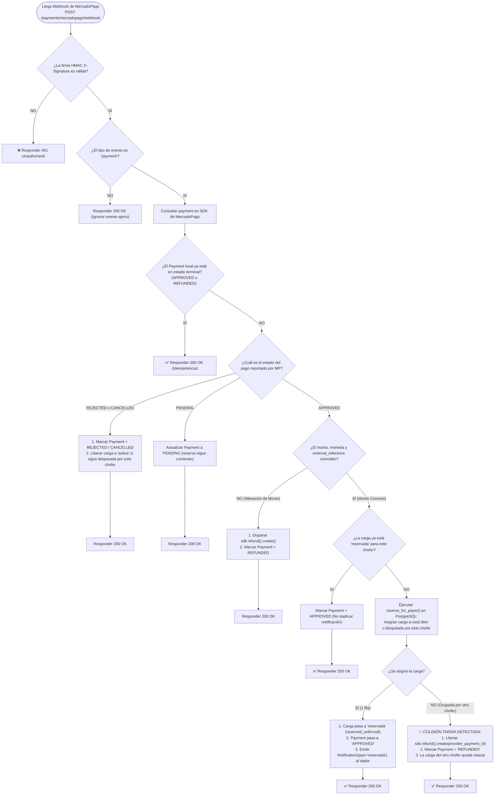
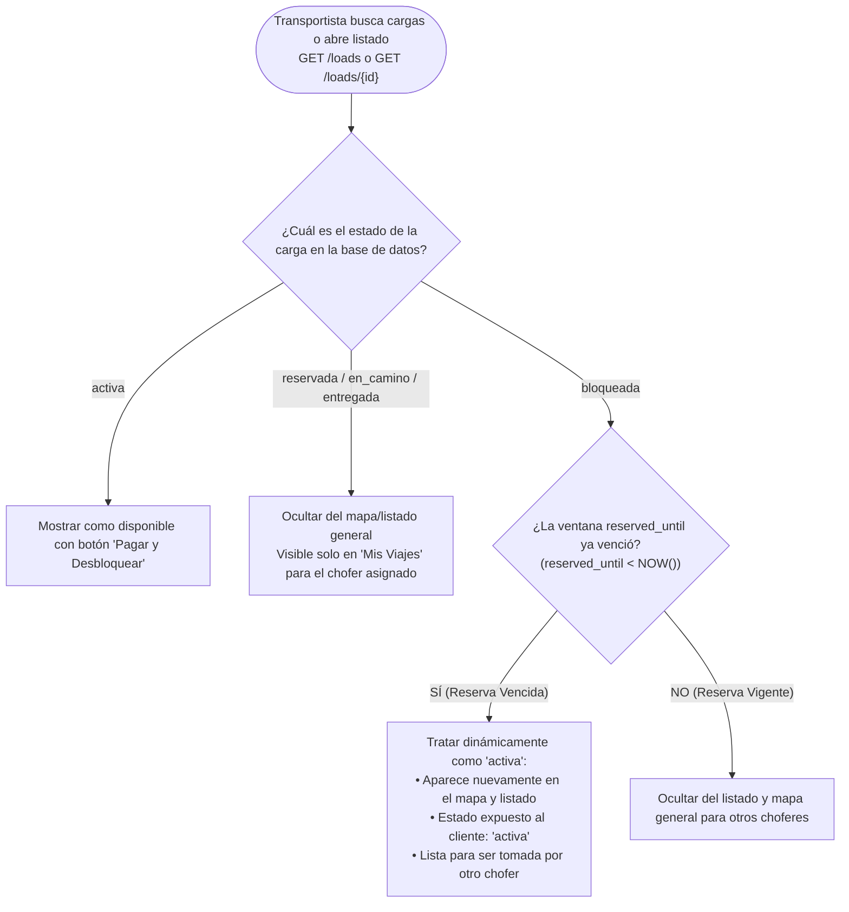
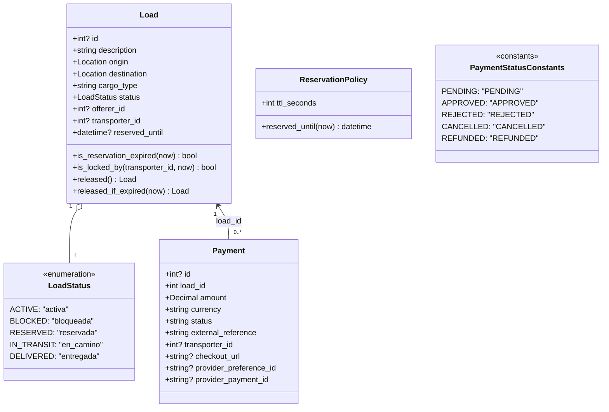
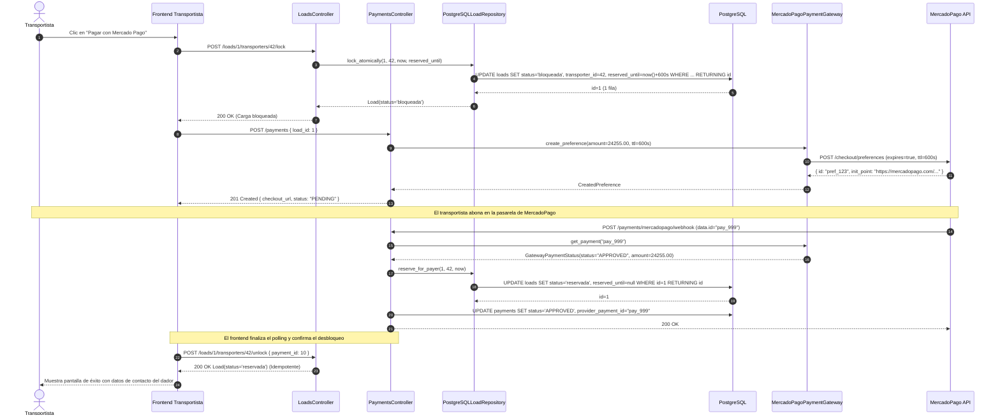
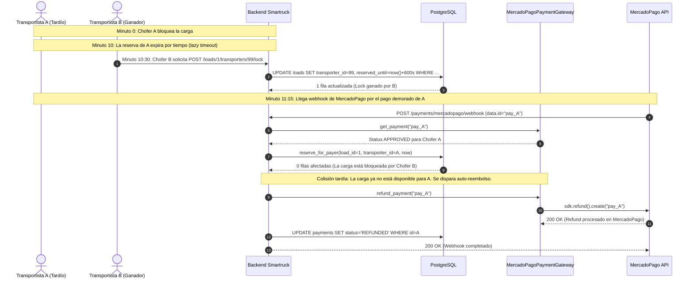
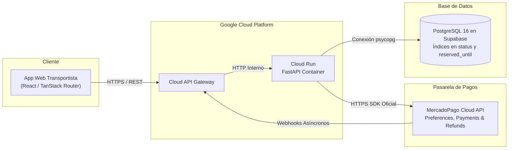

# Documento de Arquitectura de Software: Reserva Temporal, Concurrencia y Desbloqueo Consistente de Cargas
**Modelo de Vistas Arquitectónicas 4+1 (Philippe Kruchten) + Árboles de Decisión y Prosa Exhaustiva**  
**Proyecto:** Smartruck Backend & Frontend Transportista  
**Módulo:** Gestión de Cargas y Pasarela de Pagos (MercadoPago Checkout Pro)  
**Ticket:** T.2.32 — Desbloqueo y Reserva Consistente de Cargas  
**Versión:** 4.1 (Definitiva y fiel al código en producción)

---

## Índice General

1. [Resumen Ejecutivo y Declaración del Problema](#1-resumen-ejecutivo-y-declaración-del-problema)
2. [Vista de Escenarios (Narrativa en Prosa de los 12 Casos de Uso)](#2-vista-de-escenarios-narrativa-en-prosa-de-los-12-casos-de-uso)
3. [Vista Lógica: Árboles de Decisión y Explicación en Prosa](#3-vista-lógica-árboles-de-decisión-y-explicación-en-prosa)
   - [3.1. Árbol 1: Bloqueo Temporal e Inicio de Pago](#31-árbol-1-flujo-de-bloqueo-temporal-e-inicio-de-pago)
   - [3.2. Árbol 2: Procesamiento del Webhook de MercadoPago y Reembolso](#32-árbol-2-procesamiento-del-webhook-de-mercadopago-y-reembolso)
   - [3.3. Árbol 3: Consulta, Búsqueda y Visibilidad de Cargas](#33-árbol-3-consulta-búsqueda-y-visibilidad-de-cargas)
   - [3.4. Diagrama de Clases del Dominio (DDD Táctico)](#34-diagrama-de-clases-del-dominio-ddd-táctico)
4. [Vista de Procesos: Diagramas de Secuencia y Narrativa Técnica](#4-vista-de-procesos-diagramas-de-secuencia-y-narrativa-técnica)
   - [4.1. Secuencia del Caso Feliz (< 10 min)](#41-secuencia-del-caso-feliz-bloqueo-pago-y-desbloqueo--10-min)
   - [4.2. Secuencia del Caso Borde Crítico (Webhook Tardío con Auto-Refund)](#42-secuencia-del-caso-borde-crítico-webhook-tardío-con-reembolso-automático)
5. [Vista de Desarrollo (Arquitectura Hexagonal, Capas y Puertos)](#5-vista-de-desarrollo-arquitectura-hexagonal-capas-y-puertos)
6. [Vista Física y de Despliegue en la Nube](#6-vista-física-y-de-despliegue-en-la-nube)
7. [Mecanismos de Persistencia y Consulta SQL Atómica](#7-mecanismos-de-persistencia-y-consulta-sql-atómica)
8. [Matriz de Riesgos, Resiliencia y Mitigaciones](#8-matriz-de-riesgos-resiliencia-y-mitigaciones)
9. [Alcance y Casos Diferidos](#9-alcance-y-casos-diferidos)

---

## 1. Resumen Ejecutivo y Declaración del Problema

En la plataforma logística Smartruck, transportistas y dadores de carga interactúan concurrentemente en tiempo real. La asignación física de un viaje exige el pago previo de un *Unlock Fee* a través de MercadoPago Checkout Pro. La consistencia en el estado de las cargas es de misión crítica para evitar disputas comerciales y pérdida de reputación.

### Los 4 Grandes Desafíos de Concurrencia

1. **Condición de Carrera (*Race Condition*)**:  
   Dos o más transportistas intentan tomar la misma carga al mismo tiempo. Sin un bloqueo transaccional a nivel de tupla en PostgreSQL, ambos podrían obtener preferencias de pago independientes para la misma carga física.
2. **Doble Cobro sin Asignación Física**:  
   Si MercadoPago cobra a dos choferes por el mismo viaje (debido a latencias de red o pagos rezagados), el sistema no puede permitir que ambos tengan la carga. Debe garantizarse que solo uno sea asignado y que el segundo reciba un reembolso automático inmediato sin intervención manual.
3. **Bloqueos Fantasma (*Stale Locks / Abandoned Checkouts*)**:  
   Si un transportista inicia la reserva pero abandona el checkout, cierra el navegador o se queda sin batería, la carga no debe quedar bloqueada indefinidamente. La carga debe volver a aparecer en los listados y mapas para otros choferes tras vencer la ventana temporal de 10 minutos (`reserved_until < NOW()`).
4. **Desincronización por Latencia de Red (*Late Webhooks*)**:  
   Un transportista paga en el límite de los 10 minutos (p. ej. minuto 09:59) y el webhook de MercadoPago llega con demora (minuto 11:30) cuando la ventana de reserva ya expiró. El sistema debe evaluar de forma atómica si la carga sigue libre para asignarla tolerantemente, o si ya fue bloqueada/tomada por otro chofer para disparar un reembolso automático total (*auto-refund*).

### La Solución Arquitectónica
Se implementa una ventana de **Bloqueo Temporal Optimista de 10 Minutos** sincronizada con el TTL de la preferencia de MercadoPago (`PREFERENCE_TTL_SECONDS = 600`), controlada por una sentencia atómica `UPDATE ... WHERE ... RETURNING` en PostgreSQL, un webhook handler idempotente con guarda de estados terminales y un servicio de **Reembolso Automático (*Auto-Refund*)** ante desincronización tardía o alteración de montos.

---

## 2. Vista de Escenarios (Narrativa en Prosa de los 12 Casos de Uso)



### Explicación en Prosa de Cada Escenario:

* **E01 - Caso Feliz Estándar (Pago en < 10 minutos)**:  
  El transportista visualiza una carga en estado `activa`. Al presionar pagar en el modal de checkout, el frontend ejecuta `POST /loads/{id}/transporters/{tid}/lock`. El backend actualiza la fila atómicamente a `bloqueada` con `reserved_until = NOW() + 600s`. Luego se crea la preferencia de pago en MercadoPago (`POST /payments`) y el chofer abona dentro del plazo. Llega el webhook `APPROVED`. El backend confirma la vigencia, asigna la carga pasando a `reservada`, limpia el `reserved_until`, aprueba el `Payment` y crea la notificación para el dador. Cuando el frontend completa el polling y llama a `POST /loads/{id}/transporters/{tid}/unlock`, la operación responde de manera idempotente entregando los datos completos del dador.
* **E02 - Concurrencia Simultánea (Dos transportistas en el mismo milisegundo)**:  
  El transportista A y el transportista B solicitan el lock de la carga al mismo tiempo. El motor de PostgreSQL evalúa la condición atómica `WHERE id = :id AND (status = 'activa' OR (status = 'bloqueada' AND reserved_until < :now))`. El primer proceso gana la tupla y cambia el estado a `bloqueada`. Cuando el segundo proceso evalúa la tupla, la condición es falsa (0 filas afectadas). El backend detecta la colisión y responde `409 Conflict` informando que la carga está ocupada por otro chofer.
* **E03 - Abandono de Pago (Expiración Perezosa / Lazy Timeout)**:  
  El transportista A bloquea la carga pero abandona la pantalla. Transcurren los 10 minutos. No se requiere ningún cron en segundo plano consumiendo CPU: la próxima vez que cualquier usuario busque o liste cargas, la consulta SQL evalúa `OR (status = 'bloqueada' AND reserved_until < NOW())`, tratando la tupla como disponible. Si otro transportista B solicita el lock, la condición atómica le transfiere la carga directamente.
* **E04 - Cancelación Manual por el Transportista**:  
  El transportista inicia el proceso pero cierra el diálogo de checkout o presiona volver. El frontend dispara `POST /loads/{id}/transporters/{tid}/abort-lock`. El backend comprueba que la carga siga bloqueada por ese mismo transportista y la retorna inmediatamente a `activa` con `transporter_id = null` y `reserved_until = null`, dejándola disponible al instante sin esperar los 10 minutos.
* **E05 - Pago Rechazado o Cancelado en MercadoPago**:  
  La tarjeta del transportista es rechazada o el usuario cancela en la pasarela. MercadoPago emite el webhook con estado `REJECTED` o `CANCELLED`. El backend actualiza el registro local del `Payment` y, al constatar que la carga continúa bloqueada por ese mismo chofer, ejecuta `release_if_locked_by`, devolviéndola inmediatamente a `activa`.
* **E06 - Webhook Tardío con Carga Libre**:  
  El transportista A completa el pago con demora y la notificación llega en el minuto 11 (cuando la reserva ya había expirado). Al evaluar la carga, el backend verifica que ningún otro chofer la tomó en ese lapso (sigue libre o con reserva vencida). Por tolerancia de negocio, ejecuta `reserve_for_payer`, asignándole la carga a A (`reservada`).
* **E07 - Webhook Tardío con Carga Ocupada (Colisión Crítica: Auto-Refund)**:  
  El transportista A pagó con retraso, pero en el minuto 10:30 el transportista B bloqueó la carga libre. Cuando llega el webhook de aprobación de A, el backend detecta que la carga ya no puede ser asignada a A. Para evitar cobrarle por un viaje que no tendrá, invoca inmediatamente al SDK oficial de MercadoPago (`sdk.refund().create(provider_payment_id)`), reintegra el 100% del dinero, guarda el pago local como `REFUNDED` y responde `200 OK` al webhook.
* **E08 - Idempotencia ante Webhooks Duplicados**:  
  MercadoPago reenvía la notificación de pago varias veces por reintentos de red. El backend busca el pago por `external_reference`. Si el pago ya se encuentra en un estado terminal (`APPROVED` o `REFUNDED`), retorna `200 OK` inmediatamente sin re-ejecutar transacciones ni duplicar notificaciones.
* **E09 - Seguridad: Firma Criptográfica HMAC Inválida**:  
  Un atacante envía peticiones simuladas a `/payments/mercadopago/webhook`. El gateway verifica las cabeceras `X-Signature` y `X-Request-Id` contra `MERCADOPAGO_WEBHOOK_SECRET` mediante `WebhookSignatureValidator`. Al no coincidir, rechaza la solicitud con `401 Unauthorized` sin modificar la base de datos.
* **E10 - Detección de Alteración de Monto (*Tampering*)**:  
  Un usuario malintencionado intenta manipular los parámetros de pago abonando un importe menor al oficial. Al llegar el webhook aprobado, el backend compara `status.amount` y `status.currency` contra el `Payment` local. Al diferir, dispara `refund_payment()` automáticamente, marca el pago como `REFUNDED` y no asigna la carga.
* **E11 - Consulta y Polling de Estado desde el Frontend**:  
  Mientras el transportista está en el checkout de MercadoPago, la aplicación web realiza sondeo a `GET /payments/{id}`. Al detectarse el cambio a `APPROVED`, sincroniza la pantalla de espera y llama al endpoint de confirmación `unlock`.
* **E12 - Falla de Pasarela al Crear Preferencia**:  
  Si MercadoPago se encuentra caído o hay error de conexión al invocar `create_preference()`, el caso de uso marca el `Payment` como `CANCELLED`, libera inmediatamente el bloqueo previo de la carga para que no quede retenida, y propaga `502 Bad Gateway` al cliente.

---

## 3. Vista Lógica: Árboles de Decisión y Explicación en Prosa

### 3.1. Árbol 1: Flujo de Bloqueo Temporal e Inicio de Pago



#### Explicación en Prosa del Árbol 1:
1. **Validación de Identidad**: El controlador valida que el transportista autenticado exista en la base de datos.
2. **Bloqueo Transaccional Atómico**: Se ejecuta un `UPDATE` condicional que solo tiene éxito si la carga está `activa`, si su reserva anterior ya expiró (`reserved_until < NOW()`), o si ya está bloqueada por el mismo chofer (renovando la ventana de tiempo).
   - Si no afecta filas, se verifica si la carga no existe (404) o si fue tomada por otro transportista (409 Conflict).
3. **Generación de Preferencia**: Una vez asegurado el lock, se crea la preferencia de pago vinculando el `transporter_id` al registro de `Payment`. Si la pasarela externa falla, se cancela el pago, se libera el lock de la carga y se devuelve `502 Bad Gateway`.
4. **Comportamiento durante la ventana**: Si el transportista cancela, se invoca `abort-lock` y la carga vuelve a `activa` de inmediato. Si abandona, la reserva expira silenciosamente por tiempo.

---

### 3.2. Árbol 2: Procesamiento del Webhook de MercadoPago y Reembolso



#### Explicación en Prosa del Árbol 2:
1. **Autenticación e Idempotencia**: Se valida la firma HMAC del webhook. Si el pago ya fue marcado como `APPROVED` o `REFUNDED`, se responde inmediatamente `200 OK` garantizando idempotencia estricta ante notificaciones duplicadas.
2. **Rechazo o Cancelación**: Se actualiza el pago a `REJECTED` o `CANCELLED` y se libera la carga inmediatamente a `activa` si todavía estaba bloqueada por ese mismo transportista.
3. **Aprobación e Integridad de Monto**: Se valida que el monto cobrado coincida exactamente con la tarifa requerida. Si hubo alteración (*tampering*), se reembolsa y no se asigna la carga.
4. **Asignación o Auto-Refund**:
   - Si la carga sigue bloqueada por el chofer o está libre, la consulta `reserve_for_payer` la pasa atómicamente a `reservada`, limpia el temporizador y emite la notificación al dador.
   - Si la carga ya fue tomada por otro transportista (caso borde tardío), se dispara el reembolso automático del 100% mediante el SDK de MercadoPago y el pago queda registrado como `REFUNDED`.

---

### 3.3. Árbol 3: Consulta, Búsqueda y Visibilidad de Cargas



#### Explicación en Prosa del Árbol 3:
1. **Expiración Transparente**: La cláusula de disponibilidad en persistencia (`_available_clause`) incluye automáticamente tanto las cargas con estado `activa` como aquellas en estado `bloqueada` cuya ventana de reserva ya expiró (`reserved_until < NOW()`).
2. **Mapeo Limpio de Dominio**: El método `Load.released_if_expired(now)` transforma en memoria cualquier carga vencida al estado `activa` (limpiando `transporter_id` y `reserved_until` caducos), de modo que los clientes web y móviles nunca reciben información inconsistente de bloqueos obsoletos.

---

### 3.4. Diagrama de Clases del Dominio (DDD Táctico)



---

## 4. Vista de Procesos: Diagramas de Secuencia y Narrativa Técnica

### 4.1. Secuencia del Caso Feliz: Bloqueo, Pago y Desbloqueo (< 10 min)



---

### 4.2. Secuencia del Caso Borde Crítico: Webhook Tardío con Reembolso Automático



---

## 5. Vista de Desarrollo (Arquitectura Hexagonal, Capas y Puertos)

Estructura de archivos real implementada en `smartruck-backend`:

```text
src/
├── domain/                                                # Dominio puro sin dependencias de infraestructura
│   ├── models/
│   │   ├── load.py                                        # Entidad Load (is_reservation_expired, released_if_expired)
│   │   ├── payment.py                                     # Entidad Payment (status, REFUNDED, transporter_id)
│   │   └── notification.py                                # Entidad Notification (tipo 'reservada')
│   ├── repositories/
│   │   ├── load_repository.py                             # Puerto: lock_atomically(), reserve_for_payer(), release_if_locked_by()
│   │   ├── payment_repository.py                          # Puerto: get_by_external_reference(), save()
│   │   └── notification_repository.py                     # Puerto: save()
│   ├── gateways/
│   │   └── payment_gateway.py                             # Puerto: create_preference(), get_payment(), refund_payment()
│   ├── reservation.py                                     # Value Object ReservationPolicy y helper as_aware
│   ├── load_status.py                                     # Enum LoadStatus (activa, bloqueada, reservada)
│   └── exceptions.py                                      # LoadAlreadyLockedError (409), PaymentGatewayError (502)
│
├── application/                                           # Orquestación de Casos de Uso
│   └── use_cases/
│       ├── loads/
│       │   ├── lock_load_use_case.py                      # Orquesta el bloqueo atómico y aborto voluntario
│       │   ├── unlock_load_use_case.py                    # Confirmación idempotente de desbloqueo
│       │   └── get_unlock_fee_use_case.py                 # Cálculo de tarifa de desbloqueo
│       └── payments/
│           ├── create_payment_use_case.py                 # Valida disponibilidad, crea preferencia y Payment
│           ├── process_payment_notification_use_case.py   # Webhook handler: idempotencia, asignación y auto-refund
│           └── sync_payment_use_case.py                   # Sincronización manual de pago
│
├── infrastructure/                                        # Adaptadores Hexagonales
│   ├── inbound/
│   │   ├── http_controllers/
│   │   │   ├── loads_controller.py                        # /loads/{id}/transporters/{tid}/lock | abort-lock | unlock
│   │   │   └── payments_controller.py                     # /payments, /payments/mercadopago/webhook, /payments/{id}
│   │   ├── dto/load/load_response.py                      # DTO con campo reserved_until opcional
│   │   └── mappers/load_http_mapper.py                    # Mapeo a respuesta HTTP
│   └── outbound/
│       ├── gateways/
│       │   └── mercadopago_payment_gateway.py             # SDK MercadoPago oficial: preference, payment, refund
│       └── persistence/
│           ├── models/
│           │   ├── load.py                                # LoadRecord con columna reserved_until e índices
│           │   └── payment.py                             # PaymentRecord con columna transporter_id
│           └── repositories/
│               ├── postgres_load_repository.py            # Implementación SQL atómica y cláusula de disponibilidad
│               └── postgres_payment_repository.py         # Persistencia de pagos
│
└── config/
    ├── mercadopago.py                                     # Variables de entorno y PREFERENCE_TTL_SECONDS (600s)
    └── reservation.py                                     # Fábrica de ReservationPolicy
```

---

## 6. Vista Física y de Despliegue en la Nube



---

## 7. Mecanismos de Persistencia y Consulta SQL Atómica

### 7.1. Sentencia de Bloqueo Atómico (`lock_atomically`)

```sql
UPDATE loads
SET 
    status = 'bloqueada',
    transporter_id = :transporter_id,
    reserved_until = :reserved_until
WHERE 
    id = :load_id 
    AND (
        status = 'activa' 
        OR (status = 'bloqueada' AND reserved_until < :now)
        OR (status = 'bloqueada' AND transporter_id = :transporter_id)
    )
RETURNING id;
```

### 7.2. Sentencia de Asignación Atómica para el Pagador (`reserve_for_payer`)

```sql
UPDATE loads
SET 
    status = 'reservada',
    transporter_id = :transporter_id,
    reserved_until = NULL
WHERE 
    id = :load_id 
    AND (
        status = 'activa' 
        OR (
            status = 'bloqueada' 
            AND (transporter_id = :transporter_id OR reserved_until < :now)
        )
    )
RETURNING id;
```

### 7.3. Cláusula de Disponibilidad para Consultas y Búsquedas (`_available_clause`)

```sql
-- Filtro aplicado en get_available(), búsquedas por área y recomendaciones
status = 'activa' OR (status = 'bloqueada' AND reserved_until < :now)
```

### 7.4. Migración Alembic Real (`0035_add_load_reservation_window.py`)

```python
"""add reserved_until to loads and payer transporter_id to payments

Revision ID: 0035
Revises: 0034
Create Date: 2026-10-28 12:00:00.000000

"""
from alembic import op
import sqlalchemy as sa

revision = "0035"
down_revision = "0034"

def upgrade() -> None:
    op.add_column("loads", sa.Column("reserved_until", sa.DateTime(timezone=True), nullable=True))
    op.create_index("ix_loads_status_reserved_until", "loads", ["status", "reserved_until"])
    op.add_column("payments", sa.Column("transporter_id", sa.Integer(), nullable=True))
    op.create_foreign_key(
        "fk_payments_transporter_id_transporters",
        "payments",
        "transporters",
        ["transporter_id"],
        ["id"],
    )

def downgrade() -> None:
    op.drop_constraint("fk_payments_transporter_id_transporters", "payments", type_="foreignkey")
    op.drop_column("payments", "transporter_id")
    op.drop_index("ix_loads_status_reserved_until", table_name="loads")
    op.drop_column("loads", "reserved_until")
```

---

## 8. Matriz de Riesgos, Resiliencia y Mitigaciones

| Riesgo Técnico | Impacto | Estrategia de Mitigación Implementada |
|---|:---:|---|
| **Doble asignación por Webhook tardío** | Crítico | Verificación atómica en `reserve_for_payer`. Si la carga ya fue tomada por otro, se dispara `sdk.refund().create()` automáticamente y el pago queda en `REFUNDED`. |
| **Colisión de concurrencia al reservar** | Alto | Consulta atómica `UPDATE ... WHERE ... RETURNING id`. Retorna 0 filas si otro chofer ganó la tupla y el controlador responde `409 Conflict`. |
| **Bloqueos huérfanos por abandono** | Medio | Expiración perezosa (*lazy expiration*): toda consulta de cargas trata `reserved_until < NOW()` como disponible, sin requerir crons periódicos. |
| **Webhooks duplicados o fuera de orden** | Medio | Guarda de estados terminales (`APPROVED`, `REFUNDED`) en `ProcessPaymentNotificationUseCase`. Un webhook tardío o duplicado es una operación no-op que responde `200 OK`. |
| **Alteración de importe (*Tampering*)** | Alto | Comparación estricta de `amount`, `currency` y `external_reference`. Ante discrepancias, se cancela la asignación y se ejecuta el reembolso total inmediato. |
| **Falla de conexión con MercadoPago al crear preferencia** | Medio | Fallo rápido con `PaymentGatewayError` (502 Bad Gateway), marcando el pago local como `CANCELLED` y liberando el bloqueo de la carga. |

---

## 9. Alcance y Casos Diferidos

* **Fuera de Alcance Inmediato**:  
  - No se implementa un proceso cron en segundo plano que ejecute *polling* contra la base de datos para limpiar tuplas vencidas. La liberación perezosa en consultas de lectura y re-locks resuelve completamente la consistencia con menor sobrecarga de infraestructura.
  - No se realiza reconciliación proactiva contra el API de pagos en caso de pérdida total de webhooks prolongada más allá de las 48 horas de reintentos de MercadoPago.
* **Verificación de Calidad**:  
  - Se añadieron pruebas unitarias exhaustivas en Python (`pytest`) para todos los árboles de decisión y casos borde (845 tests pasando en `smartruck-backend`).
  - Se verificaron 849 tests unitarios y de componentes pasando en el frontend de transportistas (`vitest` en `smartruck-transportista`).
