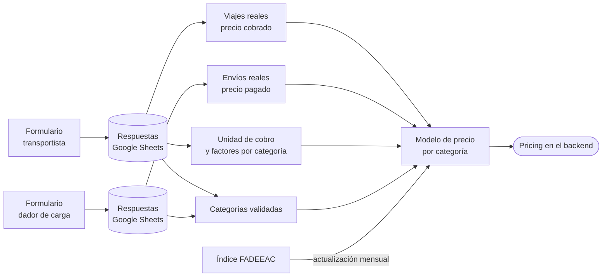
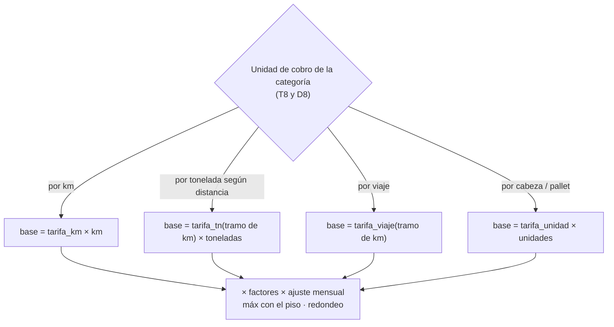

# Tarifario: formularios de relevamiento y modelo de estimación de precio

> Diseño de los Google Forms del spike **S.2** ([roadmap#127](https://github.com/smartruck-ar/roadmap/issues/127)) y de cómo sus respuestas alimentan la regla de precio sugerido al dador ([smartruck-backend#124](https://github.com/smartruck-ar/smartruck-backend/issues/124), D.2.1.4).
> Fecha: 2026-10-05 · v2: dos formularios (transportista y dador), introducción académica, preguntas reducidas.

---

## 1. Contexto y problema

### 1.1 Qué hay hoy

El precio sugerido al dador se calcula en `Pricing` (`smartruck-backend/src/domain/models/pricing.py`):

```
precio_sugerido = max(2.000 ARS × km, 50.000 ARS)
```

| Supuesto actual | Problema |
|---|---|
| Una sola tarifa por km para **todas** las categorías | Un flete de hacienda, uno refrigerado y uno de carga peligrosa no cuestan lo mismo por km |
| La unidad de cobro es **siempre el km** | En granos el mercado usa una **tarifa por tonelada según la distancia** (ver 1.2) |
| Los valores 2.000 y 50.000 son **constantes sin fuente** | No hay respaldo para defender la cifra ni un criterio para actualizarla |
| No considera peso, equipo, retorno vacío ni costos extra | Factores que el transportista sí tiene en cuenta al cotizar |
| No se actualiza | Los costos del transporte suben todos los meses (ver 1.2) |

### 1.2 Referencias de mercado existentes en Argentina

| Referencia | Qué es | Uso para Smartruck |
|---|---|---|
| **Tarifa referencial de fletes de granos** | Tarifa por **tonelada** según la distancia, acordada entre entidades de transportistas y dadores de carga con mediación del Ministerio de Transporte. FETRA calcula la evolución de costos que se usa para ajustarla | Base directa para las categorías de granos y agroindustria |
| **Índice de Costos del Transporte de Cargas (FADEEAC)** | Índice mensual de 11 rubros (combustible, salarios, mantenimiento, etc.), auditado por la FCE-UBA | **Actualizar** las tarifas mes a mes sin volver a relevar |

### 1.3 Por qué dos formularios

| | Formulario transportista | Formulario dador de carga |
|---|---|---|
| **Pregunta central** | ¿Cómo **cobrás** un flete? | ¿Cómo **pagás** un flete? |
| **Qué aporta** | Unidad de cobro, piso mínimo, factores de costo, fuentes del tarifario, precio cobrado | Cómo contrata, cómo se define el precio, qué referencias usa, precio pagado, interés en un precio sugerido |
| **Por qué separarlo** | Cada formulario queda más corto y con el lenguaje de quien responde | |

Cruzar los dos lados permite comparar **lo que se cobra** con **lo que se paga** para la misma categoría, y validar si al dador le sirve que la plataforma le sugiera un precio.



---

## 2. Formularios

### 2.1 Principios

- **5 minutos como objetivo** para cada formulario: unas 20 preguntas, la mayoría cerradas.
- **Introducción académica al inicio**, para que quien responde sepa que no es una empresa ni otro transportista buscando información comercial.
- **Sin repeticiones**: cada dato se pregunta una sola vez.
- **"Otro" abierto** donde sirve para validar nuestras listas.
- **Un viaje o envío real** al final: el dato más valioso para calibrar. Es opcional, para no perder respuestas.
- **Anónimo**, con contacto opcional.
- **Voseo**, como en el mensaje de difusión. Si se prefiere un registro más formal, alcanza con ajustar los textos del script (sección 4).

### 2.2 Introducción (igual en los dos formularios)

> **Relevamiento de tarifas de fletes — Trabajo Profesional FIUBA**
>
> Somos un grupo de estudiantes de la Facultad de Ingeniería de la Universidad de Buenos Aires (FIUBA). Para nuestro Trabajo Profesional (el trabajo final de la carrera) estamos desarrollando una plataforma que conecta transportistas con dadores de carga.
>
> Con esta encuesta queremos entender cómo se cotizan los fletes en Argentina. No representamos a ninguna empresa de transporte. Las respuestas son **anónimas** y se usan **solo con fines académicos**.
>
> Te lleva unos 5 minutos. ¡Muchas gracias!
>
> Contacto: `[mail del grupo]`

> Completar el mail de contacto del grupo antes de publicar: aumenta la confianza y permite que quien dude pueda consultar.

### 2.3 Mensaje de difusión

> Hola! Somos estudiantes de Ingeniería de la UBA y estamos haciendo nuestro trabajo final sobre transporte de cargas. Nos ayudarías mucho respondiendo una encuesta corta (5 min, anónima):
>
> 🚛 **Si sos transportista:** `[link formulario transportista]`
> 📦 **Si sos dador de carga:** `[link formulario dador]`
>
> ¡Gracias por compartir!

### 2.4 Formulario transportista

#### Sección 1 · Sobre vos

| # | Pregunta | Tipo | Opciones | Obligatoria |
|---|---|---|---|---|
| T1 | ¿Cómo trabajás? | Opción única + "Otro" | Transportista independiente · Empresa de transporte · Intermediario / broker | Sí |
| T2 | ¿Cuántos camiones operás? | Opción única | 1 · 2 a 5 · 6 a 20 · Más de 20 | Sí |
| T3 | ¿Qué equipos usás? | Casillas + "Otro" | Semirremolque · Acoplado · Bitren · Batea · Tolva · Cisterna · Furgón / térmico · Sider · Jaula (hacienda) · Plataforma / playo · Portacontenedor · Carretón | Sí |
| T4 | ¿En qué provincia tenés tu base? | Desplegable | 24 jurisdicciones | Sí |

> T3 releva a la vez la **configuración** del tráiler (semirremolque, acoplado, bitren) y el **tipo de carrocería** (batea, tolva, sider…), una decisión pendiente del modelo de datos (B15 en [plan-centralizacion-routes.md](plan-centralizacion-routes.md)).

#### Sección 2 · Qué transportás

| # | Pregunta | Tipo | Opciones | Obligatoria |
|---|---|---|---|---|
| T5 | ¿Qué tipos de carga transportás? | Casillas + "Otro" | Las 6 categorías del sistema (ver 2.6) | Sí |
| T6 | ¿Falta algún tipo de carga en la lista, o hay alguno que no tenga sentido? | Párrafo | — | No |

#### Sección 3 · Cómo cobrás

| # | Pregunta | Tipo | Opciones | Obligatoria |
|---|---|---|---|---|
| T7 | ¿Cuál es el tipo de carga que más transportás? | Desplegable | Las 6 categorías + Otra | Sí |
| T8 | Para ese tipo de carga, ¿cómo calculás el precio de un viaje? **(podés marcar más de una)** | **Casillas** + "Otro" | Por kilómetro · Por tonelada · Por tonelada según la distancia (tabla) · Precio fijo por viaje · Por pallet o bulto · Por cabeza (hacienda) · Por hora o jornada · Lo fija el dador | Sí |
| T9 | Si cobrás un mínimo por viaje, ¿de cuánto es? (en pesos; dejalo vacío si no cobrás mínimo) | Respuesta corta | — | No |
| T10 | ¿Cuánto influye cada factor en el precio? | Cuadrícula | Filas: Peso · Carga peligrosa · Refrigeración · Urgencia · Carga, descarga y espera · Peajes · Caminos de tierra o ripio · Volver vacío. Columnas: No influye · Influye poco · Influye mucho | Sí |

> T8 pasó de opción única a **casillas**: un mismo viaje puede combinar unidades (por ejemplo, por tonelada con un mínimo fijo por viaje). En Google Forms, "opción múltiple" permite elegir **una sola** respuesta; para elegir varias hay que usar "casillas de verificación".

#### Sección 4 · De dónde sacás los precios

| # | Pregunta | Tipo | Opciones | Obligatoria |
|---|---|---|---|---|
| T11 | ¿De dónde sacás los precios para cotizar? | Casillas + "Otro" | Tarifa referencial de granos (CATAC / FETRA) · Índice de costos de FADEEAC · Cámara o asociación de mi zona · Grupos de WhatsApp o Facebook · Aplicaciones o bolsas de carga · Lo que ofrece el dador · Mis propios costos · Colegas | Sí |
| T12 | Si usás una tabla, publicación o aplicación concreta, ¿cuál? | Respuesta corta | — | No |
| T13 | ¿Cada cuánto actualizás tus precios? | Opción única | Cada viaje · Semanal · Mensual · Cuando sube el combustible · Cuando sale una nueva tarifa de referencia · Casi nunca | Sí |

#### Sección 5 · Tu último viaje (opcional)

| # | Pregunta | Tipo |
|---|---|---|
| T14 | Origen (ciudad) | Respuesta corta |
| T15 | Destino (ciudad) | Respuesta corta |
| T16 | Tipo de carga | Desplegable (6 categorías + Otra) |
| T17 | Toneladas aproximadas | Respuesta corta |
| T18 | Precio cobrado (en pesos) | Respuesta corta |
| T19 | Ese precio, ¿incluía IVA? ¿Y peajes? | Casillas: Incluía IVA · Incluía peajes · No incluía ninguno |
| T20 | Mes y año del viaje | Respuesta corta |

#### Sección 6 · Contacto (opcional)

| # | Pregunta | Tipo |
|---|---|---|
| T21 | ¿Te podemos contactar para una charla de 15 minutos? Dejanos un teléfono o mail | Respuesta corta |

### 2.5 Formulario dador de carga

#### Sección 1 · Sobre vos

| # | Pregunta | Tipo | Opciones | Obligatoria |
|---|---|---|---|---|
| D1 | ¿A qué se dedica tu empresa o actividad? | Opción única + "Otro" | Producción agropecuaria · Acopio o cerealera · Industria · Comercio o distribución · Construcción o minería · Logística o intermediación | Sí |
| D2 | ¿Cuántos envíos por camión hacés por mes, aproximadamente? | Opción única | 1 a 5 · 6 a 20 · 21 a 100 · Más de 100 | Sí |
| D3 | ¿Desde qué provincia despachás principalmente? | Desplegable | 24 jurisdicciones | Sí |

#### Sección 2 · Qué enviás

| # | Pregunta | Tipo | Opciones | Obligatoria |
|---|---|---|---|---|
| D4 | ¿Qué tipos de carga enviás? | Casillas + "Otro" | Las 6 categorías del sistema (ver 2.6) | Sí |
| D5 | ¿Falta algún tipo de carga en la lista, o hay alguno que no tenga sentido? | Párrafo | — | No |

#### Sección 3 · Cómo contratás y pagás

| # | Pregunta | Tipo | Opciones | Obligatoria |
|---|---|---|---|---|
| D6 | ¿Cómo conseguís transporte? (podés marcar más de una) | Casillas + "Otro" | Transportistas de confianza · Empresas de transporte · Intermediario / broker · Aplicaciones o bolsas de carga · Grupos de WhatsApp o Facebook | Sí |
| D7 | ¿Cómo se define el precio del flete? (podés marcar más de una) | Casillas + "Otro" | Lo propone el transportista · Lo propongo yo · Comparo varias cotizaciones · Uso una tarifa de referencia · Se negocia en cada viaje | Sí |
| D8 | ¿En qué unidad pagás el flete? (podés marcar más de una) | Casillas + "Otro" | Por kilómetro · Por tonelada · Por tonelada según la distancia (tabla) · Precio fijo por viaje · Por pallet o bulto · Por cabeza (hacienda) | Sí |
| D9 | ¿Qué hace que pagues más por un flete? | Cuadrícula | Mismas filas y columnas que T10 | Sí |
| D10 | ¿Te serviría que una plataforma te sugiera un precio justo para tu flete? | Opción única | Sí · No · Depende de cómo se calcule | Sí |

#### Sección 4 · Referencias

| # | Pregunta | Tipo | Opciones | Obligatoria |
|---|---|---|---|---|
| D11 | ¿Usás alguna referencia para saber si un precio es razonable? | Casillas + "Otro" | Tarifa referencial de granos (CATAC / FETRA) · Índice de costos de FADEEAC · Precios que pagué antes · Consulto a otros dadores de carga · Ninguna | Sí |
| D12 | Si usás una tabla, publicación o aplicación concreta, ¿cuál? | Respuesta corta | — | No |

#### Sección 5 · Tu último envío (opcional)

| # | Pregunta | Tipo |
|---|---|---|
| D13–D19 | Origen, destino, tipo de carga, toneladas, **precio pagado**, IVA y peajes, mes y año | Igual que T14–T20 |

#### Sección 6 · Contacto (opcional)

| # | Pregunta | Tipo |
|---|---|---|
| D20 | ¿Te podemos contactar para una charla de 15 minutos? Dejanos un teléfono o mail | Respuesta corta |

### 2.6 Categorías a validar

Las categorías del formulario son las de `CargoCategory` del backend, con nombres en lenguaje del sector. `OTRO` se reemplaza por la opción "Otro" abierta de Google Forms.

| Categoría del sistema | Texto en el formulario |
|---|---|
| CARNES Y GANADERÍA | Hacienda y carnes |
| GRANOS Y AGROINDUSTRIA | Granos y agroindustria |
| MINERÍA Y CONSTRUCCIÓN | Minería y construcción |
| PELIGROSA / REGULADA | Carga peligrosa o regulada |
| PRODUCTOS INDUSTRIALIZADOS | Productos industrializados y carga general |
| REFRIGERADO / PERECEDERO | Refrigerados y perecederos |

> La versión anterior preguntaba también los 29 tipos de carga de `CargoType`. Se quitaron para acortar el formulario: los faltantes y duplicados se relevan con la pregunta abierta (T6 / D5). Duplicados a confirmar en el sistema: `PELIGROSA` / `CARGA PELIGROSA`, `REFRIGERADO` / `CARGA REFRIGERADA`, y `GRANEL` / `GRANOS Y OLEAGINOSAS` / `CARGA LÍQUIDA A GRANEL`.

---

## 3. Del formulario a la fórmula: modelo de estimación

### 3.1 Estructura propuesta

La fórmula deja de ser única y pasa a depender de la **categoría**:

```
precio_sugerido = redondeo_a_miles(
    max( piso(categoría),
         base(categoría, cantidad) × Π factores(carga) )
    × ajuste_por_costos(mes)
)
```

| Componente | Qué es | De dónde sale |
|---|---|---|
| `base(categoría, cantidad)` | Precio base según la **unidad de cobro** de la categoría | T8 y D8 (unidad) + viajes reales (valores) + referencias de mercado |
| `piso(categoría)` | Precio mínimo por viaje | T9 |
| `factores(carga)` | Multiplicadores (peligrosa, refrigerada, urgencia, etc.) | T10 y D9 (cuáles importan) + viajes reales (cuánto) |
| `ajuste_por_costos(mes)` | Actualización mensual | Índice de costos FADEEAC (o la referencia que indiquen T11 y D11) |
| Redondeo a miles | Ya definido en backend#124 (CA3) | — |

### 3.2 La unidad de cobro cambia la fórmula



Ejemplo de la diferencia: con la fórmula actual, 30 t de soja y 5 t de soja por el mismo recorrido tienen **el mismo precio**. Con una tarifa por tonelada (como la referencial de granos), el precio refleja la cantidad transportada. Si los formularios confirman que una categoría se cobra por tonelada, el dador va a tener que informar el **peso**, que hoy es opcional en `Load.weight`.

Como T8 y D8 admiten varias respuestas, se puede detectar la combinación más frecuente por categoría (por ejemplo, "por tonelada" con "mínimo por viaje").

### 3.3 Plan de análisis de las respuestas

| Paso | Qué se hace | Resultado |
|---|---|---|
| 1 | Contar categorías marcadas (T5, D4) y agrupar los "Otro" y los comentarios (T6, D5) | Lista de categorías **validada** |
| 2 | Combinación de unidades más frecuente (T8, D8) **por categoría** | Unidad de cobro de cada categoría |
| 3 | Factores marcados como "Influye mucho" por al menos la mitad de quienes respondieron esa categoría (T10, D9) | Factores a incluir en la fórmula |
| 4 | Con viajes y envíos reales: normalizar el precio (con o sin IVA y peajes) y calcular $/km o $/t por categoría; tomar la **mediana**, no el promedio, para que valores extremos no la distorsionen | Valores iniciales de `base` y `piso` |
| 5 | Llevar todos los precios al mismo mes con el índice FADEEAC | Valores comparables entre sí |
| 6 | Comparar el precio **cobrado** (transportistas) con el **pagado** (dadores) por categoría | Rango de precio razonable; si la diferencia es grande, revela el margen de intermediación |
| 7 | Aplicar la fórmula a cada viaje real y medir el error contra el precio real | Validación de la fórmula |
| 8 | Proporción de dadores que responden "Sí" o "Depende" en D10 | Validación de la funcionalidad de precio sugerido |

> Con 20–30 viajes o envíos reales por categoría ya se puede contrastar la fórmula contra la realidad. Ese número es una orientación, no un requisito estadístico.

### 3.4 Cómo se refleja en el backend

- Los parámetros (`base`, `piso`, `factores` por categoría) van en **configuración**, no como constantes en el código, para actualizarlos sin redeploy.
- `Pricing` pasa de una tarifa única a una **estrategia por unidad de cobro**, seleccionada según la categoría.
- Los criterios de aceptación de backend#124 se mantienen (crecimiento con la distancia, piso, redondeo) y se suman escenarios por categoría.
- El ajuste mensual puede empezar **manual** (actualizar la configuración con el índice publicado) y automatizarse más adelante.

---

## 4. Script para crear los formularios (Google Apps Script)

### 4.1 Cómo usarlo

1. Entrar a [script.google.com](https://script.google.com) → **Nuevo proyecto**.
2. Borrar el contenido de `Código.gs`, pegar el script completo y guardar.
3. Completar `CONTACT_EMAIL` al principio del script.
4. Verificar que en el selector de funciones de la barra superior (al lado de **Ejecutar** y **Depurar**) esté elegida **`createSurveys`** → **Ejecutar**. Crea los dos formularios. Para crear uno solo, elegir `createCarrierSurvey` o `createShipperSurvey`.
5. La primera vez Google pide permisos. Si aparece "Google no verificó esta app", es tu propio script: **Configuración avanzada → Ir a (nombre del proyecto)**. Si se cierra esa ventana sin aceptar, el script no hace nada: volver a ejecutar.
6. El **registro de ejecución** (panel inferior; si no aparece, botón **Registro de ejecución**) muestra, para cada formulario, el link para editar y el link para compartir. Los formularios también quedan en **Google Drive → Mi unidad**.

> **Si "no pasa nada":** casi siempre es porque se ejecutó otra función. El selector elige por defecto la primera función del archivo; por eso `createSurveys` está al principio. Si el registro dice "Ejecución completada" sin mostrar links, revisar qué función está seleccionada.

Cada ejecución crea un formulario **nuevo**. Para compartirlo con el equipo como editores, completar `EDITORS` o usar "Agregar colaboradores" desde el formulario.

### 4.2 ¿Se puede editar el formulario que ya existe?

| Situación | Recomendación |
|---|---|
| El formulario anterior **todavía no tiene respuestas** | Borrarlo desde Google Drive y generar los dos nuevos con este script: es lo más rápido y deja todo consistente |
| El formulario anterior **ya tiene respuestas** que se quieren conservar | Editarlo a mano desde Google Forms. Por ejemplo, el cambio de T8 se hace abriendo la pregunta y cambiando el tipo de "Opción múltiple" a "Casillas de verificación": las opciones se conservan |

No conviene modificar un formulario existente con el script: habría que borrar y recrear preguntas, y las respuestas ya recibidas quedarían desvinculadas de las preguntas nuevas.

### 4.3 Código

```javascript
// Función principal: es la primera del archivo para que quede seleccionada por defecto al ejecutar.
function createSurveys() {
  createCarrierSurvey();
  createShipperSurvey();
}

const CONTACT_EMAIL = '[mail del grupo]';
const EDITORS = []; // por ejemplo: ['companero@fi.uba.ar']

const CATEGORIES = [
  'Hacienda y carnes', 'Granos y agroindustria', 'Minería y construcción',
  'Carga peligrosa o regulada', 'Productos industrializados y carga general',
  'Refrigerados y perecederos',
];
const PROVINCES = [
  'Buenos Aires', 'CABA', 'Catamarca', 'Chaco', 'Chubut', 'Córdoba', 'Corrientes', 'Entre Ríos',
  'Formosa', 'Jujuy', 'La Pampa', 'La Rioja', 'Mendoza', 'Misiones', 'Neuquén', 'Río Negro',
  'Salta', 'San Juan', 'San Luis', 'Santa Cruz', 'Santa Fe', 'Santiago del Estero',
  'Tierra del Fuego', 'Tucumán',
];
const PRICE_UNITS = [
  'Por kilómetro', 'Por tonelada', 'Por tonelada según la distancia (tabla)',
  'Precio fijo por viaje', 'Por pallet o bulto', 'Por cabeza (hacienda)',
];
const FACTORS = [
  'Peso', 'Carga peligrosa', 'Refrigeración', 'Urgencia', 'Carga, descarga y espera',
  'Peajes', 'Caminos de tierra o ripio', 'Volver vacío',
];
const FACTOR_LEVELS = ['No influye', 'Influye poco', 'Influye mucho'];

function introText() {
  return 'Somos un grupo de estudiantes de la Facultad de Ingeniería de la Universidad de Buenos Aires. ' +
    'Para nuestro Trabajo Profesional creamos Smartruck, una plataforma ' +
    'que conecta transportistas con dadores de carga.\n\n' +
    'Con esta encuesta queremos entender cómo se cotizan los fletes en Argentina. ' +
    'No representamos a ninguna empresa de transporte. Las respuestas son anónimas y se usan solo con fines académicos.\n\n' +
    'Te lleva unos 5 minutos. ¡Muchas gracias!\n\nContacto: ' + CONTACT_EMAIL;
}

function newSurvey(title) {
  const form = FormApp.create(title);
  form.setDescription(introText());
  if (EDITORS.length > 0) form.addEditors(EDITORS);
  return form;
}

function addCategorySection(form, verb) {
  form.addPageBreakItem().setTitle('Qué ' + verb);
  form.addCheckboxItem().setTitle('¿Qué tipos de carga ' + verb + '?').setRequired(true)
    .showOtherOption(true).setChoiceValues(CATEGORIES);
  form.addParagraphTextItem()
    .setTitle('¿Falta algún tipo de carga en la lista, o hay alguno que no tenga sentido?');
}

function addLastTripSection(form, title, priceLabel) {
  form.addPageBreakItem().setTitle(title + ' (opcional)')
    .setHelpText('Los datos son anónimos y se usan solo para validar el cálculo de precios.');
  form.addTextItem().setTitle('Origen (ciudad)');
  form.addTextItem().setTitle('Destino (ciudad)');
  form.addListItem().setTitle('Tipo de carga').setChoiceValues(CATEGORIES.concat(['Otra']));
  form.addTextItem().setTitle('Toneladas aproximadas');
  form.addTextItem().setTitle(priceLabel + ' (en pesos)');
  form.addCheckboxItem().setTitle('Ese precio, ¿incluía IVA? ¿Y peajes?')
    .setChoiceValues(['Incluía IVA', 'Incluía peajes', 'No incluía ninguno']);
  form.addTextItem().setTitle('Mes y año');
}

function addContactSection(form) {
  form.addPageBreakItem().setTitle('Contacto (opcional)');
  form.addTextItem()
    .setTitle('¿Te podemos contactar para una charla de 15 minutos? Dejanos un teléfono o mail');
}

function logLinks(form) {
  Logger.log(form.getTitle());
  Logger.log('  Editar: ' + form.getEditUrl());
  Logger.log('  Compartir: ' + form.getPublishedUrl());
}

function createCarrierSurvey() {
  const form = newSurvey('Relevamiento de tarifas de fletes (transportistas) - Trabajo Profesional FIUBA');

  form.addSectionHeaderItem().setTitle('Sobre vos');
  form.addMultipleChoiceItem().setTitle('¿Cómo trabajás?').setRequired(true).showOtherOption(true)
    .setChoiceValues(['Transportista independiente', 'Empresa de transporte', 'Intermediario / broker']);
  form.addMultipleChoiceItem().setTitle('¿Cuántos camiones operás?').setRequired(true)
    .setChoiceValues(['1', '2 a 5', '6 a 20', 'Más de 20']);
  form.addCheckboxItem().setTitle('¿Qué equipos usás?').setRequired(true).showOtherOption(true)
    .setChoiceValues(['Semirremolque', 'Acoplado', 'Bitren', 'Batea', 'Tolva', 'Cisterna',
                      'Furgón / térmico', 'Sider', 'Jaula (hacienda)', 'Plataforma / playo',
                      'Portacontenedor', 'Carretón']);
  form.addListItem().setTitle('¿En qué provincia tenés tu base?').setRequired(true)
    .setChoiceValues(PROVINCES);

  addCategorySection(form, 'transportás');

  form.addPageBreakItem().setTitle('Cómo cobrás');
  form.addListItem().setTitle('¿Cuál es el tipo de carga que más transportás?').setRequired(true)
    .setChoiceValues(CATEGORIES.concat(['Otra']));
  form.addCheckboxItem()
    .setTitle('Para ese tipo de carga, ¿cómo calculás el precio de un viaje? (podés marcar más de una)')
    .setRequired(true).showOtherOption(true)
    .setChoiceValues(PRICE_UNITS.concat(['Por hora o jornada', 'Lo fija el dador']));
  form.addTextItem()
    .setTitle('Si cobrás un mínimo por viaje, ¿de cuánto es? (en pesos; dejalo vacío si no cobrás mínimo)');
  form.addGridItem().setTitle('¿Cuánto influye cada factor en el precio?').setRequired(true)
    .setRows(FACTORS).setColumns(FACTOR_LEVELS);

  form.addPageBreakItem().setTitle('De dónde sacás los precios');
  form.addCheckboxItem().setTitle('¿De dónde sacás los precios para cotizar?').setRequired(true)
    .showOtherOption(true)
    .setChoiceValues(['Tarifa referencial de granos (CATAC / FETRA)', 'Índice de costos de FADEEAC',
                      'Cámara o asociación de mi zona', 'Grupos de WhatsApp o Facebook',
                      'Aplicaciones o bolsas de carga', 'Lo que ofrece el dador',
                      'Mis propios costos', 'Colegas']);
  form.addTextItem().setTitle('Si usás una tabla, publicación o aplicación concreta, ¿cuál?');
  form.addMultipleChoiceItem().setTitle('¿Cada cuánto actualizás tus precios?').setRequired(true)
    .setChoiceValues(['Cada viaje', 'Semanal', 'Mensual', 'Cuando sube el combustible',
                      'Cuando sale una nueva tarifa de referencia', 'Casi nunca']);

  addLastTripSection(form, 'Tu último viaje', 'Precio cobrado');
  addContactSection(form);
  logLinks(form);
}

function createShipperSurvey() {
  const form = newSurvey('Relevamiento de tarifas de fletes (dadores de carga) - Trabajo Profesional FIUBA');

  form.addSectionHeaderItem().setTitle('Sobre vos');
  form.addMultipleChoiceItem().setTitle('¿A qué se dedica tu empresa o actividad?').setRequired(true)
    .showOtherOption(true)
    .setChoiceValues(['Producción agropecuaria', 'Acopio o cerealera', 'Industria',
                      'Comercio o distribución', 'Construcción o minería', 'Logística o intermediación']);
  form.addMultipleChoiceItem().setTitle('¿Cuántos envíos por camión hacés por mes, aproximadamente?')
    .setRequired(true).setChoiceValues(['1 a 5', '6 a 20', '21 a 100', 'Más de 100']);
  form.addListItem().setTitle('¿Desde qué provincia despachás principalmente?').setRequired(true)
    .setChoiceValues(PROVINCES);

  addCategorySection(form, 'enviás');

  form.addPageBreakItem().setTitle('Cómo contratás y pagás');
  form.addCheckboxItem().setTitle('¿Cómo conseguís transporte? (podés marcar más de una)')
    .setRequired(true).showOtherOption(true)
    .setChoiceValues(['Transportistas de confianza', 'Empresas de transporte', 'Intermediario / broker',
                      'Aplicaciones o bolsas de carga', 'Grupos de WhatsApp o Facebook']);
  form.addCheckboxItem().setTitle('¿Cómo se define el precio del flete? (podés marcar más de una)')
    .setRequired(true).showOtherOption(true)
    .setChoiceValues(['Lo propone el transportista', 'Lo propongo yo', 'Comparo varias cotizaciones',
                      'Uso una tarifa de referencia', 'Se negocia en cada viaje']);
  form.addCheckboxItem().setTitle('¿En qué unidad pagás el flete? (podés marcar más de una)')
    .setRequired(true).showOtherOption(true).setChoiceValues(PRICE_UNITS);
  form.addGridItem().setTitle('¿Qué hace que pagues más por un flete?').setRequired(true)
    .setRows(FACTORS).setColumns(FACTOR_LEVELS);
  form.addMultipleChoiceItem()
    .setTitle('¿Te serviría que una plataforma te sugiera un precio justo para tu flete?').setRequired(true)
    .setChoiceValues(['Sí', 'No', 'Depende de cómo se calcule']);

  form.addPageBreakItem().setTitle('Referencias');
  form.addCheckboxItem().setTitle('¿Usás alguna referencia para saber si un precio es razonable?')
    .setRequired(true).showOtherOption(true)
    .setChoiceValues(['Tarifa referencial de granos (CATAC / FETRA)', 'Índice de costos de FADEEAC',
                      'Precios que pagué antes', 'Consulto a otros dadores de carga', 'Ninguna']);
  form.addTextItem().setTitle('Si usás una tabla, publicación o aplicación concreta, ¿cuál?');

  addLastTripSection(form, 'Tu último envío', 'Precio pagado');
  addContactSection(form);
  logLinks(form);
}
```

---

## 5. Riesgos y limitaciones

| Riesgo | Mitigación |
|---|---|
| Pocas respuestas | Formularios cortos, introducción académica, difusión por cámaras regionales, grupos del sector y contactos de las entrevistas previas |
| Desconfianza ("¿quién me pide mis precios?") | Introducción que aclara el origen académico, mail de contacto del grupo, respuestas anónimas |
| Sesgo de quienes responden (por ejemplo, solo granos) | Revisar la cobertura por categoría antes de sacar conclusiones; completar con entrevistas |
| Precios no comparables (con o sin IVA, peajes, distintos meses) | Preguntas de IVA y peajes en el viaje real; normalización con el índice FADEEAC (sección 3.3) |
| Las referencias de mercado cambian | Usarlas como **fuente de actualización** (índice mensual), no como valores fijos |

---

## 6. Fuentes

**Tickets**
- [roadmap#127 · S.2 – Google Forms para conocer los tarifarios por categoría](https://github.com/smartruck-ar/roadmap/issues/127)
- [smartruck-backend#124 · D.2.1.4 – Criterio para estimar precio del flete](https://github.com/smartruck-ar/smartruck-backend/issues/124)

**Tarifas de referencia de granos**
- [Bichos de Campo – Nuevo esquema de tarifas referenciales de fletes de granos](https://bichosdecampo.com/se-acordo-un-nuevo-esquema-de-tarifas-referenciales-de-fletes-de-granos-el-valor-para-400-kilometros-pasa-a-ser-de-4233-tonelada)
- [Bichos de Campo – Ajuste de tarifas referenciales de fletes](https://bichosdecampo.com/se-acordo-un-nuevo-ajuste-de-las-tarifas-referenciales-de-fletes-el-valor-para-400-kilometros-pasa-a-ser-de-17-200-tonelada)

**Índice de costos del transporte (FADEEAC)**
- [Informe del Índice de Costos del Transporte de Cargas (FADEEAC, ejemplo de informe)](https://cdn.uc.assets.prezly.com/22a9d11d-0538-4737-9415-5a95c63e260a/-/inline/no/informe-del-indice-de-costos-del-transporte-de-cargas-i-octubre-2020.pdf)
- [MDZ – Costos del transporte de cargas](https://www.mdzol.com/dinero/costos-del-transporte-cargas-desacelera-la-escalada-precios-n1559478)
- [El Litoral – Costos de transporte de carga y sus componentes](https://ellitoral.com/economia/combustible-neumaticos-cubiertas-costos-transporte-carga-argentina-inflacion_0_41zMb0RwM0.amp.html)

**Google Apps Script**
- [Referencia del servicio Forms (FormApp)](https://developers.google.com/apps-script/reference/forms)
